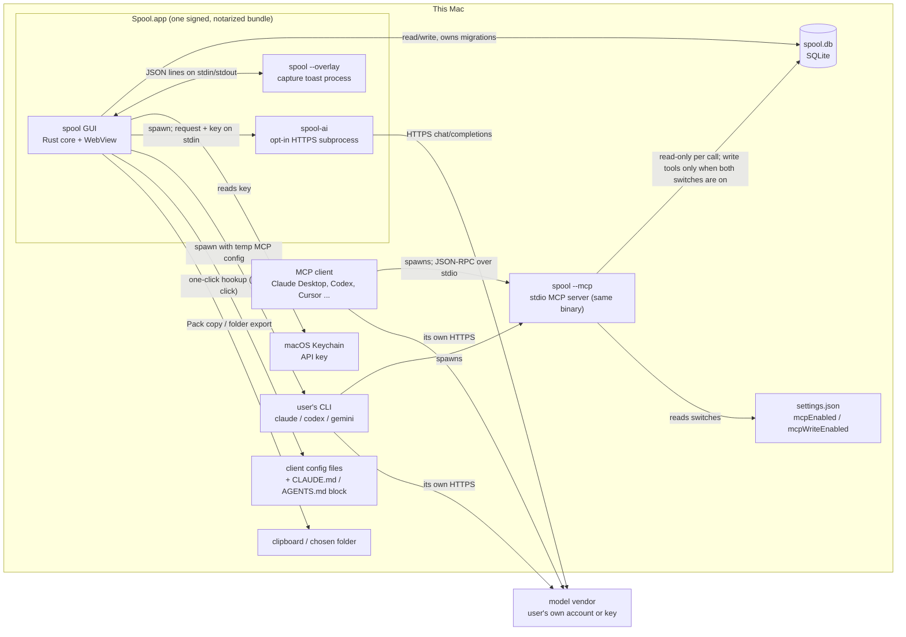

<!-- PURGE-BEFORE-APPLICATION: 本文件是给申请作品集用的事实表，§11.4 列着哪些文件含申请相关内容；发送申请前一并清除或移出公开仓库。总清单：本文件 §11.4。标记于 2026-09-25。 -->
# Spool — 作品集事实表（PORTFOLIO_FACTS）

> **生成日期**：2026-09-23（本机时区 UTC+1；实测命令的 UTC 时间写在各条里）
>
> **依据**
> - 最新公开 release：**v0.6.2**，annotated tag `04e1386` → commit **`58ec01f`**（2026-08-24 16:05:39 +0800）
> - 公开 main（`origin/main`）：**`7d1b2b7`**（2026-08-27）
> - 本地 main HEAD：**`bbf31e8`**（内容是 2026-09-03 的；比 `origin/main` 多 40 个提交，**没有推送**）。
>   2026-09-23 按 `CLAUDE.md` §5 改写了最顶上 4 个提交的提交信息，所以哈希变了：原来的 HEAD 是 `a0236a3`，tree 完全相同。
>   2026-09-24 在它上面又加了两个修复提交 `d1c972c`、`d576ee3`（§2.3），同样没推送。
>
> **读者**：作品集仓库 `~/Desktop/portfolio` 的 Claude Code 和 Hanze。网站读者是美国 CS / HCI 硕士项目的招生委员和教授。
>
> **称呼**：仓库文档里的「Ocean」就是 Hanze 本人（owner）。
>
> **每条事实的字段**：值 · 测量条件 · 日期 · 样本量（适用时）· 出处 · 能否上站。
> 「能否上站」只有三档：**可上站** / **仅内部** / **不得公开**。
>
> **写法**：说明用中文；准备上站的措辞、数字、功能名保留英文，每句不超过 25 个英文词。
> 查不到的写「**缺**」，并写清缺什么、谁能补、怎么补。
>
> **这份文档不是什么**：它不是执行光标，也不改变 `docs/EXECUTION_POLICY.md` 和 HANDOFF 的任何安排。
> 2026-09-23 第一轮只新建了本文件。同一天第二轮按 Hanze 的指示多做了三件事（§14 有记录）：
> 改写 4 个本地提交的信息、给 28 份文档加清除标记、补拍截图（09-23 共 18 张，09-24 起为 20 张，§9.2）。
> 两轮都没有提交、推送、打 tag 或发版。

---

## 0. 怎么更新这份文档（每次发版后重跑）

**规矩**：旧值不删。某个值变了，就把旧值连同它原来的日期挪进文末 **§14 变更记录**，正文只留新值。

| 节 | 重核什么 | 命令（在仓库根目录跑，除非另注） |
|---|---|---|
| 头部 · §1 | 最新 release、日期、资产、是否 prerelease | `gh release list --limit 10` · `gh release view <tag> --json tagName,isPrerelease,isDraft,publishedAt,assets` · `git tag --sort=-creatordate --format='%(refname:short) %(objectname:short) %(*objectname:short) %(creatordate:iso)'` |
| §1 | 签名、公证、sha256（拿**下载回来的发布件**核，不拿本机 `/Applications` 里的） | `gh release download <tag> --pattern '*.dmg'` → `shasum -a 256 *.dmg` → `spctl -a -vv -t install <dmg>` → `xcrun stapler validate <dmg>` → `hdiutil attach -nobrowse -readonly -mountpoint <tmp> <dmg>` → `spctl -a -vv <tmp>/Spool.app` → `hdiutil detach <tmp>`。公证 submission id 只能从 `CASE_STUDY_LEDGER.md` §1.2 抄，或由 Hanze 用 `xcrun notarytool history` 复核 |
| §1 | 本机装的是不是发布版 | `defaults read /Applications/Spool.app/Contents/Info.plist CFBundleShortVersionString` 加 `spctl -a -vv /Applications/Spool.app`（**只有 `Notarized` 才是发布版**，`Unnotarized Developer ID` 是开发构建） |
| §1 · §3 | MCP 工具数（从发布的二进制实数，不从源码数） | 见 §3.6 那段探针；**必须**带 `SPOOL_DATA_DIR=<空临时目录>`，否则会连到真库 |
| §2 | 哪些提交在 release 里、哪些只在 main、哪些只在本地 | `git log --format='%h %ad %s' --date=short <tag>..origin/main -- . ':(exclude)docs'` · `git log --format='%h %ad %s' --date=short origin/main..main -- . ':(exclude)docs'` · 每个分支：`git merge-base --is-ancestor <branch> <tag>` |
| §2 | MCP Registry 条目 | `curl -s 'https://registry.modelcontextprotocol.io/v0.1/servers?search=io.github.KIM-ocean-HZ%2Fspool'` |
| §3 | 代码行号 | 行号钉在 tag 上：`git show <tag>:<path> \| grep -n <pattern>`。发版后逐条重 grep，行号全部换成新 tag 的 |
| §3 | 主进程没有网络库 | 在 tag 的 worktree 里：`cd src-tauri && cargo tree -e normal --prefix none \| awk '{print $1}' \| sort -u \| grep -xiE 'ureq\|rustls\|reqwest\|hyper\|native-tls\|openssl\|ring\|curl'`（⚠️ 不要用不带 `-x` 的 grep：`string_cache` 里的 "ring" 会误报） |
| §4 | 测试实跑 | 见 §4.1 的脚本。在 `git worktree add --detach <tmp> <tag>` 里跑，跑完 `git worktree remove` |
| §5–§7 | 有没有新一轮评测、新 blocker | `grep -n '^## ' docs/Deepseek-API-compress-test.md`（当前最后一节是 §8 第六轮）· `grep -n '^### 3\.' docs/CASE_STUDY_LEDGER.md`（当前最后是 §3.46）· `grep -n '^| Field' docs/CASE_STUDY_LEDGER.md`（当前最后一列是 v0.6.2） |
| §9 | 截图 | `git log --format='%h %ad' --date=short -- docs/screenshots/<file>` |
| §9 | 发版后重拍 | 照 §9.2 的做法：新 tag 的 worktree 里改 bundle id、`APP_IDENTIFIER`、`KEYCHAIN_SERVICE` 三处常量（行号按新 tag 重 grep），`npx tauri build --bundles app`，用新 tag 的 `scripts/seed-demo-library.sh`（改目标目录）灌演示库；每次点击前核对最前面的窗口属于隔离版；⛔ 不碰「Launch at login」和「Update config」 |
| §11.4 | 清除清单 | `grep -rl 'PURGE-BEFORE-APPLICATION' --include='*.md' . \| grep -v node_modules`；源码清单用 §11.4 里那条 `git grep` 重算 |
| §10 | 下载数 | `gh api repos/KIM-ocean-HZ/spool/releases --paginate --jq '.[] \| [.tag_name, ([.assets[].download_count]\|add)] \| @tsv'` |
| §12 | 作品集口径 | 只读打开 `~/Desktop/portfolio/content/facts.yaml`（`id: spool`）、`content/evidence.yaml`（`project: spool`）、`docs/CONTENT-GUIDE.md` §4 |

---

## 1. 发布记录

### 1.1 最新公开 release：v0.6.2

| 字段 | 值 | 条件 / 出处 | 日期 | 上站 |
|---|---|---|---|---|
| 版本 | **v0.6.2** | `gh release list`：标 `Latest`，`isPrerelease=false`，`isDraft=false` | 2026-09-23 查 | 可上站 |
| 发布时间 | **2026-08-24T08:06:24Z** | `gh release view v0.6.2 --json publishedAt` | — | 可上站 |
| Tag | `v0.6.2`（tag 对象 `04e1386`）→ commit **`58ec01f`** | `git tag` 输出；commit 时间 2026-08-24 16:05:39 +0800 | — | 可上站 |
| 平台 | **macOS，Apple Silicon（aarch64）**；release notes 写 macOS 11 或更新 | `docs/RELEASE_NOTES_v0.6.2.md` "Download" 一节 | — | 可上站 |
| 产物 | `Spool_0.6.2_aarch64.dmg` 与 `Spool-macOS-arm64.dmg`，同一份字节，各 **10,390,759** 字节 | `gh release view` 的 assets | — | 可上站 |
| sha256 | **`fc74abee8f3c1084d70a885ccdd79520cb200a266b349536c3ad3fb12d992899`**（两个名字都是这个值） | 2026-09-23 下载回来实测 `shasum -a 256`；与 `CASE_STUDY_LEDGER.md` §1.2 一致 | 2026-09-23 | 可上站 |
| 签名身份 | Developer ID Application，Team **`Q5Y5JRXZ58`**；随包的 `spool-ai` 同一个 Team | 2026-09-23 挂载发布件后跑 `codesign -dvv`；codesign 时间戳 2026-08-24 09:01:34（本机时区 UTC+1） | 2026-09-23 | 可上站 |
| Gatekeeper | `.dmg` 和其中的 `.app` 都是 **`accepted` · `source=Notarized Developer ID`**；`xcrun stapler validate` 对 `.dmg` 通过 | 2026-09-23 对**下载回来的发布件**实测 | 2026-09-23 | 可上站 |
| 公证 · `.app` | submission `19bba6d2-ab45-4f1e-94c1-79a3ee59f9ee` · Accepted（上传名是 `Spool.zip`） | `CASE_STUDY_LEDGER.md` §1.2 v0.6.2 那一列（id 是事后用 `xcrun notarytool history` 捞回来的）。**本轮没有复核**：需要 Apple 凭据 | 2026-08-24 | 可上站 |
| 公证 · `.dmg` | submission `64c13142-db18-43fc-b208-0a2df177d309` · Accepted | 同上 | 2026-08-24 | 可上站 |
| 固定名链接 | `releases/latest/download/Spool-macOS-arm64.dmg` → **HTTP 200** | 2026-09-23 `curl -I -L` 实测 | 2026-09-23 | 可上站 |
| 库版本 | schema **v23 → v24**（加两列、不改已有行） | release notes；`src/lib/db/client.test.ts:902`（v0.6.2） | — | 可上站 |
| 内置 MCP 服务 | `serverInfo` = `spool 0.6.2`；**20 个工具（13 读 / 7 写）+ 7 个 prompt** | 2026-09-23 对挂载的发布件跑 `tools/list` + `prompts/list`，数据目录指向空临时目录（§3.6） | 2026-09-23 | 可上站 |

**建议上站写法**

- "Spool v0.6.2 shipped on 2026-08-24 as a Developer ID–signed, Apple-notarized build for Apple Silicon Macs."
- "Re-checked on 2026-09-23: the published .dmg and the app inside both pass Gatekeeper as notarized."

### 1.2 v0.6.2 没覆盖的平台

| 平台 | 状态 | 原因 / 出处 | 上站 |
|---|---|---|---|
| Windows | **v0.6.2 没有 Windows 包。** 最后一个 Windows 安装包是 **v0.6.1**（2026-08-19，`Spool_0.6.1_x64-setup.exe`，**没有代码签名**，CI run `32228101203`） | Windows 流水线只在 `windows-port` 分支上跑，这一版没跑；Hanze 2026-08-24 明说只发 macOS（`WORKPLAN-2026-08-22.md` 第 103 行；ledger §1.2 v0.6.2 列）。不签名是 2026-08-15 的决定（WORKPLAN §4.1） | 可上站 |
| Intel Mac（x86_64） | 历次 release 都只有 `aarch64` 包 | `gh release view` 各版资产 | 可上站 |
| Linux | 没有 | 同上 | 可上站 |

- "v0.6.2 is macOS-only. The last Windows installer, unsigned, shipped in v0.6.1 on 2026-08-19."

**已知问题（Hanze 2026-09-23 定：以后会更新安装包，暂时不处理）**：README（公开 main）和官网 spoolapp.org 首页一共挂着 **4 处**「Download for Windows」（README 1 处，线上首页 3 处），都指向 `releases/latest/download/Spool-windows-x64-setup.exe`。最新 release 没有这个资产，所以 2026-09-23 实测返回 HTTP 404。作品集别链这个地址。

### 1.3 v0.6.2 之后正在路上的（不算 Released）

| 东西 | 状态 | 出处 | 上站 |
|---|---|---|---|
| 公开 main 上的新提交 | `v0.6.2..origin/main` 共 22 个提交，其中 **10 个**动了 `docs/` 以外的代码（功能列表见 §2.2） | `git log v0.6.2..origin/main` | 可上站（写成 "on main, unreleased"） |
| 只在本地 main 的提交 | `origin/main..main` 共 40 个；**4 个**动了代码（§2.3），其余 36 个只改 `docs/` | `git log origin/main..main` | 仅内部（没推送，外人看不到） |
| 下一版 | **缺**：没有版本号、没有日期、没有 release 草稿 | `gh release list` 里没有 draft | — |
| 本机装的 Spool | `/Applications/Spool.app` 自报 **0.6.2**，但 `spctl` 显示 **`Unnotarized Developer ID`**，签名时间 2026-08-30 02:54（本机时区）。它是 `ee3dbda` 那一版的**开发构建**，含未发布功能，库是 v29。**它不是 v0.6.2 发布版** | 2026-09-23 `defaults read` + `spctl` + `codesign -dv`；`ee3dbda` 提交信息「全部已装机」 | 仅内部 |

⚠️ 用本机这个 app 拍的截图会显示**未发布**的界面，不能标成 v0.6.2（§9）。

### 1.4 更早的 release（给时间线用）

| 版本 | 发布（GitHub） | 平台 | 出处 |
|---|---|---|---|
| v0.6.1 | 2026-08-19T07:40:50Z | macOS（公证）+ Windows（未签名） | ledger §1.2 |
| v0.6.0 | 2026-08-19T04:56:37Z | macOS（公证）+ Windows（未签名） | ledger §1.2 |
| v0.5.0 | 2026-08-18T15:15:08Z | macOS（公证）+ Windows 首发（未签名） | ledger §1.2 |
| v0.4.0 | 2026-08-07T17:22:11Z | macOS（公证） | ledger §1.2 |
| v0.3.0 | 2026-07-30T05:48:53Z | macOS，首个公开 release | `gh release list` |

仓库在 GitHub 上建于 **2026-05-17T13:01:22Z**，第一个 commit `33b07d8` 也是 2026-05-17（`gh repo view`；`git log --reverse`）。v0.6.2 时共 568 个 commit，本地 main HEAD 时 630 个，作者全部是 `KIM-ocean-HZ`。可上站。

---

## 2. 功能状态三栏

判定口径：
- **Released** = 在 tag `v0.6.2` 的代码里，并且发布件里能用到。
- **Merged, unreleased** = 在 main 上、不在 v0.6.2 里。再分「已推到公开 main」和「只在本地 main」两档。
- **Branch / evaluating** = 只在分支上，或只有设计稿 / 评估。

**分支核对（2026-09-23）**：本地和远端的 `feat/api-compress-sidecar`、`fix/tailwind-alpha`、`valentine-edition`、`windows-port` **全部是 v0.6.2 的祖先**（`git merge-base --is-ancestor`）。所以**没有只在分支上的功能代码**；第三栏只剩设计稿和评估中的东西。

### 2.1 Released（v0.6.2）

| 功能 | 英文一句话（可上站） | 证据（v0.6.2） |
|---|---|---|
| **AI 压缩（Compress 页签）** | "An opt-in Compress tab sends a project's pack to an AI with the user's own key, then shows a checked diff." | Release notes「New: compressing a project's context」；`src-tauri/src/api_engine.rs:137` `compress_pack_via_api`；默认关：`src/stores/settingsStore.ts:359` `apiEngineEnabled: false`；默认端点 `:362` `https://api.deepseek.com`，模型 `:366` `deepseek-v4-flash` |
| **spool-ai 子进程** | "Network calls for AI features run in a separate subprocess, spool-ai; the main app links no HTTP library." | `src-tauri/sidecar/src/main.rs:1-24`（契约）；`tauri.conf.json:32` `externalBin`；§3 的 `cargo tree` 实测 |
| 压缩写回库的三道闸 | "A draft that dropped a number or date cannot be saved; the original text stays on each block." | `src/stores/compressStore.ts:675` `useDraft`（数字闸、结构闸、没变就不写）；`src/lib/db/blocks.ts:642` `applyCompression`（`original_content` 只写第一次）；一键还原 `restoreBlockOriginal` |
| 夜间压缩队列 | "Projects can be queued for an overnight compression run; each draft waits for the user's check in the morning." | Release notes「compress overnight」；只在 app 开着时跑（`compressStore.ts` ⑥ 段注释） |
| **查过期（Out-of-date check）** | "An out-of-date check asks an AI which blocks were overtaken; every quoted line is verified before the user sees it." | Release notes「New: an out-of-date check」；`api_engine.rs:1131` `stale_scan_via_api`（同样走 spool-ai、要 key）；`src/lib/blocks/staleGuards.ts`（不许覆盖已有关系） |
| **MCP 读** | "Any MCP client can read projects over stdio: 13 read tools; the MCP service is off by default." | 发布件实测 13 个读工具（§3.6）；默认关：`settingsStore.ts:329`、`src-tauri/src/mcp.rs:1204-1212` |
| **MCP 写** | "Seven write-gated tools let an AI add attributed blocks; it cannot edit or delete what the user wrote." | 发布件实测 7 个写工具；闸 `mcp.rs:6518-6520`；append-only 说明 `mcp.rs:3583-3590` |
| 一键接入 | "One click registers Spool with Claude Desktop, Claude Code, Cursor, VS Code, Windsurf or Codex." | `mcp.rs:7001-7034`（六个客户端的配置文件路径）；`mcp.rs:7094` `configure_client` |
| **CLI 引擎槽** | "If Claude Code, Codex CLI or Gemini CLI is installed, Spool can run it headless to maintain a project." | `src-tauri/src/engine.rs:118-122` `EngineKind`；动作五个：`src/stores/engineStore.ts:43-48`；出现条件 `src/lib/engine/gate.ts:32-33` |
| **联网跟进（Follow up）** | "Each project lists what to watch; a follow-up runs the user's own Claude Code with web search and queues sourced findings for approval." | 引擎槽的第五个动作（v0.6.2 `engineStore.ts:48`）；**只有这个动作能上网**（`lib.rs:129` `let web = action == "follow_up"`，给 `WebSearch` / `WebFetch`）；每条要求带 URL、最多 5 条、只进待审面不直接入库（`mcp.rs` `follow_up_prompt_text` 第 3–6 条）；清单分「单次」（One-off，答上就结束）和「永久」（Permanent，一直查，只有用户能结束）（`FollowUpPanel.tsx:116`、`:287`）。⚠️ 两处限定：① v0.6.2 里引擎**关不掉**答上的单次问题（白名单缺 `close_follow_up_item`，本地 main `d1c972c` 已修、未发布，§2.3）；② **Codex** 跑跟进时，写类调用会被 Codex 自己取消（HANDOFF `DISCOVERED-20260924-1`，提案这一步是否也受影响**没验证**），所以英文句只写 Claude Code。截图：§9.2 B 的 05–11 |
| 捕捉 | "Double-tap ⌥ in any app to file the clipboard into the current project, with a note box already focused." | `src-tauri/src/double_tap.rs`、`capture.rs`；README "Capture" 一段 |
| Pack | "Any project packs into a plain-text briefing for pasting into any AI." | `src/lib/pack/assemble.ts`；Rust 版 `mcp.rs`（§4.3 golden 测试） |

⚠️ **别把两个「压缩」混在一起**：CLI 引擎槽里有个动作 `distill`，中文界面标签也叫「压缩」（`engineStore.ts:53`）。作品集里说的「AI compression」指的是 **Compress 页签 + spool-ai**，不是这个。

**「CLI」在 Spool 里到底指什么（按代码核实）**：
- 指的是 **引擎槽**：Spool 在本机找到用户自己装、自己登录的 `claude` / `codex` / `gemini`，作为**子进程**起它，并给它挂上 Spool 自己的 MCP 服务（`engine.rs:1-26` 模块说明；`engine.rs:577` `mcp_config_json`；`engine.rs:1382` 起进程）。
- **Spool 没有给用户用的命令行。** 二进制的 `--mcp` 和 `--overlay` 是内部进程模式，不是 CLI 工具（`src-tauri/src/main.rs:7-17`）。
- 容易混的一点：Claude Code、Codex CLI 这些命令行工具**也可以当 MCP 客户端**直接连 Spool（README 的 `mcp-library.png` 就是 Codex CLI 读库）。那一条算 **MCP**，不算引擎槽。
- 建议作品集的三个接口写成：**"Desktop app · MCP server · CLI engine slot"**，并附一句定义：
  "The CLI engine slot runs the user's own Claude Code, Codex or Gemini CLI as a subprocess."

### 2.2 Merged, unreleased —— 已推到公开 main（`origin/main` = `7d1b2b7`）

| 提交 | 日期 | 功能（英文一句话） | 备注 |
|---|---|---|---|
| `9cd2fe0` | 08-25 | "Whole-block supersession and readable relation lines; new MCP tool propose_supersede." | 工具数 20 → 21；库 v24 → v27 |
| `cc7ec76` | 08-25 | "Annotations can be corrected; AI annotations are marked and must cite a sentence." | |
| `16f7f20` | 08-25 | "Citations carry a reason field (ref_note)." | 库 v27 → v28 |
| `cf45a1e` | 08-25 | "New MCP tool set_block_gist lets an AI add or fix a block summary." | 工具数 21 → 22 |
| `74b6d28` | 08-25 | "A Block summary tab shows and edits those summaries." | |
| `a24d050` | 08-25 | 修：周回顾页面印出整段 NDJSON | |
| `d9fb8c3` | 08-26 | "Weekly review can run through the API engine (DeepSeek) as well as a CLI." | ⚠️ **spool-ai 多了一种发出去的内容**（周回顾），见 §3.5 |
| `3e6b8a5` | 08-26 | "Weekly review offers a model picker and groups by week." | |
| `5894dbc` | 08-26 | "The API engine shows the account's remaining balance." | ⚠️ 从这个提交起 **spool-ai 的测试目标编译不过**（§4.2） |
| `6a94e30` | 08-27 | "Three body-text sizes, ⌘F in-project find, and a scrollbar that marks search hits." | |

2026-09-23 在公开 main 上数：**22 个工具（13 读 / 9 写）**，库 schema **v28**。仅内部（未发布的数字不上站，除非写明 "on main"）。

### 2.3 Merged, unreleased —— 只在本地 main（没推送，外人看不到）

| 提交 | 日期 | 内容 | 备注 |
|---|---|---|---|
| `fa4bf47` | 08-27 | 十条修复：10 个会阻塞的 Tauri 命令搬下主线程；长按 ⌥ 直接写笔记；查找计数等 | 提交信息里的对照实验：同步命令占 3 秒 → 主线程冻 3001 ms；加 `(async)` 后 0 次冻结。n 未写，**缺**样本量 |
| `e37950c` | 08-27 | 「今天已专注 N 分钟」按天计、跨重启 | |
| `cb3c4b0` | 08-29 | 仓库根目录的 `server.json`（MCP Registry 元数据） | 见下面 Registry 一行 |
| `ee3dbda` | 08-30 | F2「来龙去脉」的数据那一半 + 退役块折行 | 库 v28 → v29；提交信息写「TS 803、Rust 139 全绿」—— 那个 139 **只是主 crate**（§4.2） |
| `d1c972c` | 09-24 | 修两个作品集实拍撞到的缺陷：引擎白名单补上 `close_follow_up_item`（跟进答上的单次问题能自己收掉）；查过期的原因跟界面语言走 | HANDOFF `DISCOVERED-20260923-1/2`；演示版实测都过了（§9.2 B）。TS 803、主 crate Rust 141 |
| `d576ee3` | 09-24 | 引擎白名单补齐为 mcp.rs 的全部 22 个工具（原来 15 个，漏了 7 个后加的工具）；测试改成「白名单 = 全部工具」，差一个就红 | 起因：服务器说明和别的工具的返回值会把 AI 指向白名单外的工具（例如搜索命中锁定文件时叫它用 `request_file_access`），一调就被拒、整次运行以「请给我权限」收尾。只有单元测试，没做真机 |

### 2.4 官方 MCP Registry 上架（发行渠道，不是代码功能）

| 字段 | 值 | 出处 | 上站 |
|---|---|---|---|
| 条目名 | `io.github.KIM-ocean-HZ/spool` | 2026-09-23 实测 `GET https://registry.modelcontextprotocol.io/v0.1/servers?search=io.github.KIM-ocean-HZ%2Fspool` | 可上站 |
| 状态 | `status: active`，`isLatest: true` | 同上 | 可上站 |
| 首次发布 | **2026-08-29T07:16:38Z** | 同上 `publishedAt` | 可上站 |
| 登记的版本 | `0.6.2` | 同上 | 可上站 |
| 形态 | **只有元数据**：name / title / description / repository / websiteUrl；没有 `packages`、没有 `remotes`。用户仍要自己下载 .dmg | 同上；`cb3c4b0` 提交信息 | 可上站 |
| 源文件 | `server.json` **只在本地 main**（`cb3c4b0`），公开仓库里还没有 | `git merge-base --is-ancestor cb3c4b0 origin/main` → 否 | 仅内部 |

**归栏结论**：条目本身**已经在线、公开可查**，指向的是已发布的 v0.6.2；但它不属于任何一个 release，产生它的提交也没推送。建议上站写：
- "Listed in the official MCP Registry as io.github.KIM-ocean-HZ/spool since 2026-08-29 (metadata-only entry)."

### 2.5 Branch / evaluating（只有设计稿或评估，没有功能代码）

| 东西 | 状态 | 出处 | 上站 |
|---|---|---|---|
| F2 来龙去脉的**界面**那一半 | 数据那一半在本地 `ee3dbda`；界面没做 | `ee3dbda` 提交信息 | 仅内部 |
| F3 事件 / 时间层（C1–C7） | 设计中；存储模型要 Hanze 先定 | `WORKPLAN-2026-08-22.md` §2.F3；`EXECUTION_POLICY.md` §6.8 | 仅内部 |
| F4 音视频 | 开工前五项调查未做 | WORKPLAN §2.F4 | 仅内部 |
| 压缩用 `supersedes` 写回（整条取代旧块） | **封着**：它压得动时会丢日期 | WORKPLAN §1「G 批」 | 仅内部 |
| Windows 新版本 / Windows 代码签名 | 流水线在 `windows-port` 分支；签名跟着收费走 | WORKPLAN §1「G 批」、§4.1 | 可上站（只写 "not planned for now"） |
| 跨生态记忆实验 | **不在本文范围**（见 §11.3） | — | 不得公开 |

---

## 3. 三个入口与写入边界（给架构图用）

以下行号全部钉在 **tag `v0.6.2`（`58ec01f`）**。本地 main 上行号已经漂移。

### 3.1 进程

| 进程 | 谁起它 | 做什么 | 代码 |
|---|---|---|---|
| `spool`（GUI） | 用户 | Tauri 主程序：Rust 核心 + WebView（React）。**库的唯一迁移者** | `main.rs:18` → `lib.rs:325` `run()` |
| `spool --overlay` | GUI 启动并常驻 | 捕捉浮窗的独立进程。**从不打开 SQLite**，五个库调用都转回主进程 | `main.rs:14-17`；`overlay.rs:1-34`（第 21-25 行是「从不开库」那条）；起进程 `overlay.rs:133` |
| `spool --mcp` | **MCP 客户端**（或引擎槽里的 CLI）起它 | MCP 服务，stdio 上的 JSON-RPC；不监听任何端口 | `main.rs:7-10`；`mcp.rs:1-26` 说明；`mcp.rs:8888` `run()` |
| `spool-ai` | GUI 在需要时起它，跑完就退 | **唯一**会开 socket 的进程；stdin 进一个 JSON，stdout 出一行信封 | `sidecar/src/main.rs:1-24`、`:118` `main()`；GUI 侧 `api_engine.rs:251` |
| `claude` / `codex` / `gemini` | GUI（引擎槽） | 用户自己的 CLI，headless 跑；它自己再起 `spool --mcp` | `engine.rs:1382`；临时 MCP 配置 `engine.rs:577` |

### 3.2 数据存储

| 存储 | 位置 | 谁写 | 出处 |
|---|---|---|---|
| `spool.db`（SQLite） | `~/Library/Application Support/com.oceanjin.spool/` | GUI（全部）；`spool --mcp`（仅写工具） | `docs/PRIVACY.md`「数据存放在哪里」；`mcp.rs:1236-1275`、`:3635-3657` |
| `settings.json` | 同一目录 | GUI；`spool --mcp` 只读它来判开关 | `mcp.rs:1202-1230` |
| `mcp-clients.json` | 同一目录 | `spool --mcp`：客户端名 + 最后一次连接时间 | `mcp.rs:3704`、`:3741`；2026-09-23 用发布件实测确实写了这个文件 |
| 迁移前快照 | 同一目录 | GUI，每次迁移前 `VACUUM INTO` | ledger §3.1 第 3 条 |
| API key | **macOS 钥匙串**，service `com.oceanjin.spool` | GUI | `api_engine.rs:525-561` |
| 其他客户端的配置文件 | `claude_desktop_config.json`、`~/.cursor/mcp.json`、`~/.claude.json`、VS Code `User/mcp.json`、`~/.codeium/windsurf/mcp_config.json`、`~/.codex/config.toml` | GUI，**只在用户点「一键接入」时** | `mcp.rs:7001-7034` |
| 其他 AI 的说明文件 | `~/.claude/CLAUDE.md`、`~/.codex/AGENTS.md` 里一段 `<!-- spool:begin -->…<!-- spool:end -->` | GUI，一键接入时 | `mcp.rs:7216-7231`；这段**不含任何库内容**（`mcp.rs:7212-7215` 注释） |
| Pack 文件夹 / 导出的库 | 用户在对话框里选的位置 | GUI | `pack.rs:62`；`transfer.rs:71` |

### 3.3 连线（谁调谁、走什么）

| 从 | 到 | 协议 | 代码 |
|---|---|---|---|
| GUI WebView | `spool.db` | `tauri-plugin-sql` | `Cargo.toml` 依赖；迁移注册表 `src/lib/db/client.ts` |
| GUI | overlay | 双向，每行一个 JSON（overlay 的 stdin / stdout） | `overlay.rs:30-34` |
| MCP 客户端 | `spool --mcp` | 客户端起子进程，stdio 上的 JSON-RPC 2.0 | `mcp.rs:1-8` |
| `spool --mcp` | `spool.db` | 读：**每次调用新开一个只读连接**；写：只读写工具开读写连接，2 秒 busy timeout | `mcp.rs:1236-1241`（`SQLITE_OPEN_READ_ONLY`）；`mcp.rs:3635-3645`（`READ_WRITE`） |
| GUI | CLI 引擎 | 起子进程，带临时 MCP 配置 + 工具白名单 | `engine.rs:67`（14 个 Spool 工具，逐个列出）；claude `--allowedTools` `engine.rs:704`；codex `--sandbox read-only` `engine.rs:884-885` |
| CLI 引擎 | `spool --mcp` | 同 MCP 客户端那条 | `engine.rs:21-26` |
| GUI | `spool-ai` | 起子进程；**请求连同 key 走 stdin，从不走 argv** | `sidecar/src/main.rs:9-12`；`api_engine.rs:251` |
| `spool-ai` | 模型厂商 | HTTPS `POST {base_url}/chat/completions`；**明文 http 直接拒绝** | `sidecar/src/main.rs:158`、`:168` |
| CLI 引擎 | CLI 的厂商 | CLI 自己的网络请求，用用户自己的账号 | `engine.rs:18-21` |

### 3.4 哪些路径能写库，要过哪几道开关

| 写入者 | 能写什么 | 要过的闸（按顺序） | 代码 |
|---|---|---|---|
| 用户（GUI） | 全部 | — | — |
| **GUI 替 AI 压缩写回** | `blocks.content` ← 压缩稿；原文存进 `original_content`（设置里能关） | ① API 引擎开着（默认关）且 key 在 → ② 用户按 **「Use this one」** → ③ 数字 / 日期闸（丢了就拒，不许用户确认放行）→ ④ 结构闸（少块、多编号、重复都拒）→ ⑤ 没变短的块不写 | `compressStore.ts:667-695`；`blocks.ts:642-666` |
| GUI 替查过期写关系 | 新块的引用关系，或旧块的 `stale_at` | 用户在三选一里点 → 已经指着别的块的，拒绝覆盖（`8c0e007` 修的就是这个） | `src/lib/blocks/staleGuards.ts`；`blocks.ts:697` `setBlockSupersession` |
| **MCP 写工具** | 直接写：`create_thread`、`add_block`（只追加、带来源标签）、`set_thread_summary`（不覆盖用户写的摘要）、`close_follow_up_item`。只排队不入库：`propose_blocks`、`request_file_access`、`suggest_follow_up_item` | ① 用户自己配置了客户端 → ② **`mcpEnabled`**（默认 **false**；读不到 settings 也算关）→ ③ **`mcpWriteEnabled`**（默认 **true**，只在 ② 打开后才有意义；settings 读不到或解析不了 = 不许写）→ ④ 库版本必须**严格等于** 24，否则拒写 → ⑤ 单个工具的规则（例如拒绝在正文里写原始 id） | ② `mcp.rs:1204-1212`，检查点 `mcp.rs:6355`；③ `mcp.rs:1222-1230`，检查点 `mcp.rs:6518-6520`；④ `mcp.rs:3595`、`:3647-3656`；⑤ 测试 `mcp.rs:10510` |
| CLI 引擎 | **没有自己的写入路**；只能调上面那些 MCP 写工具 | 界面出现条件四个全满足：检测到 CLI ∧ `mcpEnabled` ∧ `mcpWriteEnabled` ∧ `aiEngineActionsEnabled`（默认 true）→ 用户点动作。自动跑只有「周回顾」一种，且要 `aiAutoMaintain`（默认 **false**） | `gate.ts:32-33`；`engine.rs:21-26`；`settingsStore.ts:337`、`:349`；`src/hooks/useAutoMaintain.ts` |
| `spool-ai` | **本地什么都不写**，只往 stdout 吐一行信封 | — | `sidecar/src/main.rs:1-7` |
| `spool --mcp`（不经开关） | 只写 `mcp-clients.json`（客户端名 + 时间），**不碰库** | 在 `initialize` 时写，不看开关 | `mcp.rs:3700-3704`、`:3741` |
| overlay | 什么都不直接写 | 库调用转交主进程 | `overlay.rs:21-25` |

### 3.5 内容离开本机的全部路线（v0.6.2）

| # | 路线 | 谁发起 | 默认 | 发到哪 | 代码 / 出处 |
|---|---|---|---|---|---|
| 1 | 复制 Pack，用户自己粘贴 | 用户 | — | 用户粘贴的地方 | `PRIVACY.md` 表格第 1 行 |
| 2 | MCP 客户端读库 | 用户配置的客户端 | **关**（`mcpEnabled: false`） | 客户端之后发给谁由客户端决定 | `settingsStore.ts:329`；`mcp.rs:6355` |
| 3 | CLI 引擎 | 用户点动作（或打开了自动周回顾） | 装了 CLI 且开了 MCP 读写才出现 | CLI 的厂商；**「跟进」**动作额外给 `WebSearch` / `WebFetch`，只给 Claude 和 Codex，不给 Gemini | `engine.rs:96`；`engine.rs:153-159` |
| 4 | `spool-ai`：压缩、查过期、夜间队列 | 用户点，或到了用户设的夜间时间（app 开着时） | **关**（`apiEngineEnabled: false`），还要有 key | 用户配置的 HTTPS 端点，默认 `https://api.deepseek.com` | `settingsStore.ts:359-366`；`api_engine.rs:137`、`:1131`；`sidecar/src/main.rs:158-168` |

**机制上不会出网的部分**（2026-09-23 在 v0.6.2 上核）：
- WebView 的 CSP 只允许 `connect-src 'self' ipc: http://ipc.localhost`（`tauri.conf.json:27`）。
- 主 crate 的 **283 个**普通依赖里，**没有任何一个**是 HTTP / TLS 库（`ureq|rustls|reqwest|hyper|native-tls|openssl|ring|curl` 精确匹配为 0）。这些库**只在** `spool-ai` 里（`ureq`、`rustls`、`ring`、`webpki-roots`）。

**只在 main 上（未发布）新增的 spool-ai 用法**：周回顾走 DeepSeek（`d9fb8c3`）、查余额（`5894dbc`）。要是下一版发布，§3.5 第 4 行要加这两项。

**建议上站写法**
- "Spool's main process links no HTTP or TLS library; the only network client is an opt-in subprocess, spool-ai."
- "External AI clients reach the library over MCP on stdio. Spool listens on no network port."
- "An AI can write only after two switches: MCP on (off by default), then 'Let AI write'."
- "AI-written blocks are append-only and carry the client's name; an AI cannot edit or delete user text."

### 3.6 MCP 工具数怎么从发布件实数（本轮用过的探针）

```bash
TMP=$(mktemp -d); mkdir -p "$TMP/data" "$TMP/mnt"
gh release download v0.6.2 -R KIM-ocean-HZ/spool --pattern 'Spool_0.6.2_aarch64.dmg' -D "$TMP"
hdiutil attach -nobrowse -readonly -mountpoint "$TMP/mnt" "$TMP/Spool_0.6.2_aarch64.dmg"
printf '%s\n' \
 '{"jsonrpc":"2.0","id":1,"method":"initialize","params":{"protocolVersion":"2024-11-05","capabilities":{},"clientInfo":{"name":"probe","version":"1"}}}' \
 '{"jsonrpc":"2.0","method":"notifications/initialized"}' \
 '{"jsonrpc":"2.0","id":2,"method":"tools/list","params":{}}' \
 '{"jsonrpc":"2.0","id":3,"method":"prompts/list","params":{}}' \
 | SPOOL_DATA_DIR="$TMP/data" "$TMP/mnt/Spool.app/Contents/MacOS/spool" --mcp
hdiutil detach "$TMP/mnt"
```

⛔ `SPOOL_DATA_DIR` 不能省：不带它，这个进程会去找真库。

**2026-09-23 的结果（v0.6.2 发布件）**：20 个工具。
- 读（13）：`list_threads`、`get_digest`、`get_pack`、`search_blocks`、`find_similar_blocks`、`get_blocks`、`check_library`、`weekly_review`、`thread_health`、`distill`、`get_follow_up_brief`、`get_project_overview`、`get_block_original`
- 写（7）：`create_thread`、`add_block`、`propose_blocks`、`request_file_access`、`suggest_follow_up_item`、`close_follow_up_item`、`set_thread_summary`
- prompt（7）：`compress_pack`、`weekly_review`、`thread_health`、`distill`、`triage_conversation`、`file_this`、`catch_up`

"v0.6.2's MCP server exposes 20 tools: 13 read-only and 7 behind a separate write switch." —— 可上站。

### 3.7 mermaid 草图



---

## 4. 测试

### 4.1 在 v0.6.2 tag 上实跑（2026-09-23）

**环境**：`git worktree add --detach <scratch>/wt-v062 v0.6.2`，HEAD = `58ec01fd54c1e949f086a80ed43e33a791b675f8`。macOS（Darwin 25.5.0），Node v24.11.0，cargo / rustc 1.95.0。`node_modules` 用软链接借主工作区那一份：`package.json` 和 `package-lock.json` 在 v0.6.2 和 main 之间 `git diff` 为空，所以依赖相同。跑完已 `git worktree remove`。**没加 `--ignored`。**

**命令**：
```bash
npx tsc -b && npx vite build                          # 生成 dist/，Tauri 编译要它
npx vitest run
bash scripts/build-sidecar.sh                          # 生成 src-tauri/binaries/spool-ai-<triple>
cargo test --manifest-path src-tauri/sidecar/Cargo.toml
cargo test --manifest-path src-tauri/Cargo.toml
```

**跑之前查过**：不带 `#[ignore]` 的 Rust 测试都用临时目录建库，不读真库、不碰钥匙串；engine 的进程测试只起 `/bin/sh`，不起真的 CLI。

| 套件 | 结果 | 开始时间（UTC） | 上站 |
|---|---|---|---|
| TypeScript 类型检查 + 构建 | `tsc -b` 干净，`vite build` 成功 | 16:25:03Z | 可上站 |
| **Vitest** | **627 / 627 通过**，50 个文件，0 失败，0 跳过 | 16:25:11Z | 可上站 |
| **spool-ai crate** | **13 / 13 通过**，0 跳过 | 16:25:27Z | 可上站 |
| **主 crate**（第 1 次） | **127 通过 · 2 失败 · 4 跳过**（共 133） | 16:25:34Z | 仅内部 |
| 主 crate（随后连跑 10 次，默认并行） | 每次都是 **129 通过 · 0 失败 · 4 跳过** | 约 16:27Z | 可上站（要连同首跑一起说） |

**那 2 次失败**：`engine::tests::a_run_can_be_cancelled_and_takes_its_children_with_it`（`engine.rs:2287` 报「取消的运行不许报成功」）和 `engine::tests::a_run_is_read_line_by_line_while_it_is_still_going`（`engine.rs:2213` 拿到 `spool:cancelled`）。两条都用同一个全局「取消」槽。从报错看，是第一条的子进程提前结束，它的取消线程随后打到了第二条的运行上。两条单独跑、`--test-threads=1` 串行跑都通过。**判定：时序相关的偶发失败，根因没查。** 这是新发现，本轮不改代码。

**4 个跳过的**（设计如此）：`api_engine.rs:795`（要联网）、`compress_sweep.rs:97`（花真钱）、`:301`（读归档的一轮）、`:427`（读真库）。

**建议上站写法**
- "At the v0.6.2 tag, 627/627 TypeScript and 13/13 sidecar tests passed (run 2026-09-23)."
- "Main Rust crate: 129 passed, 4 skipped by design; two timing-sensitive tests failed once in 11 runs."

### 4.2 在本地 main HEAD 上也跑了一次（同一天；跑的时候是 `a0236a3`，改写提交信息后是 `bbf31e8`，tree 相同）

| 套件 | 结果 |
|---|---|
| Vitest | **803 / 803**，63 个文件 |
| 主 crate | **139 通过 · 0 失败 · 4 跳过**（共 143） |
| **spool-ai crate** | ⛔ **测试目标编译失败，0 条测试跑成**：`error[E0063]: missing field kind in initializer of Request`（`sidecar/src/main.rs:669`）和 `error[E0004]: non-exhaustive patterns: &Envelope::Balance { .. } not covered`（`:683`） |

**spool-ai 编译失败的来由**：`5894dbc`（2026-08-26，「看得见余额了」，**已推到公开 main**）给 `Envelope` 加了 `Balance` 分支、给 `Request` 加了 `kind` 字段，但测试里的 match 和构造没跟上。发布构建不受影响（只坏在测试目标）。`ee3dbda` 提交信息里的「Rust 139 全绿」**只覆盖了主 crate**。仅内部；见 §8 候选 D 和 §13。

### 4.3 覆盖面（v0.6.2，按模块分组；不是覆盖率）

**Vitest，按目录**（2026-09-23 实跑输出分组）：

| 模块 | 文件 | 测试 |
|---|---|---|
| `src/lib/blocks` | 12 | 138 |
| `src/lib/db` | 8 | 124 |
| `src/lib/ai` | 3 | 105 |
| `src/lib/pack` | 2 | 74 |
| `src/lib/engine` | 4 | 40 |
| `src/stores` | 5 | 33 |
| `src/lib/breakReminder.test.ts` | 1 | 21 |
| `src/lib/search` | 1 | 17 |
| `scripts`（中文站生成） | 1 | 12 |
| `src/lib/layout.test.ts` | 1 | 11 |
| `src/lib/workspaces` | 1 | 10 |
| `src/lib/capture` | 2 | 9 |
| `src/lib/threads` | 2 | 8 |
| `src/lib/undo` | 1 | 6 |
| 其余 7 个（hooks、attachments、mcp、sidebar、theme、utils 等） | 6 | 13 |
| **合计** | **50** | **627** |

**Rust，按文件**（v0.6.2 源码里的 `#[test]` 数；括号里是其中 `#[ignore]` 的数）：
`mcp.rs` 53 · `engine.rs` 33 · `api_engine.rs` 23（1）· `transfer.rs` 7 · `systime.rs` 6 · `compress_sweep.rs` 4（3）· `pack.rs` 4 · `capture.rs` 3 → 主 crate 133（4）；`sidecar/src/main.rs` 13。

**最能说明问题的几个测试**（行号在 v0.6.2；「链接安全」的意思见 §11.3）：

| 测试 | 它钉死了什么 | 位置 | 链接安全 |
|---|---|---|---|
| **跨语言 golden** | TS 和 Rust 两个 pack 渲染器对**同一份夹具**必须逐字节相同（时间戳先归一） | `src/lib/pack/assemble.test.ts:822-826`；`src-tauri/src/mcp.rs:9097` `golden_pack_matches_fixture`；夹具 `src/lib/pack/fixtures/golden-pack.expected.txt` | assemble.test.ts 安全；夹具与 mcp.rs 不安全（夹具里有一行和申请相关的文字） |
| ⚠️ 上面那条的限定 | 两个渲染器**喂进去的数据故意不同**（TS 侧没有跨项目的项目名），golden 对的是渲染函数 | WORKPLAN §4.1「两个 pack 渲染器故意不一致」；ledger §3.45（真实 pack 上只差 3 行） | — |
| **迁移全程走一遍** | 用 `downgradeToV2…V23` 把库降回 v2，再一步步迁到 v24，用户数据还在 | `src/lib/db/client.test.ts:341`「walks a v2 database through every step to the current version」 | 不安全 |
| **防清库** | 一个有数据的库遇到不认识的版本时**抛错，不重建** | `client.test.ts:935`「refuses to rebuild a populated database at an unknown version」；来由 ledger §3.1 | 不安全 |
| TS / Rust 版本号锁 | 两边的 schema 版本常量必须相等 | `mcp.rs:9563` `schema_version_locked_to_gui` | 不安全 |
| 每个 MCP 工具都声明读写属性 | 少声明一个，某个客户端上那个工具就调不动 | `mcp.rs:9152` | 不安全 |
| 查过期两道闸互斥且穷尽 | 新块只要指着别的块，就一定被其中一道挡住（blocker T2 的回归测试） | `src/lib/blocks/staleGuards.test.ts`（12 条） | 不安全 |
| 截断仍是失败 | 被输出上限掐断、但写了正文的回复，必须报失败（blocker T3） | `src-tauri/sidecar/src/main.rs:654` | 安全 |
| 明文 http 被拒 | 在发出任何东西之前就拒 | `sidecar/src/main.rs:579` | 安全 |
| 引擎白名单与只读沙盒 | claude 只拿到列出来的工具；codex 带 `--sandbox read-only` | `engine.rs:1714`、`:1774` | 安全 |

### 4.4 历史记录（给趋势用）

| 日期 | 基准 | Vitest | 主 crate | sidecar | 出处 |
|---|---|---|---|---|---|
| 2026-08-07 | v0.4.0 收口 | 268 | 45 | — | ledger §1 |
| 2026-08-13 | `242e751` | 361 | 72 | — | ledger §7.4 |
| 2026-08-20 | spool-ai 刚接上 | 485 / 485 | 110 通过 · 1 跳过 | 7 / 7 | ledger §3.44 |
| **2026-09-23** | **v0.6.2 tag** | **627 / 627** | **129 通过 · 4 跳过**（首跑 2 次偶发失败） | **13 / 13** | 本文 §4.1 |
| 2026-09-23 | 本地 main `a0236a3`（= `bbf31e8`） | 803 / 803 | 139 通过 · 4 跳过 | **编译失败** | 本文 §4.2 |

---

## 5. 发布前评测（压缩那几轮实测）

**一手来源**：`docs/Deepseek-API-compress-test.md` §1–§8。**第六轮（§8，2026-08-24）是最后一轮，之后没有新一轮**（2026-09-23 查标题）。六轮全部在 v0.6.2 打 tag（2026-08-24 16:05 +0800）之前跑完，第六轮在当天 00:13–11:0x。

**钱的口径**：文档里的「实付 / 计费」是**每次调用返回的 token 用量 × DeepSeek 公布的价目表**算出来的。第一轮两次曾与价目表逐位对上（ledger §3.44）。**没有和厂商的月账单整体对过账**（缺；Hanze 能在 DeepSeek 控制台核）。高峰时段价格是闲时的两倍。

**谁执行的**：这几轮由 AI 编程代理用测试台（`compress_sweep.rs`，只读打开库）驱动。文档以第一人称「我」记录出题、标真值和逐条判分，而 owner 在文中被称为「Ocean / 他」。所以文中的「我」是执行该轮的代理，不是 Hanze（这是按文本推断，证据：§7.0「Ocean … 手动跑一次、点了『始终允许』」、§7.8「我逐题读完 92 条回答之后判的」、§7.12 第 3 条「真值只有我一个人标」）。Hanze 在里面做的是：裁定真值分歧（§6.1 第 2 条、§8.17）、决定在高峰跑（§6）、决定「全跑，不管价格」（§8.10）、点钥匙串授权（§7.0）、解锁屏幕（§8.16）。

### 5.1 每一轮

| 轮 | 日期 | 测什么 | 调用次数 | 实付（元） | 出处 |
|---|---|---|---|---|---|
| 1 | 08-20 ~ 08-21 | 压缩，手动从界面跑 | **12** | **0.9566**（12 行相加） | §1 |
| 2 | 08-21 夜 | 压缩，自动化 | **45**（0 失败） | **5.84** | §4 |
| 3 | 08-21 白天 | 查过期 | **25 + 2 探针 = 27**（0 失败） | **1.7841**（高峰） | §5 |
| 4 | 08-21 下午 | 查过期，彻底测 | **60 + 2 探针 = 62**（0 失败） | **5.7110**（高峰；闲时折算 2.7927） | §6 |
| 5 | 08-23 | 压缩档位、重跑、逐字对齐、查过期、四臂问答 | **217**（1 失败） | **12.17**（闲时折算 6.81） | §7 |
| 6 | 08-24 | 验 T 批修复、截断、停止、查过期、三臂问答 | **194** | **≥ 2.91**（闲时折算 2.33）——**下限** | §8 |
| **合计** | 08-20 → 08-24 | | **557** | **≥ 29.37** | 本表相加 |

**为什么不用 WORKPLAN §5 的「六轮 541 次、¥28.41」**：按各轮自报数相加，541 = 130 + 217 + 194，而 130 = 第 2 轮 45 + 第 3 轮 25 + 第 4 轮 60，**漏了第 1 轮手动的 12 次，也漏了第 3、4 轮的 4 次探针**；它的钱 ¥13.33 = 5.84 + 1.7841 + 5.7110，**算了探针的钱，没算第 1 轮的 ¥0.9566**。次数和钱的口径不一致。本表把六轮全部算进去。

**第 6 轮是下限的原因**：失败的调用记账为 ¥0，而厂商照收——**失败信封里没有用量字段**（§8.7，见 §6.2）。文档开头说「失败的那 8 次」，括号里列的却是「阶段 2 的 3+5、阶段 2b 的 3」= 11 次；两个数对不上，但不管哪个，¥2.91 都是下限。另外 §8.17 说 X-T4 那道重写的题「已补跑 6 次」，**没写这 6 次算没算进 194**（缺）。

**建议上站写法**
- "Before v0.6.2, six evaluation rounds made 557 real API calls, costing at least ¥29.37 (2026-08-20 to 08-24)."
- "Costs are token usage times the vendor's price list; failed calls reported no usage, so the total is a floor."

### 5.2 下游问答检查（「压缩后 AI 还读得懂吗」）

| 轮 | 调用 | 设计 | 结果 | 出处 |
|---|---|---|---|---|
| 5 · 阶段 5 | **92** | 四臂（原始 / 压缩 / 产品真压过并被接受的那份 / 再退掉一块），每题每臂问 **1 次** | 四臂全对（见下） | §7.8 |
| 6 · 阶段 4 | **120** | 三臂（原始 / 压缩 / 压缩 + 退掉一块），20 题 × 3 臂 × **每题问 2 次** | A **40/40**，B **39/40**，C **38/40** | §8.10 |
| **合计** | **212** | | | |

作品集现用的「92 downstream QA checks」只是第 5 轮那一格。

### 5.3 「12/12」和它的全部限定

**值**：第 5 轮阶段 5，**Flux 这一个项目**的压缩臂（压完剩 65%，即压掉 35%）：14 道题里 2 道作废，**12 道有效题全对**。（§7.8「真正有信息量的是 Flux —— 压掉了 35%，12 道有效题一道没错」）

**必须同时出现的限定**（§7.8、§7.9、§7.12）：
1. **一个项目**给出 12/12。那一阶段一共两个项目，另一个只压到剩 98%，所以它的「全对」是必然的，不是发现。
2. **一个模型**。
3. **每题每臂只问一次**；同一题问两次会不会变，这一轮量不到。
4. **2 道题作废是出题人写错了**（F16、F17 的前提错），不是模型错。
5. **真值只有一个标注者**，没有第二遍独立复标。
6. **机器判分作废**（它量的是措辞格式），表上的分数是**逐条阅读后判的**，读的是执行该轮的 AI 代理（见 §5 开头）。
7. **事前写死的读法**：三臂差不多 → 「**这个功能目前没有可测量的收益**」。
8. 另一个项目的题目由出题人在读过它的压缩稿之后才写，可能偏向「压完仍保留」的内容；Flux 的 14 题没有这个问题（§7.12 第 2 条）。

⚠️ **§7.8 里还有一处计数对不上**：92 次调用按四臂反推，最大项目应有 16 题、Flux 14 题，那么 A 臂有效题应是 16 + 12 = 28，表里写的是 26（13 + 13）。原始判分档 `s5/graded-human.md` 在本机的评测归档里，里面是真实库内容，本轮**没有打开**。缺；要核只能由 Hanze 自己看。

### 5.4 哪个数是当前最好的证据

**第 6 轮 §8.10（120 次）比第 5 轮的 12/12 更适合当证据**，理由：
- 两个项目**都真的压动了**：Flux 剩 62%、另一个剩 70%（即压掉 38% 和 30%）。第 5 轮只有一个项目压动了。
- **每题问两次**，能看一致性：60 个（题 × 臂）里 **57 个两次答案一致**（5% 不一致）。
- 真值做了**两遍**：出题人一遍，**另一个看不到第一遍的 AI 子代理**独立标第二遍；四处分歧由 Hanze 裁定（§8.17）。第二遍在花钱之前抓出了一道废题，还**事先预言**了后来真的出现的一种失败（编造原话）。
- 判分：120 条逐条阅读，机器那遍只当索引。

**它的限定**（§8.11）：每格只有 2 个样本，A 40/40 和 C 38/40 **分不出真差别**；C 臂只有 8 题是真的（Flux 这一轮没有查过期提议，所以 Flux 12 题的 C 与 B 逐字节相同）；一个模型；两个项目；判分的是 AI 代理。

**两道错题**：C 臂一题「事实全对、结论反了」（分类口径之争）；C 臂另一题**编造了一句 pack 里没有的原话**。B 臂一题把「原文不在」误读成「答不了」。

**建议上站写法**
- "Compressing two projects by 30% and 38% kept 39 of 40 answers correct; the uncompressed baseline scored 40/40."
- "Conditions: 20 questions asked twice, one model, answers graded by the coding agent; the gap is within noise."

**被取代的**：第 5 轮 12/12（§7.8）仍然成立，但只是一个项目、问一次；**不要再单独当头条**。

### 5.5 成本预测落在 ±30% 以内的比例

| 值 | 条件 | n | 出处 | 上站 |
|---|---|---|---|---|
| **46%** 落在 ±30% 内 | 第 5 轮，按「每 1,000 字符 ¥0.0035」一条直线拟合；中位误差 36%，90 分位 80%，最坏 110%；**事前写死的门槛是 90%** → 不达标，界面不显示估价 | **89** 张账单 | §7.5 | 可上站 |
| 分档位单独拟合最好 **62%** | 「保留结论和数字」一档 | 同上 | §7.5 | 可上站 |
| 更早的一次：**38%** | 旧的 130 张账单 | 130 | §7.11 | 仅内部（已被 46% 取代） |
| 原因 | 输出 / 输入 token 比中位 **1.45**、范围 **0.60–6.16**；输出单价是未命中输入的 3 倍 | 89 | §7.5 | 可上站 |
| 第二次复现 | 同一份 pack、同一提示词、同一档，第 6 轮「思考」token 均值 **3,486 → 7,144**，每次花费涨 **45%** | 各 10 | §8.5 | 可上站 |

⚠️ **仓库里有两个不相干的「46%」**：一个是这里的成本拟合；另一个是「一次真实压缩把 46% 的全角标点换成了半角」（1,049 → 566，`src/lib/blocks/quoteFold.ts:8`；blocker T4 的来由）。上站时别混。

- "A linear cost estimate landed within ±30% for only 46% of 89 real bills, so the app shows no price."

### 5.6 medium reasoning 相对 low

| 值 | 条件 | n | 出处 | 上站 |
|---|---|---|---|---|
| 压缩率 **一个百分点都没好**（都剩 98%）；**慢 3.5 倍**（248 s vs 70 s）、**贵 3.4 倍**（¥0.1916 vs ¥0.0570，每次中位） | 第 5 轮；库里最大的一个项目；「保留结论和数字」一档；**事前写死**：medium 要好 5 个百分点以上才算值得 | medium **5**，low **10** | §7.4 | 可上站 |
| 第 2 轮各档中位数比值：贵 1.6–3.6 倍、慢 1.6–4.2 倍，medium 剩 97–100% | 同一项目三个档位 | medium 各 5，low 5–10 | §4.1 | 仅内部 |
| ledger §3.45 的「贵 4 倍、慢 4.5 倍」 | **和 §4.1 任何一档的中位数都对不上**（最接近的是「只删重复」3.6× / 4.2×），没写怎么算的 | — | ledger §3.45 | **不要用** |

**当前最好的证据是第 5 轮 §7.4**（事前写死判据、同一项目同一档）。

- "Medium reasoning gave no compression gain over low; it was 3.5× slower and 3.4× costlier (n=5 vs 10)."

---

## 6. Release blockers

### 6.1 发版前修好的四条

四条都在第 5 轮（2026-08-23，217 次）挖出来，修复提交 `584d8d1`（2026-08-23 14:06 +0800）和 `8c0e007`（2026-08-24 11:05 +0800）**都是 v0.6.2 的祖先**（`git merge-base --is-ancestor`，2026-09-23 核）。第 6 轮（2026-08-24）复测。

| # | Blocker | 怎么发现的 | 证据数字 | 修复 | 复测 | 发版前修好？ |
|---|---|---|---|---|---|---|
| **T1** | **自动重试发出双请求** | 第 5 轮把 90 份压缩稿离线过一遍产品自己的 `worthRetrying` | 最大项目上默认两档 **8/10、7/10** 会自动再发一次；两次都算用户的钱，结果还是剩 98% | `584d8d1`：长度那条只对「压到最短」生效，其余两档只拦「比原文还长」（`src/lib/ai/compressBlocks.ts:654-665`） | 第 6 轮：**0/10、0/10**；新稿子上复现 0/10（§8.4、§8.3 0a） | **是** |
| **T3** | **截断的回复仍返回 ok=true** | 第 5 轮问答阶段一条回答只有 37 个字符，信封却是 `ok=true`、986 个输出 token | 92 条里 1 条 | `584d8d1`：流式和非流式两条路都读 `finish_reason`，截断报 `truncated` | 第 6 轮真实端点：上限 512 时 3/3 `ok=false`；上限 12,000 时 **5/5 `ok=false`**（4 次截断，正文 876–22,798 字符非空）（§8.6） | **是** |
| **T2** | **关系被覆盖（relation overwrite）** | 第 5 轮在**库的副本**上走三个动作 | 3 条提议里 **2 条**会毁掉一条已有关系：`setBlockSupersession` 把指向和关系类型一起覆盖 | `584d8d1` 修了一半（`corrects`）；第 6 轮离线复算发现 **`cites` 整类漏过去**（它存的是「指着谁 + 类型为空」，两道闸都按类型判）→ `8c0e007` 改成按「指着谁」判，抽出函数，补 **12 个单测** | 库副本上：全部 **24 个**「指着别的块」的块两道闸全覆盖，**0 个漏网**；第 6 轮真实提议 6 条里有 4 条正好落在那个缺口上（§8.2） | **是**（当天，比 tag 早 5 小时） |
| **T4** | **引文标点归一（quote normalization）** | 第 5 轮：闸门折叠全角 / 半角标点，渲染器不折叠 | 一次真实压缩换掉了 **46%** 的全角标点（1,049 → 566），存好的更正引文从此对不上，高亮悄悄消失、不报错 | `584d8d1`：新增 `quoteFold.ts`，和 Rust 闸门同一张折叠表 | 第 6 轮 0e：2 条改过标点的引文找得回来；编造的引文仍然认不出（§8.3） | **是** |

- "Four defects found in pre-release testing were fixed before v0.6.2 shipped, each re-tested against the live endpoint or a library copy."
- "One fix covered only half the cases; the next round's offline re-check found the other 20 blocks."

### 6.2 第 6 轮挖出的两条新缺陷：**都没修，已随 v0.6.2 发布**

| 缺陷 | 证据 | v0.6.2 的代码 | 本地 main `bbf31e8` 的代码 | 影响 |
|---|---|---|---|---|
| **失败信封不带用量** | 第 6 轮失败的调用全部报 `output_tokens: 0`、`ms: 0`（§8.7） | `sidecar/src/main.rs:86-92`：`Err { ok, kind, message, status }`，没有 `usage` | `sidecar/src/main.rs:107-113`：同样没有 | 失败那次到底花了多少钱**不可知**；产品那句「已经跑出去的那一段厂商可能照样收费」**至今没有数据支撑** |
| **`split_cuts` 之后正文为空仍报 ok=true** | 第 6 轮第 16 次：`ok=true`、压缩稿 **0 字节**、103 个输出 token 全写进了 `cuts`（§8.15） | `api_engine.rs:398-403`：`split_cuts` 之后直接 `ok: true`，不看正文空不空 | 同一位置，同样没改 | 信封是假的；但**不会写坏库**：`worthRetrying` 切不出块就重跑（实测那一次重跑救回来了，n = 1），`useDraft` 也会因为对不上块而拒写（`compressStore.ts:683-686`） |

两条都是**仅内部**。上站时如果要说「shipped with known issues」，可以写：
- "Two envelope defects from the last round shipped unfixed: failed calls report no usage, and one empty reply was marked ok."

---

## 7. 负结果（保留下来的全部）

| # | 负结果 | 条件 | n | 出处 | 上站 |
|---|---|---|---|---|---|
| 1 | medium reasoning 没收益：慢 3.5×、贵 3.4× | 见 §5.6 | 5 vs 10 | 测试记录 §7.4 | 可上站 |
| 2 | 成本估不准：只有 46% 落在 ±30% | 见 §5.5 | 89 | §7.5 | 可上站 |
| 3 | **一旦真的压动，就开始丢数字和日期**：剩 ≤85% 的 21 份里 **18 份（86%）**至少丢一个，中位丢 3 个；几乎没压的 23 份里 5 份 | 第 2 轮，三个项目 | 45 | §4.3；ledger §3.45 | 可上站（这正是数字硬闸门的来由） |
| 4 | 关掉「思考」= 功能失效：压完剩 **101%、100%**，而模型**两次都声称自己压缩了** | 第 1 轮，一个小项目 | 2 | §1；ledger §3.44 | 可上站 |
| 5 | 缓存命中 97% 只省了账单的 **6%**：输入只占花销 8%，这是缓存能省的上限 | 第 1 轮第 2 次 | 1 对 | ledger §3.44 | 可上站 |
| 6 | 默认档在最大项目上几乎不压：**剩 98%**，十次里九次在 92% 以上 | 第 5 轮 | 10 | §7.1 | 可上站 |
| 7 | 一份 pack 有 **43%** 是 Spool 自己画的骨架，提示词要求原样照抄——正文压到 0，整份也只能缩到 43%。全库 39 份合计骨架占 62.5% | 一次被真实接受的压缩（最大项目）；全库口径 39 份 | 1 / 39 | §7.15 ①；WORKPLAN §5 | 可上站 |
| 8 | 省下的 8% 按 token 折算要用 **77 次**才回本（只在按 token 付费时成立；贴进订阅窗口时省的是窗口，不是钱） | 同上那一次 | 1 | §7.15 ② | 可上站 |
| 9 | 档位不控制压缩率：同一格十次摊开 **130 个百分点**，三档中位差只有 19 个百分点；「保守」档八次里只有一次达到自己写的目标 | 第 2 轮 / 第 1 轮后的扫参 | 10 / 8 | §4.1；ledger §3.44 | 可上站 |
| 10 | 查过期**不稳**：同一份 pack 跑 5 次给的不是同一批；同一项目命中率两轮之间 4/5 → 1/5 | 第 5、6 轮 | 各 30 | §7.6、§8.9 | 可上站 |
| 11 | 查过期**很安静**：30 次只提 7 条（第 6 轮 6 条），多个项目一条都没有；召回只有**一对**真值撑着，**不报召回率** | 同上 | 30 + 30 | §7.6、§7.12 第 4 条 | 可上站 |
| 12 | 退掉一个短块，pack 反而**变长**（+92 字符；第 6 轮复现 +27） | 库副本 | 1 + 1 | §7.7 ②、§8.10 | 可上站 |
| 13 | 查过期上，思考力度 high 反而更差：提议更少、过闸更少、贵 29% | 第 3 轮 | 各 5 | ledger §3.46 | 可上站 |
| 14 | 免费 Gemini 档实测每模型每天 **20** 次，设计时按 **1,500** 规划，差 **75 倍**；四个动作里两个跑不完 | 2026-08-08，库副本、隔离目录 | — | ledger §2.5、§3.8 | 可上站 |
| 15 | 去重只值一次性的 **13%**（一对完全重复的块，各 3,503 字符） | 2026-08-07，一个项目 | 1 | ledger §2.2 | 可上站（只写形状与计数） |
| 16 | 引文闸在两轮 60 次真实调用里**一条都没丢过**——「丢掉的带理由回来」那条路在真实场景里从没走到过 | 第 5、6 轮 | 60 | §8.11 第 6 条 | 仅内部 |

**已作废、不许再用的数**：
- ⛔ **「95% 用户粘贴 / 5% AI 写入」**（ledger §2.1）：Hanze 定为测试初期数据，**任何对外场合都不许用**。它现在还写在 `docs/CASE_STUDY_PAGE.md:276-277` 和 ledger §2.1 里（§13）。不得公开。
- ⛔ 「一次压缩一到三分钱」：被第 1 轮推翻（ledger §3.44）。
- ⛔ MemTrapBench 论文的任何百分数：不许放进讲 Spool 的句子（WORKPLAN §5 最后一行）。

---

## 8. 失败案例候选（Hanze 挑一个上站）

### 候选 A · 修了一半的修复（T2，关系被覆盖）

**怎么发现的**：第 5 轮在库的副本上走「合并 / 只退旧的 / 不动」三个动作，写入路全对，但 pack 长度两个方向都和预期相反。一查：3 条提议里 2 条会把一条已有的关系整条覆盖掉，界面不报任何错。
**证据**：`584d8d1` 修好了 `corrects` 那一类。第 6 轮的离线复算（0d）专门去量这个修复，发现 `cites` 那一类从两道闸底下漏过去——两道闸都按「关系类型非空」判，而 `cites` 的类型本来就是空。真库副本里 `corrects` 只有 4 个，漏掉的 `cites` 有 **20** 个；那一轮模型真实提的 6 条里有 4 条正好落进这个缺口。
**它拦下了什么**：一次点击就会悄悄改写一条用户或 AI 留下的引用。
**后来怎么处理**：`8c0e007`，判断依据改成「这块是不是已经指着谁」；两道闸从局部闭包抽成导出函数（之前**一个单测都没有**，只能抄条件去量），补 12 个单测，其中一条钉死「互斥且穷尽」。库副本上 24/24 覆盖、0 漏网。修复比 v0.6.2 的 tag 早 5 小时。
**上站一句**："A fix passed its tests but covered one of two relation types; the next offline re-check found 20 exposed blocks."

### 候选 B · 默认设置悄悄让用户付两次钱（T1）

**怎么发现的**：第 5 轮 90 份压缩稿离线过一遍产品自己的自动重试判据，不花钱。
**证据**：判据是「剩 95% 以上就重跑」，默认档在最大项目上压完就是剩 98%，于是 8/10、7/10 会自动再发一次。重跑用的是一模一样的请求，第二次不会更短。
**它拦下了什么**：发布后第一个真实用户在大项目上会被**无声地**收两次钱。
**后来怎么处理**：`584d8d1`；第 6 轮新旧两批稿子都是 0/10。
**上站一句**："The auto-retry rule and the default setting disagreed, silently doubling cost in 7–8 of 10 runs; after the fix, 0 of 10."

### 候选 C · 一个永远不会报警的检查（第 2 轮，核对面空转）

**怎么发现的**：第 2 轮 45 次压缩第一次拿**真实数据**而不是夹具去跑核对面。
**证据**：「批注是否都还在」那道检查匹配的是裸的 `note:` 前缀，而渲染器打出来的是 `💭 note:` 和 `ai note:`——三份真实 pack 的 **34 条批注它一条都没匹配到**，所以「批注都保住了」无论如何都会显示。同一轮一共找出核对面自己的 **7 个缺陷**，其中 3 个让它形同虚设。
**它拦下了什么**：一个会让用户放心、实际什么都没查的界面。
**后来怎么处理**：7 条全修；另外补上了从没数过的两类（关系行、数字 / 日期）。ledger §3.45。
**上站一句**："The checker had been passing for a day while matching 0 of 34 annotations; real data, not fixtures, exposed it."

### 候选 D · 「全绿」只覆盖了一半（2026-09-23 本轮新发现）

**怎么发现的**：本轮在本地 main HEAD 上把两个 crate 都跑了一遍。
**证据**：spool-ai 的测试目标从 `5894dbc`（2026-08-26，已公开）起编译不过（`E0063`、`E0004`，§4.2）。之后 `ee3dbda` 的提交信息写「Rust 139 全绿」，那是主 crate；sidecar 的 13 条测试在这期间一次都没跑成。发布构建不受影响。
**它拦下了什么**：下一次发版时，blocker T3 的回归测试（`sidecar/src/main.rs:654`）其实不在跑。
**后来怎么处理**：**还没处理**（本轮只读）。需要一个排期决定（§13）。
**上站一句**：只有修好之后才适合上站。

### 候选 E · 真库被清空（2026-05-29，最早也最重的一次）

**怎么发现的**：真实库里所有块在约 15:11 消失。
**证据**：迁移函数有一个无条件的 `else` 分支——磁盘上的版本号不认识就删表重建；开发时来回切 git 构建，旧构建遇到新库就走了这条路。用 `sqlite3 .recover` 加自写的空闲页刻取器救回 **33 个块**（5/24–5/29），更早的已被覆盖，项目和工作区的标题救不回来。
**后来怎么处理**：当天改成「有数据的库遇到不认识的版本就抛错」（`1892a78`）；命名的迁移注册表 + TS / Rust 两侧版本常量互锁（`7c07bdd`）；每次迁移前自动快照；隔离的验证构建。回归测试见 §4.3「防清库」。ledger §3.1。
**上站一句**："An early build wiped the live database; 33 blocks were carved back, and migrations now refuse instead of rebuilding."

---

## 9. 截图

### 9.1 现有截图（`docs/screenshots/`，25 张）

「隔离库」= ledger §7.1 记录的隔离 verify 安装（bundle id `com.oceanjin.spool.verify`，自己的库）。「日期」取 git 里最后一次改动这张图的提交。内容一栏里标 ★ 的是本轮亲眼看过的；其余取自 README 的 alt 文本或 ledger。

| 文件 | 尺寸 | 日期 | 内容 | 隔离库？ | 反映 v0.6.2？ |
|---|---|---|---|---|---|
| `app-project.png` ★ | 1229×734 | 08-13 | 主窗：演示项目「Machine learning course」时间线 5 块，第 5 块标 `Claude · MCP`，左右两栏 | 是（ledger §7.1） | **否**（早于 v0.6.2；没有 Compress 页签） |
| `capture-toast.png` | 680×392 | 08-13 | 捕捉确认浮窗，批注框已聚焦 | 是 | 否 |
| `app-pack.png` | 1229×734 | 08-13 | Pack 对话框 | 是 | 否（v0.6.2 改过 pack 表头） |
| `app-digest.png` | 1229×734 | 08-13 | 已完成项目的 digest | 是 | 否 |
| `app-projects.png` | 1229×734 | 08-13 | 项目总览 | 是 | 否 |
| `mcp-library.png` ★ | 1020×76 | 08-13 | Codex CLI 经 MCP 读隔离库的输出末尾：3 个工作区、8 个项目、23 块 | 是 | 工具面没变的话仍可用 |
| `mcp-filed-detail.png` | 990×170 | 08-13 | 用户块 #4 + AI 块 #5（`Claude · MCP`）+ 引用行 | 是 | 否 |
| `mcp-filed-full-2026-08-13.png` ★ | 1229×734 | 08-19 提交 | 同 `app-project.png` 场景，右栏收起 | 是（文件名写 08-13） | 否 |
| `app-capture.png` | 3600×2338 | 08-16 | 捕捉场景（全屏） | 缺：08-16 那次重拍没写来源 | 否 |
| `S1.png` ★ | 3600×2338 | 08-19 | 浏览器里一个公开网页 + 右上角捕捉浮窗（演示项目） | 缺来源说明 | 否。⚠️ 画面有第三方网站和个人书签栏 |
| `S2.png` ★ | 2144×1822 | 08-13 | 同 `app-project.png` 场景的高分辨率版 | 是 | 否 |
| `S2-1.png`、`S2-2.png` | 2624×1930 | 08-19 | 两张字节相同（同大小 595,854 字节），内容缺（未看） | 缺 | 否 |
| `mcp-tools.png` ★ | 1908×1438 | 07-29 | Claude Desktop 用 `spool-demo` 服务列出演示库 | 是（演示服务） | 否（v0.4.0 之前） |
| `mcp-digest.png`、`mcp-extra-3.png`、`mcp-filed-left.png`、`mcp-filed-right.png` | — | 07-29 | MCP 客户端早期截图 | 演示服务 | 否 |
| `first-run-*.png`（4 张） | — | 08-02 / 08-03 | 首次启动引导 | 缺 | 否 |
| `tailwind-alpha-before-after-2026-08-19.png` | 1908×4899 | 08-19 | 一个半透明 bug 修前修后对比 | 缺 | 否（修复记录，不是功能图） |
| `valentine-capture-bloom-2026-08-19.png` | 1528×556 | 08-19 | 第二套外观的捕捉动画 | 缺 | 否 |

官网 `site/assets/shots/` 下的图都是从上面几张派生的（`scripts/build-site-shots.sh`；ledger §7.3）。

**结论（第一轮）**：这 25 张里**没有一张**反映 v0.6.2 的界面，也没有 Compress 页签、查过期、CLI 引擎的截图。08-13 那组要用的话，图注得写「2026-08-13」。那组图对应的确切 commit 没有记录（ledger §7.1 只写了当时的 HEAD `242e7519`）。**第二轮已补拍 8 张 v0.6.2 界面，见 §9.2。**

### 9.2 截图总表：`docs/screenshots/portfolio/` 共 20 张（2026-09-23 拍 18 张，09-24 重拍 1 张、补 2 张）

**命名规则**：`版本-序号-内容.png`。`v0.6.2-` = 发布版界面（可以标成 v0.6.2）；`main-7d1b2b7-` = 公开 main 上、**尚未发布**的界面（上站必须写 "on main, unreleased"）；`main-d1c972c-` = **只在本地 main、没推送**的修复构建（界面和 `7d1b2b7` 一样，差别只在两处修复，§2.3）。序号按讲故事的顺序排。

#### A. 发布版界面：`v0.6.2-01` … `v0.6.2-09`（8 张 AI 代理拍，1 张 Hanze 拍）

**AI 代理拍的 8 张怎么拍的**（`v0.6.2-02` 是 Hanze 用同一个 v0.6.2 演示版在浏览器里拍的，见逐张表）

| 项 | 值 |
|---|---|
| 界面版本 | **v0.6.2 源码**（tag `58ec01f`）在临时 worktree 里构建。只改了三处常量：bundle id → `com.oceanjin.spool.pf1`、`mcp.rs:1146` 的 `APP_IDENTIFIER`、`api_engine.rs:525` 的 `KEYCHAIN_SERVICE`。签名改成 ad-hoc。**功能代码一行没改**，所以界面就是 v0.6.2 的界面；但这不是公证的发布件本身 |
| 为什么三处都要改 | 只改 bundle id 不够：`compress_duplicate_probe`（`api_engine.rs:489`）和读 key（`:639`）按写死的 `com.oceanjin.spool` 找数据目录，隔离版会去读**真库**；钥匙串 service 不改，会弹出读真实 key 的授权框 |
| 数据 | 演示库：用 v0.6.2 的 `scripts/seed-demo-library.sh` 灌进 pf1 自己的目录（3 个工作区、8 个项目、23 块，日期相对当天生成）。与 08-13 README 截图是同一份种子 |
| 为什么没直接用现有演示环境的库 | 现有演示环境（`~/Desktop/Spool/Spool-Demo/Spool.app`，库在 `com.oceanjin.spool.verify`）的库在 08-27 已被一个更新的开发构建迁到 schema **v28**，v0.6.2 的程序不肯打开比自己新的库（这正是 §4.3「防清库」那条保护）。所以另开一个目录重灌同一份种子。**现有演示环境一个字节都没动** |
| 预置设置 | `language: en`、`apiEngineEnabled: true`（**不填 key**，只为让 Compress 页签显示出来）、`captureDisabled: true`、`breakReminderEnabled: false`、MCP 两道开关开 |
| 花钱 | **零**。没有任何 API 调用，没有跑 CLI 引擎（只做了 `which` / `--version` 检测） |
| 分辨率 | 窗口 1600×1000，主屏是 1 倍屏，所以是 1600×1000 像素；设置类的图裁到对话框本身（480 宽） |
| 安全核对 | 运行期间 `lsof` 只看到 pf1 自己的 `spool.db`；真实 Spool 主进程、overlay 和所有 `--mcp` 子进程拍前拍后都在；真实 app 的自启项 `~/Library/LaunchAgents/Spool.plist` 修改时间仍是 08-05、仍指向 `/Applications/Spool.app`。拍完按进程号退出隔离版，删掉 pf1 数据目录和临时 worktree |
| 做过的界面操作 | 合成鼠标点击，每次点击前核对「这个坐标上最前面的窗口属于隔离版的进程」，不是就拒绝点。关掉了顶部「需要一个权限」的提示条（隔离版没授权输入监听才会出现；没有点「Turn on capture」，所以没弹系统授权框） |

⚠️ **下次重拍的坑**：隔离版和真实版都叫 "Spool"，自启插件按这个名字认 LaunchAgent。所以隔离版的设置里「Launch at login」显示为开，它看到的是真实 app 那个文件。**这个开关绝对不能点**，一点就会删掉真实 app 的自启项。

**逐张**

| 文件 | 画面 | 证明什么 | 建议英文图注（可上站） |
|---|---|---|---|
| `v0.6.2-01-desktop-timeline.png` | 主窗：演示项目 "Machine learning course"，5 块时间线，页签 Blocks / Compress / Out-of-date check | Desktop 主界面 | "Spool v0.6.2: one project's timeline, with the source of each captured block. Demo library." |
| `v0.6.2-02-capture-in-browser.png`（**Hanze 拍**） | 外接屏整屏 2560×1440：Chrome 打开 AWS 的公开页面 "What is Overfitting?"，选中一段；右上角是捕捉浮窗，已存进 Study / Machine learning course，批注框里写着 "definition of overfitting" | 在别的 app 里捕捉，主窗口不跳出来 | "Copy on any page, double-tap ⌥, and the passage is filed with its source; Spool stays in the background." |
| `v0.6.2-03-pack-dialog.png` | Pack 对话框：BEGIN 边界 + 「先问还适不适用」的读法说明，5 块 · 9,406 字符 | Pack 交给任何 AI | "A project packs into plain text with reading rules for the receiving AI." |
| `v0.6.2-04-compress-before-run.png` | Compress 页签运行前：三档、本地重复度预检（「没有重复内容，压了也短不了多少」）、夜间队列、底部数字闸说明 | 压缩前先在本地判断值不值得；写回之前先核对 | "The Compress tab checks locally whether compression is worth paying for, before any request is sent." |
| `v0.6.2-05-out-of-date-before-run.png` | 查过期页签运行前 | 「只连块，不改正文」「这一步要花钱」写在按钮旁 | "The out-of-date check only links blocks; it never edits a block's text." |
| `v0.6.2-06-settings-api-engine.png` | 设置 → AI engine 上半：API 引擎开关、key 为空、端点 `https://api.deepseek.com`、思考力度默认 low | spool-ai 这条路用用户自己的 key | "The API route uses the user's own key, stored in the macOS keychain; default reasoning is low." |
| `v0.6.2-07-settings-cli-engine.png` | 设置 → AI engine 下半：「On-machine AI engine … ✓ Connected to Claude Code (2 more installed)」 | **CLI 引擎槽**（这台机器上检测到的是 Hanze 自己装的 CLI） | "The CLI engine slot detects the user's own Claude Code, Codex or Gemini CLI." |
| `v0.6.2-08-settings-mcp-switches.png` | 设置 → MCP 上半：「MCP server」和「Allow AI writes」两道开关 | 写入要两道同意 | "Two separate consents: one lets AI tools read, a second lets them write." |
| `v0.6.2-09-mcp-write-in-timeline.png` | 时间线里多出 #6，来源标签「Terminal probe · MCP」 | **一次真实的 MCP 写入**，来源标签由服务端按客户端自报名字加上 | "A block written over MCP appears with the client's name as its source label." |

**MCP 那张的来历（真实调用，不是种子）**：2026-09-23T17:13Z，用**公证的 v0.6.2 发布件**（挂载下载回来的 `.dmg`，`spctl` 显示 `Notarized Developer ID`）起 `spool --mcp`，`SPOOL_DATA_DIR` 指向上面的演示库目录，客户端自报 `{"name":"terminal-probe","title":"Terminal probe"}`，依次调用：

| 调用 | 结果 |
|---|---|
| `initialize` | `serverInfo = spool 0.6.2`；说明里自报「a CUSTOM data directory … NOT the user's default library」 |
| `list_threads {title_contains: "Machine learning"}` | 1 个项目，5 块，`approx_pack_chars` 9,396 |
| `get_pack {thread_id}` | 9,388 字符，以 `[SPOOL CONTEXT PACK — BEGIN …]` 开头 |
| `add_block {thread_id, content}` | 「Stored in Spool as block #6 … "source":"Terminal probe · MCP"」 |

⚠️ 演示库里第 5 块那个「Claude · MCP」是**种子脚本直接写进库的**，不是一次真实的 MCP 写入。上站时要用 #6 那张（或者图注里说清 #5 是演示数据）。

**MCP 设置那张为什么只裁上半**：下半列着六个客户端，状态写的是「Path changed」。那是因为这些客户端配置里登记的是真实 app 的路径，而隔离版的路径不同；真实用户看到的是「已连接」。整张放出去会误导，所以只保留两道开关。

#### B. 未发布的 main 界面：`main-7d1b2b7-01` … `main-7d1b2b7-09`（Hanze 拍，2026-09-23 22:49–22:57，本机时区 UTC+1）；其中 03 已于 2026-09-24 在修复构建上重拍，现为 `main-d1c972c-03`；同一天在这个构建上补了跟进的 `main-d1c972c-10`、`-11`（Hanze 拍，14:25）

**怎么判断是 main 版**：这 9 张的页签栏里都有 **Gist / 块摘要**，这个页签是 `74b6d28`（08-25）加的，v0.6.2 没有。**Hanze 2026-09-23 定：版本不重要，这组图用来展示功能；网站正式发布时用的版本一定更新，图注不必标版本，保持现状。**

| 项 | 值 |
|---|---|
| 构建 | **公开 main `7d1b2b7`**（2026-08-27），产品名 "Spool Demo main"，bundle id `com.oceanjin.spool.demomain`，放在 `~/Desktop/Spool/Spool-Demo-main/`。同样只改三处隔离常量，ad-hoc 签名。⚠️ **03 那张例外**：2026-09-24 同一位置换成了 **本地 main `d1c972c`**（修复两个缺陷的提交，**没推送、没发布**）的构建，隔离改动相同；库第一次启动时从 v28 迁到 v29，迁移前自动留了快照 |
| 数据 | v0.6.2 演示库的副本（SQLite 在线备份），第一次启动时从 v24 迁到 v28，迁移前自动留了快照。含 8 个种子项目、下面的「问题项目」，以及 v0.6.2-02 那次真实捕捉存进来的 #6 |
| 问题项目 Lisbon team offsite | 为演示「修正」专门设计的虚构英文项目，11 块：两处原样重复（#1/#2 场地邮件，#7/#8 议程 v2）；两处整块被取代（#4 议程草稿 1 → #7，#9 备用酒店 → #10）；两处局部更正（#1 日期 → #5，#3 预算 → #6） |
| 块摘要的来历 | 6 条是 2026-09-23T21:43Z 用这个版本自己的 `set_block_gist` 真实写入的（客户端自报 "Terminal probe"，库里记为 `gist_by = ai`），另外 5 块故意留空 |
| 花费 | Compress 一次 **¥0.0162**（12 s，DeepSeek，Hanze 自己的 key）；查过期一次 **¥0.00375**（4 s）；跟进走 Hanze 的 Claude Code，卡片上写 "cost unknown"。03 重拍那次查过期 **¥0.0142**（8 s，卡片上的数） |

| 文件 | 画面 | 证明什么 | 建议英文图注（可上站） |
|---|---|---|---|
| `main-7d1b2b7-01-capture-landed.png` | Machine learning course 里新增的 #6：批注 "definition of overfitting"，来源是那个 AWS 页面的标题 | 捕捉带着来源进了项目 | "The captured passage lands in the project with the page title as its source." |
| `main-7d1b2b7-02-compress-result.png` | Compress 跑完：11 → 11 块，长度 −8%，12 s，¥0.0162；核对行说「批注、你写的字和高亮都在，没有编造」；#2 那份重复的邮件被压成一句「同 #1」（短 75%） | 压缩先核对、后写入 | "Compression merged a pasted duplicate; Spool checked every block before offering to save it." |
| `main-d1c972c-03-out-of-date-result.png`（2026-09-24 重拍，替换已删除的 `main-7d1b2b7-03`） | 查过期找到 3 条：#3 → #6（预算）、#4 → #7（议程）、#9 → #10（酒店），每条都带两边的原文引文和三个按钮；三条原因都是英文（如 "Budget cap replaced by approved €11,500 figure."） | 找到了设计好的两处整块取代，外加预算那条 | "The out-of-date check found three replaced blocks, quoting both sides, and changed nothing until asked." |
| `main-7d1b2b7-04-gist-tab.png` | 块摘要页签：每块一行，6 条标「Written by AI」，5 条「No gist yet」 | AI 写的摘要用户看得见、改得动 | "Every block's one-line gist is visible and editable, including the ones an AI wrote." |
| `main-7d1b2b7-05-follow-up-set-target.png` | 「What should this project watch?」对话框，写了一条要盯的事；跟进用 Claude Code | 用户定要查什么 | "The user writes what to watch; the follow-up runs through their own Claude Code." |
| `main-7d1b2b7-06-follow-up-running.png` | 右侧栏「Follow up · Searching the web」，可停止 | 在跑、能停 | "A follow-up searching the web, with a stop button." |
| `main-7d1b2b7-07-follow-up-answer.png` | Claude Code 的回答：21–23 Oct 没有公共假日，也没有已宣布的全国交通罢工，附来源链接；最后说明「关闭这条跟进需要一个我没有的权限」 | CLI 引擎联网查、带出处 | "The answer cites its sources and says plainly what it could not do." |
| `main-7d1b2b7-08-follow-up-review.png` | 「Proposed by an AI, waiting for you」：2 块待审，Store all / No thanks | AI 提的东西先进待审，不直接入库 | "Nothing an AI proposes enters the library until the user approves it." |
| `main-7d1b2b7-09-follow-up-stored.png` | 批准后时间线多出 #12、#13，来源标签「Claude Code · MCP」 | 写入带客户端署名 | "Approved findings appear with the client's name as their source." |
| `main-d1c972c-10-follow-up-watch-list.png`（09-24） | 「What should this project watch?」对话框：清单里已有一条，带 One-off / Permanent 切换和「Solved」按钮；下方展开了引擎选择（Codex），写着 "Runs on your own CLI account's allowance." | 跟进清单分单次 / 永久，用户能自己结束；跟进用的是用户自己的 CLI 额度 | "One-off questions end once answered; permanent watches keep running until the user ends them." |
| `main-d1c972c-11-follow-up-nothing-new.png`（09-24） | 右栏：Codex 跑完跟进，"No new development found"，两条结论带来源链接，提了 0 条；左边时间线是前一天批准存进来的 #12、#13（「Claude Code · MCP」） | 没有新东西就直说，不凑数（提示词第 5 条） | "When nothing has changed, the follow-up says so, with sources, instead of padding the list." ⚠️ 回答最后一段说「收掉跟进那一步被取消了」：那是 Codex 自己的审批闸（HANDOFF `DISCOVERED-20260924-1`），不是 Spool 的行为。上站要么裁掉那一段，要么图注说清 |

**验收结论（2026-09-23）**

| # | 问题 | 涉及 | 严重程度 | 建议 |
|---|---|---|---|---|
| 1 | 这 9 张是 main 界面，不是 v0.6.2 | main-7d1b2b7 全部 | — | **Hanze 定：保持现状。**只展示功能，网站发布时的版本一定更新；文件名前缀照旧留着，方便以后查来历 |
| 2 | 查过期结果里三条原因是**中文**，界面和语言设置都是英文 | main-7d1b2b7-03 | 中 | **是产品缺陷，不是设置问题**：查过期的提示词 `STALE_SYSTEM` 通篇中文，没规定 `why` 的语言（HANDOFF `DISCOVERED-20260923-2`）。✅ **2026-09-24 已修**（`d1c972c`，本地 main），同一英文演示库上重拍为 `main-d1c972c-03`，原因已是英文 |
| 3 | 画面里有 Chrome 书签栏（Gmail、YouTube 和几个中文书签）和账户头像；页面是第三方 AWS 页面，右下角有它的聊天小窗 | v0.6.2-02 | — | **Hanze 定：忽略** |
| 4 | 顶部有一条黑边（全屏模式下隐藏的菜单栏），右上角有一个橙点（macOS 的「麦克风正在使用」指示灯） | main-7d1b2b7 全部 | — | **Hanze 定：忽略** |
| 5 | 几张图里留着鼠标指针 | main-7d1b2b7-04/05/06/08、v0.6.2-02 | 很低 | 可以不管 |
| 6 | 除此之外：画面里没有真库内容、没有申请材料、没有 key；数字和演示设计对得上 | 全部 18 张 | — | 通过 |
| 7 | 09-24 的三张同样核过：只有演示库内容，没有 key；03 的三条原因是英文；11 里有 Codex 取消那一段（见逐张表） | main-d1c972c-03 / 10 / 11 | 11：低 | 通过；11 上站前按逐张表处理那一段 |

**这次实拍顺带发现的产品缺口**：CLI 引擎的工具白名单（`engine.rs:67` 起的 14 个）里**没有 `close_follow_up_item`**，v0.6.2、公开 main、本地 main 都一样。所以「跟进」查到答案之后没法自己把那条跟进标成已解决，只能如实告诉用户（main-7d1b2b7-07 最后一段就是）。`engine.rs` 的注释写着「mcp.rs 加了工具，这里也得加，不然 AI 够不着」，这一条漏了。已登记为 HANDOFF `DISCOVERED-20260923-1`。✅ **2026-09-24 已修**（`d1c972c`，本地 main，未发布）：白名单 14 → 15；演示版用 Claude Code 跑跟进，一条单次问题查到答案后被 AI 自己收掉（`status = answered`）。⚠️ 同一轮用 **Codex** 跑时仍关不掉：工具已经进了 Codex 的工具表，但 Codex 0.147.0 在无人值守（`approval_policy="never"`）下会自己取消所有非只读的 MCP 调用（报「user cancelled MCP tool call」），这是另一个问题，登记为 HANDOFF `DISCOVERED-20260924-1`。main-7d1b2b7-07 这张图保持原样。

### 9.3 还缺的

界面截图已经齐了：Desktop、捕捉、Pack、Compress（运行前与结果）、查过期（运行前与结果）、块摘要、CLI 引擎（设置与一次完整的跟进）、MCP（开关与真实写入），发布版和 main 版都有。剩下的只是可选的补拍：

1. ~~**查过期结果那张**：等 `DISCOVERED-20260923-2` 修好后重拍~~ ✅ 2026-09-24 已修、已重拍，现为 `main-d1c972c-03-out-of-date-result.png`，旧图已删。
2. 其余都按 Hanze 2026-09-23 的决定保持现状。
3. 可选：`main-d1c972c-11` 那张的最后一段是 Codex 的失败说明。想要一张「AI 自己收掉答上的单次问题」的图，可以用 Claude Code 在演示版上再跑一次（09-24 实测是成功的，只是没截图）。

两个演示版目前都还开着：`~/Desktop/Spool/Spool-Demo-v0.6.2/Spool Demo.app`（v0.6.2，数据在 `com.oceanjin.spool.demo062`）和 `~/Desktop/Spool/Spool-Demo-main/Spool Demo main.app`（09-24 起是本地 main `d1c972c` 的构建，库 v29；数据在 `com.oceanjin.spool.demomain`）。

---

## 10. 使用数据

| 事实 | 值 | 条件 / 出处 | 上站 |
|---|---|---|---|
| 可核验、可公开的外部使用数据 | **没有** | Spool 按设计没有遥测、没有账号（`docs/PRIVACY.md`「我们收集什么」） | 可上站（"No telemetry by design; no usage data exists."） |
| GitHub 各版资产下载数累计 | **44** | 2026-09-23 16:32Z，`gh api .../releases` 把所有资产的 `download_count` 相加（v0.6.2: 3 · v0.6.1: 9 · v0.6.0: 2 · v0.5.0: 3 · v0.4.0: 8 · v0.3.0: 19） | 仅内部 |
| 其中已知是 Hanze 自测的 | 2026-08-20 那一刻的 **32 次全部是 Hanze 自己**；「真实外部下载 = 0」 | `docs/METRICS.md` 开头；WORKPLAN §4.1 最后一行、§5 第一行（Hanze 本人 2026-08-20 更正） | 仅内部 |
| 08-20 之后多出来的 12 次 | **来源不明**。至少 1 次是发版当天的自验（ledger §1.2 v0.6.2：「re-verified on the copy downloaded back」）。另外本轮 2026-09-23 为核 sha256 下载了 2 个 v0.6.2 资产，之后的计数会多 2 | — | 仅内部 |
| 每日看板 | `docs/metrics/downloads.csv` **只有 2026-08-20 一天的快照**（16 行），之后没有新行 | `cut -d, -f1 docs/metrics/downloads.csv \| sort \| uniq -c` | 仅内部 |
| ChatGPT 桌面版第一次经 MCP 写入（11 块） | 那是 Hanze **自己**的使用，不是外部用户 | ledger §2.3 | 可上站（写成开发者自测） |

⛔ **下载数不上站**：44 里至少 32 是自测，其余无法归属。任何比例、平台分布都是在算 Hanze 自己。

---

## 11. Boundaries 素材

### 11.1 许可证立场

| 事实 | 出处 | 上站 |
|---|---|---|
| 仓库**没有 LICENSE 文件**（v0.6.2 的 `git ls-tree` 里没有）；GitHub `licenseInfo` 为 null；仓库 **PUBLIC** | 2026-09-23 实查 | 可上站 |
| 立场：公开仓库不带许可证 = 保留全部权利，代码可以读、审，不能复制、改、再分发。这是决定，不是遗漏 | ledger §4 第一行 | 可上站 |
| 建议措辞（ledger 原文）："Source-available for review; all rights reserved. Not licensed for reuse." | ledger §4 | 可上站 |
| 其他写明的边界：不自动更新；不上 Mac App Store（沙盒和全局事件监听冲突）；手势和「点下去之后长什么样」不能自动化测试；Codex 的 shell 工具关不掉，所以用只读沙盒跑 | ledger §4 其余各行 | 可上站。⚠️ ledger §4「Platform: macOS only in practice」已过时（v0.5.0–v0.6.1 发过 Windows） |

### 11.2 开发中 AI 编程工具的实际用法（只写仓库里有证据的事实）

**用了哪些工具**
- **Claude Code**：仓库有一份本地的 `CLAUDE.md`（被 `.gitignore` 排除，不公开），是写给 Claude Code 的工作规则；其中 §5 记录了曾经有 `Co-Authored-By: Claude` 尾注进入历史、后来改写历史去掉的事。本地 main 上 2026-09-03 的 4 个提交也带过这种尾注，2026-09-23 已按同一条规则从提交信息里去掉（§14）。
- **本文、§4 的测试实跑、§9.2 A 部分的 8 张截图、两个演示版的构建和演示数据**：都由 AI 编程代理（Claude Code）在 2026-09-23 完成。另外 10 张截图（捕捉手势和 main 版那 9 张）由 Hanze 亲手操作、拍摄。
- **仓库文档的第一人称**：HANDOFF、`Deepseek-API-compress-test.md`、ledger §3.44–§3.46 里的「我 / I」是执行那一窗的 AI 代理；owner 被称为「Ocean / 他」。例：ledger §3.44「RETRACTED … I misread the schema」。
- **作为产品测试对象的 AI 客户端**：ChatGPT 桌面版 / Codex（MCP 写入，ledger §2.3）、Claude Desktop、Claude Code、Gemini CLI（引擎槽与免费档实测，ledger §2.5）。这些是被测对象，不是写代码的工具。
- **Codex**：仓库里没有 Codex 写产品代码的记录。唯一一份 Codex 交接文件属于研究线，不在本文范围。

**哪些是 Hanze 亲手做的（有记录的）**
- **产品决定与红线**：WORKPLAN §3.1 的「已拍完」表（发版顺序、「用户不能看到测试环境的 Spool」、版本号 0.6.2、紧急加「禁用快捷键」）；§4.1 红线表逐条带日期（不上 Mac App Store、主进程零出网、不要 LICENSE、Windows 不签名、真实外部用户 = 0 等）；v0.6.1 选 0.6.1 而不是建议的 0.7.0（ledger §1.2）；v0.6.2 只发 macOS（WORKPLAN 第 103 行）。
- **评测里的裁定**：真值分歧由 Hanze 裁定（测试记录 §6.1 第 2 条、§8.17 三个裁定原话）；第 4 轮在高峰跑、第 6 轮「全跑，不管价格」是 Hanze 定的。
- **实机验收**（文档叫「真手指验收」）：Q / W / X 三批 2026-08-26「逐条验过」（WORKPLAN 第 60 行）；`ee3dbda`「Ocean 08-30 逐条看过界面并确认」；捕捉手势只能人按（ledger §4）。
- **只有 Hanze 在场才做得了的**：第 5 轮点钥匙串授权（测试记录 §7.0，08-23 09:36）；第 6 轮解锁屏幕后才跑完（§8.16）。
- **签名身份**：发布件的 Developer ID 是 Hanze 本人的（Team `Q5Y5JRXZ58`，证书上是 Hanze 本人的姓名）；凭据不在仓库（`SPOOL_OVERVIEW.md`「Not in the repository」一段）。
- **发版命令**（build、`notarytool submit`、`gh release create`）是谁执行的，仓库里没有记录。能确定的是：签名用的是 Hanze 本人的 Developer ID，凭据不在仓库里。

**建议上站写法**
- "I built Spool with AI coding agents; product decisions, test adjudication and on-device acceptance were mine."
- "A coding agent ran and graded the automated evaluation rounds, under rules and rulings I set."

### 11.3 哪些东西不能公开

| 东西 | 为什么 | 上站 |
|---|---|---|
| 跨生态记忆实验整条线（协议、Stage 0-a、wave2、盲评包、私有实验仓库） | 本轮范围外；Hanze 指定 | 不得公开 |
| 真实库的任何内容 | ledger 开头的 Disclosure rule：只许形状与计数 | 不得公开 |
| ⚠️ **公开仓库里已经有的真实内容**：28 份文档（例如 ledger §3.45 第 1875–1877 行有具体日期和机构名；`Deepseek-API-compress-test.md` §3 贴着整段真实 pack 原文）；以及 45 个源码 / 测试夹具文件的注释或夹具里出现校名、考试名、分数或申请类项目名（例如 `mcp.rs`、`api_engine.rs:1181-1255`、`compressBlocks.ts:262`、`staleGuards.ts:23`、`client.test.ts`、golden 夹具）。完整清单与处理办法见 **§11.4** | 与 Disclosure rule 冲突；其中已推送的部分已经公开 | 不得公开（作品集**不要深链这些文件**；§4.3「链接安全」一栏就是按这个标的） |
| 评测原始归档（`~/Library/Application Support/spool-compress-sweep/…`） | 里面是真实库内容 | 不得公开 |
| 收费、定价、许可证销售条款、仓库转私有的计划 | 未公开的商业计划（WORKPLAN §4.1、G 批） | 不得公开 |
| 签名凭据（`docs/ID.txt`） | 凭据 | 不得公开 |
| 「95 / 5」 | 已作废（§7） | 不得公开 |
| MemTrapBench 的百分数放进讲 Spool 的句子 | WORKPLAN §5 | 不得公开 |
| 下载数 | §10 | 仅内部 |
| 未发布功能的数字（22 个工具、库 v28 / v29 等） | 还没发布；写就要写明 "on main, unreleased" | 仅内部 |

### 11.4 发送申请前要清除的内容（清单，2026-09-23 建）

**Hanze 2026-09-23 的决定**：凡是含真实申请内容的文档，先在文档里做标记，等发送申请时一并清除。

**标记长什么样**：文件第一行加一行 HTML 注释（GitHub 渲染时看不见），一条命令就能找全：

```bash
grep -rl 'PURGE-BEFORE-APPLICATION' --include='*.md' . | grep -v node_modules
```

**判定标准**
- **标记**：文中有来自真实库的申请内容，比如校名、项目名、截止日期、分数、选校名单、个人材料，或者真实库里申请类项目的标题。
- **不标**：偶然撞词（MIT 许可证、Windows 的 MSI 安装包、引用 Stanford 的论文），只提到「给作品集做素材」这类计划，或者只写了计数、没有内容。

**已标记的 28 份文档**

| 状态 | 文件 |
|---|---|
| **已公开**（在 `origin/main` 上，22 份） | `PLAN_EN.md` · `docs/CASE_STUDY_LEDGER.md` · `docs/COMPRESS-UX-R2-2026-08-22.md` · `docs/DESIGN_AI_ENGINE.md` · `docs/DESIGN_CASE_STUDY.md` · `docs/DESIGN_CONTEXT_HYGIENE.md` · `docs/DESIGN_FOLLOW_UP.md` · `docs/DESIGN_MCP_INTENT_ROUTING.md` · `docs/DESIGN_MCP_WRITE_ROLE.md` · `docs/DESIGN_PROJECT_FILES.md` · `docs/DESIGN_WORKBENCH.md` · `docs/DESIGN_WORKSPACE_PACK.md` · `docs/Deepseek-API-compress-test.md` · `docs/RESEARCH_RAG_CONTEXT-2026-08-24.md` · `docs/WORKPLAN-2026-08-22.md` · `docs/archive/BACKLOG-2026-08-15.md` · `docs/archive/HANDOFF-2026-08-15.md` · `docs/archive/HANDOFF-2026-08-19.md` · `docs/archive/HANDOFF-NEXT-2026-08-24.md` · `docs/archive/HANDOFF.md` · `docs/archive/INVESTIGATION_M4_SCHEDULED_FOLLOW_UP_2026-08-13.md` · `docs/archive/WORKPLAN-2026-08-20.md` |
| **已公开，但公开 main 上是挪动前的旧路径**（工作区里被挪进了 `archive/`，还没提交，4 份） | `docs/archive/DESIGN_LIBRARY_TRANSFER.md` · `docs/archive/OVERNIGHT-TEST-PLAN-2026-08-23.md` · `docs/archive/OVERNIGHT-TEST-PLAN-2026-08-24.md` · `docs/archive/PROMO-VERDICT-2026-08-20.md` |
| **只在本地提交里**（没推送，2 份） | `docs/archive/HANDOFF-2026-08-29.md` · `docs/archive/HANDOFF-2026-08-30.md` |

**2026-09-25 推送前补查后又标了 2 份**（查的范围是推送后会公开的全部 174 个文件：未推送提交改过的，加上当时所有未提交的；没有发现任何密钥或 token）：
- `docs/CODEX-HANDOFF-STAGE0A-D2-REVIEW-2026-09-03.md`：出现私有实验仓库的名字（作品集列为绝不出现）。
- `docs/PORTFOLIO_FACTS.md`（本文件）：给申请作品集用的事实表，而且本节列着哪些文件含申请内容。09-25 之前本节的两条命令里还直接写着校名，已改成读仓库外的清单文件。

**看过、没有标记的**（原因）：`docs/archive/INVESTIGATION_WINDOWS_PORT_2026-08-13.md` 与 `docs/DESIGN_WINDOWS_PORT.md`（MSI 是安装包格式）· `docs/archive/RELEASE-0.5.0-HANDOFF.md` 与 `docs/EXECUTION_POLICY.md`（MIT 许可证；后者还是 owner 锁定文件）· `docs/DESIGN_PROJECT_MEMORY.md`（引用 Stanford 的研究）· `docs/archive/DESIGN_NEXT_STAGE.md`、`docs/archive/Spool-strategy-2026-08-19.md`（只写了「给作品集做素材」「owner 本人是申请者」这类计划和身份，没有申请内容）· `docs/archive/SITE_REVISION_LIST.md`（只有块数）· `docs/archive/essayprove-gpt-analysis.md`、`docs/archive/HANDOFF-CODEX.md`（泛泛的示例句和规则）· 各种求职、租房示例（演示数据）。

**源码与测试夹具：没有在文件里加标记**（它们不是「文档」；而 golden 夹具多一个字节，跨语言对照测试就会失败）。工作区（main）里共 **45 个**文件的注释、测试数据或夹具出现校名、考试名、分数或申请类项目名，其中一部分是照真实内容写的测试夹具：

`scripts/gen_mock.py`、`src-tauri/src/api_engine.rs`、`src-tauri/src/compress_sweep.rs`、`src-tauri/src/mcp.rs`、`src-tauri/src/pack.rs`、`src/components/Compress/StaleReview.tsx`、`src/components/Review/ReviewPanel.tsx`、`src/components/RightRail/RefReviewSection.tsx`、`src/components/ThreadView/CitationLine.tsx`、`src/components/ThreadView/DateNotices.tsx`、`src/components/ThreadView/ThreadHeader.tsx`、`src/lib/ai/compress.test.ts`、`src/lib/ai/compress.ts`、`src/lib/ai/compressBlocks.test.ts`、`src/lib/ai/compressBlocks.ts`、`src/lib/ai/shield.test.ts`、`src/lib/blocks/dates.test.ts`、`src/lib/blocks/dates.ts`、`src/lib/blocks/provenance.test.ts`、`src/lib/blocks/quoteFold.test.ts`、`src/lib/blocks/quoteFold.ts`、`src/lib/blocks/quoteRelocate.test.ts`、`src/lib/blocks/quoteRelocate.ts`、`src/lib/blocks/staleGuards.test.ts`、`src/lib/blocks/staleGuards.ts`、`src/lib/db/blocks.test.ts`、`src/lib/db/blocks.ts`、`src/lib/db/client.test.ts`、`src/lib/db/dateDismissals.ts`、`src/lib/db/fileAccess.test.ts`、`src/lib/db/followUpItems.test.ts`、`src/lib/db/transfer.test.ts`、`src/lib/engine/followUp.test.ts`、`src/lib/i18n/index.ts`、`src/lib/pack/assemble.test.ts`、`src/lib/pack/assemble.ts`、`src/lib/pack/fixtures/golden-pack.expected.txt`、`src/lib/pack/fixtures/golden-pack.json`、`src/lib/pack/folder.test.ts`、`src/lib/pack/folder.ts`、`src/lib/pack/skeleton.test.ts`、`src/lib/pack/skeleton.ts`、`src/lib/pack/templates.ts`、`src/stores/compressStore.stale.test.ts`、`src/stores/compressStore.test.ts`

**校名清单不入库**：要匹配的校名、考试名和申请类项目名放在仓库外的两个本机文件里——`~/Desktop/Spool/purge-patterns-words.txt`（英文，按整词匹配）和 `~/Desktop/Spool/purge-patterns-zh.txt`（中文）。文档里只写读这两个文件的命令，不写名字本身。

重算这份清单：

```bash
{ git grep -lwE -f ~/Desktop/Spool/purge-patterns-words.txt -- src src-tauri/src src-tauri/sidecar scripts site;
  git grep -lE -f ~/Desktop/Spool/purge-patterns-zh.txt -- src src-tauri/src src-tauri/sidecar scripts site; } | sort -u
```

清理这批时要注意：golden 夹具（`src/lib/pack/fixtures/golden-pack.*`）必须和两个渲染器一起用 `GOLDEN_WRITE=1` 重生成；改测试数据后要把 §4.1 的两套测试都重跑一遍。

**光删文件去不掉的三处**
1. **git 历史**：已推送的内容，删掉之后在历史里仍然查得到。要彻底去掉只能改写历史再强推。那等于把仓库 `CLAUDE.md` §5 记录过的那次去署名流程再走一遍：所有 tag 要重新指、GitHub 的缓存要等它重算。
2. **提交信息**：全部 ref 上有 **19 个**提交的提交信息里出现校名、考试名或申请类项目名，**全部早已公开**；本地未推送的提交里没有（2026-09-25 查）。命令：`git rev-list --all | while read h; do git log -1 --format=%B "$h" | grep -qE -f ~/Desktop/Spool/purge-patterns-words.txt -f ~/Desktop/Spool/purge-patterns-zh.txt && echo "$h"; done | sort -u | wc -l`。（09-23 写的「18 个，其中 17 个公开」用的是另一套不分大小写的词表，口径不同，以这次为准。）
3. **GitHub 之外的副本**：本机评测归档（`~/Library/Application Support/spool-compress-sweep/`）不在仓库里、没公开，但也是真实内容。

---

## 12. 与作品集现在口径的冲突表

来源：只读打开 `~/Desktop/portfolio`（HEAD `a7165d1`，2026-09-23）的 `content/facts.yaml`（`id: spool`，第 41–96 行）、`content/evidence.yaml`（`project: spool` 三行）、`docs/CONTENT-GUIDE.md` §4。

| # | 网站现在的说法 | 最新事实 | 判定 | 建议写法 | 出处 |
|---|---|---|---|---|---|
| 1 | `status: released` | v0.6.2 已发布 | **仍成立** | — | §1.1 |
| 2 | `period: "2025 – present"` | 仓库建于 2026-05-17，第一个 commit 同日；仓库里没有更早的记录 | **需要改** | "2026 – present" | §1.4 |
| 3 | `role: "Independent product developer — sole author"` | 630 个提交的作者都是 Hanze 的账号；但开发中用了 AI 编程代理，有记录 | **需要改**（"sole author" 会被理解成独自写了全部代码） | "Sole developer; built with AI coding agents (see Boundaries)." | §11.2 |
| 4 | one_line「desktop, CLI and MCP interfaces」 | CLI = 引擎槽，起用户自己的 CLI；Spool 没有自己的命令行 | **需要改**（加定义） | "…through a desktop app, an MCP server, and a CLI engine slot that runs the user's own AI CLI." | §2.1 |
| 5 | headline：release 版本号 / 日期 TODO | **v0.6.2 · 2026-08-24** | 需要填 | "v0.6.2 · 2026-08-24" | §1.1 |
| 6 | headline：「347 · Real API calls across five pre-release evaluation rounds」 | **六轮、557 次**（2026-08-20 → 08-24），**≥ ¥29.37** | **作废** | "557 · real API calls across six pre-release evaluation rounds (2026-08-20 to 08-24)" | §5.1 |
| 7 | headline：测试数量 TODO | v0.6.2 tag：Vitest 627 / 627；Rust 129 + 13（首跑 2 次偶发失败）；2026-09-23 | 需要填（旁边要带 §4.1 那句偶发失败） | "769 tests run at the v0.6.2 tag on 2026-09-23: TypeScript 627/627, Rust 142 passed, 4 skipped by design." | §4.1 |
| 8 | spec「Distribution: Developer ID signed, Apple-notarized」 | 2026-09-23 对下载回来的发布件复验通过 | **仍成立** | 可加 "re-checked 2026-09-23" | §1.1 |
| 9 | spec「Interfaces」TODO | 同 #4 | 需要填 | "Desktop app · MCP server (20 tools) · CLI engine slot" | §2.1、§3.6 |
| 10 | `prerelease.component: "DeepSeek compression sidecar"`（当 pre-release 写） | **随 v0.6.2 发布了**，默认关，用户自己的 key | **作废** | 挪进 Released："Opt-in AI compression (v0.6.2), off by default, using the user's own API key." | §2.1 |
| 11 | `api_calls: 347`、`rounds: 5` | 557、6 | **作废** | 同 #6 | §5.1 |
| 12 | `downstream_qa_checks: 92` | 92 只是第 5 轮；加上第 6 轮 120，共 212。**当前最好的证据是第 6 轮那 120 次** | **需要改** | "212 downstream QA answers across two rounds; best evidence: 120 in round six." | §5.2、§5.4 |
| 13 | `total_cost: "CNY 25.50"` | ≥ ¥29.37（下限；token 用量 × 价目表） | **作废** | "at least ¥29.37" | §5.1 |
| 14 | 四条 release blockers | 四条都对，而且**都在发版前修好了**；另有两条小缺陷发布时没修 | **仍成立，需要补一句** | "Four blockers found in testing were fixed before release; two minor envelope defects shipped and remain open." | §6 |
| 15 | 负结果「46% within ±30%」 | 仍成立：第 5 轮 89 张账单，事前门槛 90% | **仍成立**（补 n） | "…46% of 89 real bills…" | §5.5 |
| 16 | 负结果「medium ~3.5x slower, ~3.4x more」 | 仍成立：medium n=5 vs low n=10，一个项目一档 | **仍成立**（补 n） | "(n=5 vs 10, one project)" | §5.6 |
| 17 | qualified_result「one round on FLUX samples, 35% compression preserved 12/12 … two projects only, a single model, one attempt per question」 | 12/12 只来自 **Flux 一个项目**（「两个项目」是那一阶段整体）；判分的是 AI 代理；已被第 6 轮 120 次取代 | **需要改** | 换成 §5.4 那两句 | §5.3、§5.4 |
| 18 | evidence 行 1：日期 TODO | 2026-08-24 | 需要填 | `date: "2026-08-24"` | §1.1 |
| 19 | evidence 行 2：「Five pre-release evaluation rounds made 347 real API calls and 92 downstream QA checks, costing CNY 25.50」，`public: false` | 见 #6、#12、#13 | **作废** | 重写；链接先别指向 `Deepseek-API-compress-test.md`（里面有真实内容，§11.3），保持 `public: false` 直到 Hanze 决定怎么处理那份文件 | §5、§11.3 |
| 20 | evidence 行 3：「Release was blocked by four defects…」，链接 TODO | 四条都在发版前修好 | **需要改** | "Four defects found in pre-release testing were fixed before v0.6.2 (commits 584d8d1, 8c0e007)." ⚠️ `8c0e007` 的提交信息和 `staleGuards.ts` 带真实项目名；安全的证据链接是 `sidecar/src/main.rs` 的 T3 回归测试（第 654 行，v0.6.2） | §6.1、§11.3 |
| 21 | CONTENT-GUIDE §4「Released：… Desktop / CLI / MCP 三个接口」 | 同 #4 | **需要改** | 同 #4 | §2.1 |
| 22 | CONTENT-GUIDE §4「Pre-release（DeepSeek 压缩 sidecar，不得写成已发布）」 | 已发布 | **作废**（该页顶部 D23 已预告） | 同 #10 | §2.1 |
| 23 | CONTENT-GUIDE §4「12/12 … 不加这串限定就不要写这个数字」 | 限定本身要改（#17），而且有更好的证据 | **需要改** | 用 §5.4 | §5.3、§5.4 |
| 24 | CONTENT-GUIDE §4 可公开链接 / 绝不出现 | 不变 | **仍成立** | — | — |
| 25 | CONTENT-GUIDE §4 Boundaries「我设计、验证并交付了该系统」 | 设计决定、裁定、实机验收有记录是 Hanze 做的；自动化评测由 AI 代理执行；每个提交的代码是谁写的，没有逐条记录（缺） | **需要改**（「验证」要拆开说） | 用 §11.2 那两句 | §11.2 |

---

## 13. 仍缺、需要 Hanze 亲手做的事

**2026-09-23 第二轮已经处理的（Hanze 当天的五条指示）**

| # | 指示 | 处理结果 |
|---|---|---|
| 1 | Windows 下载链接 404 先当没问题 | 记成已知问题（§1.2），以后更新安装包时处理；作品集别链那个地址 |
| 2 | 用演示环境的库拍照 | AI 代理先拍了 8 张 v0.6.2 界面（零花费）；又建了两个演示版（v0.6.2 与公开 main）和问题项目，Hanze 拍了另外 10 张；18 张已验收、改名（§9.2）。现有演示环境（`com.oceanjin.spool.verify`）没动 |
| 3 | 三件事按实际情况说明 | AI 工具用法写进 §11.2；判分是 AI 代理做的，写进 §5；起始年份按仓库记录改成 2026（§12 第 2 条） |
| 4 | 给含真实申请内容的文档做标记，申请时一并清除 | 28 份文档第一行已加 `PURGE-BEFORE-APPLICATION` 标记；45 个源码 / 夹具文件列了清单，没改文件（§11.4） |
| 5 | 删掉 4 个本地提交的 AI 署名尾注 | 已删。`71217fe` → `b454a26`、`edebc43` → `4ef5849`、`aa274f3` → `6fa0022`、`a0236a3` → `bbf31e8`；作者、提交者、时间、tree 全部不变，只改了提交信息；所有 ref 上都查不到尾注了；没有推送。旧哈希只在本地 reflog 里，推送不会带出去。`docs/archive/HANDOFF-2026-09-04-FULL-PROCESS-LOG.md:222` 里仍写着旧哈希 `aa274f3`，那是历史流水，没改 |

**仍然需要 Hanze 的**
1. ~~**截图验收的遗留**：只剩查过期那张，等语言缺陷修好后重拍（§9.3）~~ ✅ 2026-09-24 已重拍（`main-d1c972c-03`）。其余几条 Hanze 已定为保持现状或忽略。
1b. **两个演示版还开着**（§9.3）。确定不再补拍后告诉我，我来关掉并清理数据；系统设置「输入监控」「辅助功能」里的 Spool Demo 由你删（选中后按「−」）。桌面上那批原始截图（`Screenshot 2026-09-23 at 22.xx.png`，含带「(2)」的重复件）没动，要不要删由你定。
2. **发送申请时按 §11.4 清除**，顺带决定要不要连 git 历史和提交信息一起清。后者要改写历史、强推。
3. **两处作废数字还挂着**：「95 / 5」在 `docs/CASE_STUDY_PAGE.md:276-277` 和 ledger §2.1；「4× / 4.5×」在 ledger §3.45。
4. **要不要提交**：本文、`docs/screenshots/portfolio/` 的 20 张图、28 份文档的首行标记，都还是未提交的改动。其中 28 份文档里有几份本来就带着别人未提交的改动（例如 ledger、WORKPLAN），提交时要一起看。

**仓库本身（不挡网站，但要排期）**
5. **spool-ai 测试编译失败**（从 `5894dbc` 起，已公开）：下一版发之前必须修，否则 T3 的回归测试不在跑。
6. **两条随 v0.6.2 发布的缺陷**（§6.2）：失败信封不带用量、`split_cuts` 之后空正文仍 ok=true。
7. **engine 的两条偶发失败测试**（§4.1）：要不要查根因。
7b. ~~**两个产品缺陷，Hanze 要求下一窗修**~~ ✅ 2026-09-24 已修（`d1c972c`，本地 main，未发布；§2.3），演示版实测都过了。同一天顺带把引擎白名单补齐到全部 22 个工具（`d576ee3`）。
7c. **新登记、等 Hanze 决定**：HANDOFF `DISCOVERED-20260924-1`，Codex 引擎在无人值守时会自己取消所有写类 Spool 调用（已证实 `close_follow_up_item`；`propose_blocks` 没验证，若也被取消，用 Codex 跑跟进就永远提不回东西）。
8. 第 5 轮问答表的计数对不上（§5.3 末尾）；第 6 轮「8 次 vs 3+5+3」和「补跑 6 次算不算进 194」（§5.1）。只有打开原始归档才能核，归档里是真实内容。
9. 可选：用 `xcrun notarytool history` 复核 v0.6.2 的两个 submission id；在 DeepSeek 控制台看 08-20 → 08-24 的实际扣费，和 ≥ ¥29.37 对一下。

---

## 14. 变更记录

| 日期 | 节 | 旧值 | 新值 | 说明 |
|---|---|---|---|---|
| 2026-09-23 | 全文 | — | 初版 | 依据 v0.6.2（`58ec01f`）、公开 main `7d1b2b7`、本地 main `a0236a3` |
| 2026-09-23 | §5 | 作品集：五轮、347 次、¥25.50（截至 2026-08） | 六轮、557 次、≥ ¥29.37 | 347 = 第 2–4 轮主轮 130 + 第 5 轮 217；漏了第 1 轮和第 6 轮 |
| 2026-09-23 | §5 | WORKPLAN §5：六轮 541 次、¥28.41 | 557 次、≥ ¥29.37 | 541 漏了第 1 轮 12 次和 4 次探针；¥28.41 漏了第 1 轮 ¥0.9566 |
| 2026-09-23 | §2 | 作品集：压缩 = pre-release | Released in v0.6.2（默认关） | 作品集 DECISIONS D23 已预告 |
| 2026-09-23 | §4 | 最近一次有记录的实跑 2026-08-20：Vitest 485 / 485，主 crate 110 + 1 跳过，sidecar 7 / 7；另有「v0.6.2 上静态约 625 个 TS 测试、146 个 Rust `#[test]`」 | v0.6.2 实跑：627 / 627；主 crate 129 + 4 跳过（首跑 2 次偶发失败）；sidecar 13 / 13 | 静态数 146 = 主 crate 133 + sidecar 13，与实跑一致 |
| 2026-09-23 | §9 | 作品集线索：`app-*` 与 `mcp-*` 是 08-13 隔离库拍的 | 基本成立；`mcp-tools.png` 等 5 张是 07-29 的；`app-capture.png` 08-16 重拍、来源没写 | — |
| 2026-09-23（第二轮） | 头部 · §4 · §6 | 本地 main HEAD `a0236a3` | `bbf31e8` | 按 `CLAUDE.md` §5 改写 4 个提交的信息；tree 相同，测试结果不受影响 |
| 2026-09-23（第二轮） | §1.2 | Windows 链接 404「要定怎么处理」 | 已知问题，暂不处理 | Hanze 定：以后更新安装包 |
| 2026-09-23（第二轮） | §4.3 | golden 夹具标「链接安全」 | 不安全 | 夹具里有一行和申请相关的文字 |
| 2026-09-23（第二轮） | §9 | 没有 v0.6.2 界面的截图 | 8 张（`docs/screenshots/portfolio/`） | 隔离构建 + 演示种子，零花费；MCP 写入那张是发布件的真实调用 |
| 2026-09-23（第二轮） | §11.2 · §12 | 「缺，要 Hanze 自述 / 确认」 | 按仓库记录写明 | Hanze 定：按实际情况说明 |
| 2026-09-23（第二轮） | §11.3 · §11.4 | 「v0.6.2 源码里 21 个文件」 | 28 份文档已标记；工作区 45 个源码 / 夹具文件列清单 | 21 是 v0.6.2 上只数校名 / 考试名的结果；45 是 main 上连申请类项目名一起数 |
| 2026-09-23（第二轮） | 多处 | WORKPLAN 第 59、102 行；ledger 第 1874–1876 行 | 第 60、103 行；第 1875–1877 行 | 那几份文档首行加了清除标记，行号整体后移一行 |
| 2026-09-23（第三轮） | §9 | 8 张（旧文件名如 `desktop-project-v0.6.2.png`） | 18 张，按 `版本-序号-内容` 改名（`v0.6.2-01…09`、`main-7d1b2b7-01…09`） | Hanze 另拍了 10 张（1 张 v0.6.2 捕捉 + 9 张 main 版）；已逐张验收，结论在 §9.2 B |
| 2026-09-23（第三轮） | §13 | — | 新增：CLI 引擎白名单漏 `close_follow_up_item` | 实拍「跟进」时发现 |
| 2026-09-23（第四轮） | §9.2 B · §13 | 截图验收的 5 条问题 | 版本、书签栏、橙点：Hanze 定保持现状 / 忽略；中文原因：定为产品缺陷 | 两个缺陷登记进 HANDOFF §8（`DISCOVERED-20260923-1/2`） |
| 2026-09-24 | §9.2 B | `main-7d1b2b7-03-out-of-date-result.png`（原因是中文）；白名单缺口「没有改代码」 | `main-d1c972c-03-out-of-date-result.png`（原因是英文），旧图已删；两个缺陷已修 | 修复提交 `d1c972c`（本地 main，没推送、没发布）；演示版换成这个提交的构建后，Hanze 重拍 03。Codex 那条路另有问题，登记为 HANDOFF `DISCOVERED-20260924-1` |
| 2026-09-24（第二轮） | §2.1 | 没有单列「跟进」 | 新增「联网跟进（Follow up）」一行，只写 v0.6.2 做到的，附两处限定 | Hanze：把跟进加进作品集的 Spool 介绍 |
| 2026-09-24（第二轮） | §2.3 | 本地 main 只到 `ee3dbda` | 加 `d1c972c` 和 `d576ee3` 两行 | 后者把引擎白名单补齐到 22 个工具 |
| 2026-09-24（第二轮） | §9.2 · §9.3 · §13 | 18 张；§9.3 / §13 挂着「等修好后重拍」「下一窗修」 | 20 张（加 `main-d1c972c-10`、`-11` 两张跟进图，Hanze 拍）；这几条划掉、标已完成；§13 加 7c（Codex） | 命名规则加 `main-d1c972c-` 前缀 |
| 2026-09-25 | §11.4 | 两条命令的正则里直接写着校名；「18 个提交、17 个公开」 | 校名挪到仓库外的 `~/Desktop/Spool/purge-patterns-*.txt`，命令改读文件；19 个提交、全部早已公开 | 推送前补查时发现是本文件自己泄露了校名 |
| 2026-09-25 | 首行 · §11.4 | 已标 28 份 | 再标 2 份：CODEX 交接文件（私有仓库名）、本文件 | Hanze 定：推送前把有问题的文件照同样做法标记，申请时一并删除 |
