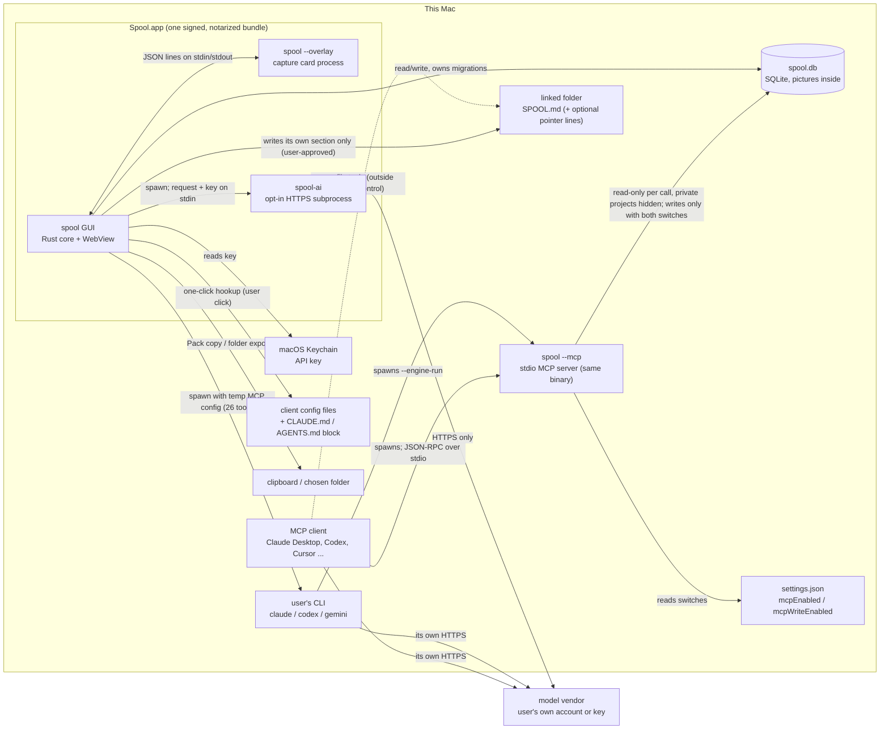

<!-- PURGE-BEFORE-APPLICATION: 本文件是给申请作品集用的事实表，§11.4 列着哪些文件含申请相关内容；发送申请前一并清除或移出公开仓库。总清单：本文件 §11.4。标记于 2026-09-25。 -->
# Spool — 作品集事实表（PORTFOLIO_FACTS）

> **生成日期**：2026-10-29 重跑（初版 2026-09-23）。本机时区 GMT（UTC+0）；实测命令的 UTC 时间写在各条里。
>
> **依据**
> - 最新公开 release：**v0.7.4**，annotated tag `ec18c3e` → commit **`ba7d2a7`**（2026-10-26 16:53:54 +0000），GitHub 发布于 2026-10-26T20:18:07Z。
> - 公开 main（GitHub API `commits/main`）= 本地 main HEAD = **`cbbda2e`**（2026-10-28）。**本地没有未推送的提交**（上一轮那 40 个本地提交都已推送）。
> - v0.6.2 那一轮（tag `04e1386` → `58ec01f`，2026-09-23 测）的数字**保留原版本号**，不继承到 v0.7.4；被取代的值挪进 §14。
>
> **读者**：作品集仓库 `~/Desktop/portfolio` 的 Claude Code 和 Hanze。网站读者是美国 CS / HCI 硕士项目的招生委员和教授。
>
> **称呼**：仓库文档里的「Ocean」就是 Hanze 本人（owner）。
>
> **每条事实的字段**：值 · 测量条件 · 日期 · 样本量（适用时）· 出处 · 能否上站。
> 「能否上站」只有三档：**可上站** / **仅内部** / **不得公开**。
>
> **写法**：说明用中文；准备上站的措辞、数字、功能名保留英文，每句不超过 25 个英文词。
> 查不到的写「**缺**」，并写清缺什么、谁能补、怎么补。
>
> **这份文档不是什么**：它不是执行光标，也不改变 `docs/EXECUTION_POLICY.md` 和 HANDOFF 的任何安排。
> 2026-10-29 这一轮是 Hanze 交代的一次性任务（作品集要按 v0.7.4 重跑）：只改了本文件，没有拍新截图、没有改作品集仓库、没有推送。
> 2026-09-23 / 09-24 那几轮做过的额外事情（改写提交信息、加清除标记、补拍截图）见 §14。

---

## 0. 怎么更新这份文档（每次发版后重跑）

**规矩**：旧值不删。某个值变了，就把旧值连同它原来的日期挪进文末 **§14 变更记录**，正文只留新值。

| 节 | 重核什么 | 命令（在仓库根目录跑，除非另注） |
|---|---|---|
| 头部 · §1 | 最新 release、日期、资产、是否 prerelease | `gh release list --limit 12` · `gh release view <tag> --json tagName,isPrerelease,isDraft,publishedAt` · `gh release view <tag> --json assets --jq '.assets[]\|[.name,.size,.downloadCount,.digest]\|@tsv'` · `git tag --sort=-creatordate --format='%(refname:short) %(objectname:short) %(*objectname:short) %(creatordate:iso)'` |
| §1 | 签名、公证、sha256（拿**下载回来的发布件**核，不拿本机 `/Applications` 里的） | `gh release download <tag> --pattern '*_aarch64.dmg'` → `shasum -a 256 *.dmg` → `spctl -a -vv -t install <dmg>` → `xcrun stapler validate <dmg>` → `hdiutil attach -nobrowse -readonly -mountpoint <tmp> <dmg>` → `spctl -a -vv <tmp>/Spool.app` → `codesign -dvv <tmp>/Spool.app` 和 `…/Contents/MacOS/spool-ai` → `hdiutil detach <tmp>`。公证 submission id 只能从 `CASE_STUDY_LEDGER.md` §1.2 抄，或由 Hanze 用 `xcrun notarytool history` 复核。⚠️ 下载一次，GitHub 的下载计数就 +1（§10） |
| §1 | 本机装的是不是发布版 | `defaults read /Applications/Spool.app/Contents/Info.plist CFBundleShortVersionString` 加 `spctl -a -vv /Applications/Spool.app`（**只有 `Notarized` 才是发布版**，`Unnotarized Developer ID` 是开发构建）。⚠️ main 上的开发构建版本号也写 0.7.4，只看版本号分不出来 |
| §1 · §3 | MCP 工具数（从发布的二进制实数，不从源码数） | 见 §3.6 那段探针；**必须**带 `SPOOL_DATA_DIR=<空临时目录>`，否则会连到真库。引擎模式再加 `--engine-run` 跑一次 |
| §1.3 | Windows 现状 | 当前 HANDOFF §9.8、§9.3 的 P13 / 发版二两行；`docs/TASKBOOK-P13-*` 的 §7 回执；`curl -s -o /dev/null -I -L -w '%{http_code}'` 打 README / 官网上的 Windows 下载地址 |
| §2 | 哪些提交在 release 里、哪些只在 main、哪些只在本地 | `gh api repos/KIM-ocean-HZ/spool/commits/main --jq .sha`（这台机器 SSH `git fetch` 不通，`origin/main` 可能是旧的）· `git log --format='%h %ad %s' --date=short <tag>..main -- . ':(exclude)docs'` · 每个分支：`git merge-base --is-ancestor <branch> <tag>` |
| §2 | MCP Registry 条目 | `curl -s 'https://registry.modelcontextprotocol.io/v0.1/servers?search=io.github.KIM-ocean-HZ%2Fspool'` |
| §3 | 代码行号 | 行号钉在 tag 上：在 §4.1 那份 `git archive` 副本里 `grep -n`，或 `git show <tag>:<path> \| grep -n <pattern>`。发版后逐条重 grep，行号全部换成新 tag 的 |
| §3 | 主进程没有网络库 | 在 tag 的副本里：`cd src-tauri && cargo tree -e normal --prefix none \| awk '{print $1}' \| sort -u \| grep -xiE 'ureq\|rustls\|reqwest\|hyper\|native-tls\|openssl\|ring\|curl\|webpki-roots'`（⚠️ 不要用不带 `-x` 的 grep：`string_cache` 里的 "ring" 会误报）；`sidecar/` 里同一条命令应当命中 `ureq rustls ring webpki-roots` |
| §4 | 测试实跑 | 见 §4.1。**用 `git archive <tag> \| tar -x -C /tmp/<新目录>` 解出干净副本**，在副本里 `npm ci`、构建、跑测试；不在工作区里装依赖或构建 |
| §5–§7 | 有没有新一轮评测、新 blocker | `grep -n '^## ' docs/Deepseek-API-compress-test.md`（当前最后一节仍是 §8 第六轮）· `grep -n '^### 3\.' docs/CASE_STUDY_LEDGER.md`（当前最后仍是 §3.46）· `grep -n '^| Field' docs/CASE_STUDY_LEDGER.md`（当前最后一列是 v0.7.4）· 归档任务书里的「真跑」回执（§5.0） |
| §9 | 截图 | `git log --format='%h %ad' --date=short -- docs/screenshots/<file>` |
| §9 | 发版后重拍 | 照 §9.4 的建议清单；做法照 §9.2：新 tag 的副本里改 bundle id、`APP_IDENTIFIER`、`KEYCHAIN_SERVICE` 三处常量 + `productName`（v0.7.4 行号：`tauri.conf.json:3/5`、`mcp.rs:1352`、`api_engine.rs:714`），`npx tauri build --bundles app`；用新 tag 的 `scripts/seed-demo-library.sh` 灌演示库（**脚本默认写 `com.oceanjin.spool.verify`，要改 `DIR`**）；构建出的 app 别放 `/private/tmp`；每次点击前核对最前面的窗口属于隔离版；⛔ 不碰「Launch at login」和「Update config」 |
| §11.4 | 清除清单 | `git grep -l 'PURGE-BEFORE-APPLICATION' HEAD -- '*.md'`（⚠️ 会把「提到」这个词的文件也算进来，要逐个看第一行）；源码清单用 §11.4 里那条 `git grep` 重算 |
| §10 | 下载数 | `gh api repos/KIM-ocean-HZ/spool/releases --paginate --jq '.[] \| [.tag_name, ([.assets[].download_count]\|add)] \| @tsv'` |
| §12 | 作品集口径 | 只读打开 `~/Desktop/portfolio/content/evidence.yaml`（`project: spool`）、`content/projects/spool.md`、`content/facts.yaml`（`id: spool`）、`docs/CONTENT-GUIDE.md` §4 |

---

## 1. 发布记录

### 1.1 最新公开 release：v0.7.4

| 字段 | 值 | 条件 / 出处 | 日期 | 上站 |
|---|---|---|---|---|
| 版本 | **v0.7.4**（release 名 "Spool 0.7.4 (macOS)"） | `gh release list`：标 `Latest`；`isPrerelease=false`，`isDraft=false` | 2026-10-29 查 | 可上站 |
| 发布时间 | **2026-10-26T20:18:07Z** | `gh release view v0.7.4 --json publishedAt` | — | 可上站 |
| Tag | `v0.7.4`（tag 对象 `ec18c3e`，打 tag 2026-10-26 20:17:39 +0000）→ commit **`ba7d2a7`**（2026-10-26 16:53:54 +0000） | `git tag` 输出；ledger §1.2 v0.7.4 列：tag 之后 main 上的提交在发版时只改文档和 `server.json` | — | 可上站 |
| 平台 | **macOS，Apple Silicon（aarch64）**；release notes 写 "Apple Silicon (M1 or later), macOS 11 or newer" | `docs/RELEASE_NOTES_v0.7.4.md` "Download" 一节。⚠️ 发布件 `Info.plist` 的 `LSMinimumSystemVersion` 是 **10.13**（2026-10-29 实读）；ledger 写 "minimum macOS 11.0"。Apple Silicon 本身最低就是 macOS 11，所以对用户没差别，但两处写法不一致（仅内部） | 2026-10-29 | 可上站（用 release notes 的写法） |
| 产物 | `Spool_0.7.4_aarch64.dmg` 与 `Spool-macOS-arm64.dmg`，同一份字节，各 **11,962,561** 字节 | `gh release view v0.7.4 --json assets`；两个资产的 `digest` 相同 | 2026-10-29 | 可上站 |
| sha256 | **`e70c78f74c582728ea2821ea0ef14ce7ac19aeeecd5566b044ce19e1d9a5c9ad`** | 2026-10-29T16:03:20Z 下载 `Spool_0.7.4_aarch64.dmg` 实测 `shasum -a 256`；与 release notes、ledger §1.2、GitHub `digest` 一致 | 2026-10-29 | 可上站 |
| 签名身份 | Developer ID Application: **Hanze JIN**，Team **`Q5Y5JRXZ58`**；随包的 `spool-ai` 同一个 Team、同一个证书 | 2026-10-29 挂载发布件后跑 `codesign -dvv`（`.app` 与 `Contents/MacOS/spool-ai`）；签名时间戳 2026-10-26 20:15:26 | 2026-10-29 | 可上站 |
| Gatekeeper | `.dmg` 和其中的 `.app` 都是 **`accepted` · `source=Notarized Developer ID`**；`xcrun stapler validate` 对 `.dmg` 通过（"The validate action worked!"） | 2026-10-29 对**下载回来的发布件**实测（**本轮复核**） | 2026-10-29 | 可上站 |
| 公证 · `.app` | submission `fe33298f-0cdc-44c0-b7a7-ef3c1d241ce5` · Accepted | `CASE_STUDY_LEDGER.md` §1.2 v0.7.4 列。**本轮没有复核 submission id**：要 Apple 凭据（Hanze 跑 `xcrun notarytool history`）。本轮复核的是结果：Gatekeeper 认它为已公证（上一行） | 2026-10-26 | 可上站 |
| 公证 · `.dmg` | submission `5ddcb4b2-9493-41a1-8d25-8cdfc99c4c29` · Accepted | 同上 | 2026-10-26 | 可上站 |
| 固定名链接 | `releases/latest/download/Spool-macOS-arm64.dmg` → **HTTP 200** | 2026-10-29T16:07Z `curl -I -L` 实测 | 2026-10-29 | 可上站 |
| 库版本 | schema **v35 → v37**（加两张连接文件夹的表、`attachments` 加两列可空列；已有的行不动）。从 v0.6.2 升上来一共 v24 → v37，13 步，全部只加不改 | release notes v0.7.4 "Upgrading…"；ledger §1.2 v0.7.4 / v0.7.0 列；`src/lib/db/client.ts:41` `SCHEMA_VERSION = 37`、迁移 `:1153`（35→36）、`:1200`（36→37）；`src-tauri/src/mcp.rs:4621` `EXPECTED_SCHEMA_VERSION = 37`（v0.7.4） | — | 可上站 |
| 内置 MCP 服务 | `serverInfo` = `spool 0.7.4`；**28 个工具（15 读 / 13 写）+ 7 个 prompt**；引擎模式（`--engine-run`）**26 个** | 2026-10-29T16:03Z 对挂载的发布件跑 `tools/list` + `prompts/list`，数据目录指向空临时目录（§3.6）。ledger 的 28 / 15 / 13 / 26 是「用发布提交的构建」数的，本轮**用发布件本身**复数，一致 | 2026-10-29 | 可上站 |
| MCP Registry | `io.github.KIM-ocean-HZ/spool` **0.7.4** 已发布、`isLatest: true`（2026-10-26T20:50:40Z），只有元数据（没有 `packages` / `remotes`）；0.6.2、0.7.0 – 0.7.3 也都还列着 | 2026-10-29T16:05Z `GET registry…/v0.1/servers?search=…`。ledger 写这一列时还是「没发」，之后 Hanze 手动发了 | 2026-10-29 | 可上站 |

**建议上站写法**

- "Spool v0.7.4 shipped on 2026-10-26 as a Developer ID–signed, Apple-notarized build for Apple Silicon Macs."（作品集已有，SPL-REL-074）
- "Re-checked on 2026-10-29: the published .dmg and the app inside both pass Gatekeeper as notarized."

### 1.2 v0.7.0 – v0.7.4 发布表（v0.6.2 之后的五个版本）

全部只有 macOS（Apple Silicon，签名 + 公证），都没有 Windows 包。sha256、公证、schema、工具数照 ledger §1.2 各列；发布时间、tag、资产大小 2026-10-29 用 `gh` / `git` 实查。

| 版本 | 发布（GitHub，UTC） | tag → commit | 一句话（release notes 首段） | dmg 字节 | 公证 `.app` / `.dmg`（ledger） | schema | MCP 工具（读/写；引擎） |
|---|---|---|---|---|---|---|---|
| **v0.7.0** | 2026-10-19T15:31:30Z | `3960d23` → `20cebca` | 项目里能放图片和文件；AI 的改动先提议、等用户点 | 11,478,440 | `e49524ae-4533-4d9a-ab12-c116e8b092fd` / `0e012752-73dc-45cc-8ef7-5b41005ef510` · 都 Accepted | v24 → **v35**（11 步只加） | 26（14 / 12；引擎 25） |
| **v0.7.1** | 2026-10-23T19:06:52Z | `ca6bb89` → `8402d9e` | 绿点提示 AI 写入；周回顾按项目分卡；跟进可每周自己跑（默认关） | 11,483,019 | `92748691-e320-4d15-b939-13561a7c6555` / `2c4a01d8-a3f6-44bb-8274-0c892be01146` · 都 Accepted | v35 不变 | 26（14 / 12；25） |
| **v0.7.2** | 2026-10-24T10:56:19Z | `474b484` → `de9e2ec` | 修 npm 装的 CLI 被判没装；一键连上 | 11,484,755 | `943011d2-720f-4212-830b-e0a4dd9747b8` / `0c63a5ac-c015-41ee-b391-5d39da689b9e` · 都 Accepted | v35 不变 | 26（14 / 12；25） |
| **v0.7.3** | 2026-10-25T15:30:02Z | `62ce424` → `d40cec6` | 本机 CLI 与 API key 两条路做同样四件事；过期检测查整个工作区 | 11,645,376 | `67f4908f-c4e6-4e0d-814d-10175eb821bf` / `8def0f4d-28a5-42a2-a9e2-8f00c9fab4fd` · 都 Accepted | v35 不变 | 26（14 / 12；25） |
| **v0.7.4** | 2026-10-26T20:18:07Z | `ec18c3e` → `ba7d2a7` | 工作区能连一个本机文件夹（代码仓库、论文文件夹），放一份 `SPOOL.md` | 11,962,561 | `fe33298f-0cdc-44c0-b7a7-ef3c1d241ce5` / `5ddcb4b2-9493-41a1-8d25-8cdfc99c4c29` · 都 Accepted | v35 → **v37** | **28（15 / 13；26）** |

submission id 照 ledger §1.2 各列逐字抄（本轮没有复核，要 Apple 凭据）。v0.7.4 的 sha256 本轮复核过；v0.7.0 – v0.7.3 的 sha256 只核了 GitHub 资产的 `digest`（与 release notes 写的一致），没有逐个下载。上站时只写版本和日期即可。

"Five macOS releases shipped between 2026-10-19 and 10-26 (v0.7.0 – v0.7.4), each signed and notarized." —— 可上站。

### 1.3 Windows（单列）

| 事实 | 值 | 出处 | 上站 |
|---|---|---|---|
| 最后一个 Windows 安装包 | **v0.6.1**（2026-08-19，`Spool_0.6.1_x64-setup.exe`，**没有代码签名**，CI run `32228101203`）。v0.6.2 和 v0.7.0 – v0.7.4 都没有 Windows 包 | ledger §1.2 v0.6.1 列；各版 release 资产 | 可上站 |
| 下载按钮现在指向 | README 1 处、官网首页 3 处，都写死 `releases/download/v0.6.1/Spool-windows-x64-setup.exe` → **HTTP 200**。上一轮记的「`latest/download/…windows…` 返回 404」已在 v0.7.0 发版时改掉（ledger §1.2 v0.7.0 "Windows" 一行）；`latest/download/Spool-windows-x64-setup.exe` 本身仍是 404，作品集别链它 | 2026-10-29T16:07Z `curl` 实测；`README.md:13`、`site/index.html:73/367/696` | 可上站 |
| 现在测到哪一步 | **进行中，没有发布。** P13「发版二之前：Windows 真机验证」2026-10-28 下发、状态 **ACTIVE**：在 Hanze 自己的 Windows 电脑上，用 `main`（代码 = `33a2390`）编译、跑全套测试、打不签名的 NSIS 安装包、升级验证（v0.6.1 / 库 v23 → v37）、和 Hanze 一起走 52 条；**只验不发**。到 2026-10-29 为止 P13 的 §7 回执还是空的（仓库里没有任何结果记录）。 | `docs/TASKBOOK-P13-RELEASE-TWO-WINDOWS-VERIFY-2026-10-28.md` 首屏与 §7；HANDOFF §9.8、§9.3 P13 行 | 可上站（只写 "A Windows build is in testing."） |
| 之前的 Windows 验证 | P9W（2026-10-20）在一台学校电脑上被安全软件拦住，43 条一条都没测；之后 P9X 修了 Windows 上测试编不过等问题，GitHub 的 Windows 机器上全绿 | P13 任务书首屏「来历」；HANDOFF §9.3 P9W / P9X 两行 | 仅内部 |
| 谁决定什么时候发 | **Hanze。** P13 验收通过 ⇒ 下一件是「发版二：Mac + Windows 统一发版」，另开一窗做（版本号、发版说明、Mac 公证、Windows 安装包、官网 / README 的 Windows 按钮、MCP Registry），推送前要问 Hanze | HANDOFF §9.8「返回点」；§9.3「发版二」行（Hanze 原话「验收通过就是 win+mac 统一发版」，第 241 条） | 仅内部 |
| Windows 签名 | 仍不签名（2026-08-15 的决定，WORKPLAN §4.1，现并入 HANDOFF §10） | — | 可上站（只写 "unsigned"） |
| `docs/WINDOWS-CHECK.md` | 是 2026-08-18 首个 Windows 版（v0.5.0 前后）给 Hanze 的装机清单，**不是**现在这一轮；现在这一轮只看 P13 任务书 | 文件首屏；最后修改 `b2a7627`（2026-08-18） | 仅内部 |

- "Spool runs on Apple Silicon Macs today; a Windows build is in testing. The last Windows installer, unsigned, was v0.6.1."

### 1.4 v0.7.4 之后正在路上的（不算 Released）

| 东西 | 状态 | 出处 | 上站 |
|---|---|---|---|
| 公开 main 上的新提交 | `v0.7.4..main` 共 **37** 个提交，其中 **19** 个动了 `docs/` 以外的文件（1 个只改 `server.json`；功能列表见 §2.2）。**全部已推送、公开** | `git log v0.7.4..main`；GitHub API `commits/main` = `cbbda2e` | 可上站（写成 "on main, unreleased"） |
| 只在本地的提交 | **没有**（本地 main = 公开 main） | 同上 | — |
| 下一版 | 「发版二」= Mac + Windows 一起发，等 P13 验收通过；**缺**：没有版本号、没有日期、没有 release 草稿 | `gh release list` 里没有 draft；HANDOFF §9.8 | — |
| 本机装的 Spool | `/Applications/Spool.app` 自报 **0.7.4**，但 `spctl` 是 **`rejected` · `Unnotarized Developer ID`**，签名时间 2026-10-28 14:50:31。它是 2026-10-28 14:51 换装的 **main 开发构建**（含 P10 + P12，库 v37），**不是 v0.7.4 发布版** | 2026-10-29 `defaults read` + `spctl` + `codesign -dvv`；HANDOFF §9.8「本机现状」 | 仅内部 |

⚠️ 用本机这个 app 拍的截图会显示**未发布**的界面（P10 的周回顾卡片等），不能标成 v0.7.4（§9.4）。

### 1.5 更早的 release（给时间线用）

| 版本 | 发布（GitHub） | 平台 | 出处 |
|---|---|---|---|
| v0.6.2 | 2026-08-24T08:06:24Z | macOS（公证）；tag `04e1386` → `58ec01f`；schema v23 → v24；20 个工具（13 / 7） | 上一轮 §1.1（2026-09-23 复核），现挪进 §14 |
| v0.6.1 | 2026-08-19T07:40:50Z | macOS（公证）+ Windows（未签名） | ledger §1.2 |
| v0.6.0 | 2026-08-19T04:56:37Z | macOS（公证）+ Windows（未签名） | ledger §1.2 |
| v0.5.0 | 2026-08-18T15:15:08Z | macOS（公证）+ Windows 首发（未签名） | ledger §1.2 |
| v0.4.0 | 2026-08-07T17:22:11Z | macOS（公证） | ledger §1.2 |
| v0.3.0 | 2026-07-30T05:48:53Z | macOS，首个公开 release | `gh release list` |

仓库在 GitHub 上建于 **2026-05-17T13:01:22Z**，第一个 commit `33b07d8` 也是 2026-05-17（`gh repo view`；`git log --reverse`）。v0.7.4 时共 **887** 个 commit，main HEAD `cbbda2e` 时 **924** 个，作者全部是 `KIM-ocean-HZ`（2026-10-29 `git rev-list --count`、`git log --format=%an \| sort \| uniq -c`）。仓库 PUBLIC。可上站。

---

## 2. 功能状态三栏

判定口径：
- **Released** = 在 tag `v0.7.4` 的代码里，并且发布件里能用到。
- **Merged, unreleased** = 在 main 上、不在 v0.7.4 里。这一轮 main 全部已推送，所以只有「公开 main」一档。
- **Planned** = HANDOFF 路线图里排了、或者只有设计稿 / 评估，没有功能代码。

**分支核对（2026-10-29）**：本地 `feat/api-compress-sidecar`、`fix/tailwind-alpha`、`valentine-edition`、`windows-port` 和远端同名分支**全部是 v0.7.4 的祖先**（`git merge-base --is-ancestor`）。没有只在分支上的功能代码。

证据行号全部钉在 **tag `v0.7.4`**（在 §4.1 的 `git archive` 副本里 grep）。

### 2.1 Released（v0.7.4 里有的）

#### A. v0.6.2 就有、v0.7.4 里仍然成立的（句子沿用，标注变化）

| 功能 | 英文一句话（可上站） | v0.7.4 里的变化 / 证据 |
|---|---|---|
| 捕捉 | "Double-tap ⌥ in any app to file the clipboard into the current project, with a note box already focused." | 仍成立。v0.7.0 起截图、图片也能捕（见 B）；长按 ⌥ 直接写笔记。`src-tauri/src/double_tap.rs`、`capture.rs` |
| Pack | "Any project packs into a plain-text briefing for pasting into any AI." | 仍成立。v0.7.0 起图片在 pack 里按路径列出；能导出 .md / 带文件的文件夹 |
| AI 压缩（Compress 页签） | "Compression is opt-in and checked before saving; it runs on the user's own CLI or API key." | **变了**：v0.6.2 只能走 API key（spool-ai），v0.7.3 起也能走本机 CLI（`api_engine.rs:207` `compress_pack_via_cli`，同一份提示词、同一套核对）。默认关：`settingsStore.ts:439` `apiEngineEnabled: false`；默认端点 `:443` `https://api.deepseek.com`、模型 `:447` |
| 压缩写回库的三道闸 | "A draft that dropped a number or date cannot be saved; the original text stays on each block." | 仍成立。`compressStore.ts:207`、`:801` `useDraft`；`src/lib/db/blocks.ts:1034` `applyCompression`（`:1048` `original_content = COALESCE(original_content, content)`，只写第一次） |
| 查过期（Out-of-date check） | "An out-of-date check asks an AI which blocks were overtaken; every quoted line is verified before the user sees it." | 仍成立；v0.7.3 起能查整个工作区、也能走本机 CLI（见 B） |
| MCP 读 / 写 | 见 §3.6 新数字 | 20（13 / 7）→ **28（15 / 13）**。开关、只追加的规则见 §3.4，v0.7.4 里仍成立 |
| 一键接入 | "One click registers Spool with Claude Desktop, Claude Code, Cursor, VS Code, Windsurf or Codex." | 仍成立。`mcp.rs:10053` 起 `configure_client`；`spool:begin` 段 `mcp.rs:10175` |
| CLI 引擎槽 | "If Claude Code, Codex or Gemini CLI is installed, Spool can run it headless for its AI actions." | 仍成立；v0.7.2 起 npm / nvm 装的、ChatGPT 桌面版自带的 Codex 也找得到。`engine.rs:141` `EngineKind`（Claude / Codex / Gemini） |
| 联网跟进（Follow up） | "Each project lists what to watch; a follow-up runs the user's own Claude Code with web search and queues sourced findings for approval." | **仍成立，但范围变大**：v0.7.0 起 Codex 跑跟进能写回（release notes v0.7.0 "Follow Up with the Codex CLI can write its findings back"；上一轮那条 `DISCOVERED-20260924-1` 就是这一条）；v0.7.1 起能每周自己跑（**默认关**，每个项目一个开关）；v0.7.3 起也能走 API key，用 OpenAI / Claude / Gemini / Kimi / 通义各家自带的联网。只有跟进能上网：`lib.rs:151` `let web = action == "follow_up"`。Gemini CLI 不跑跟进 |

#### B. v0.7.0 – v0.7.4 新发布的

| 功能 | 首发 | 英文一句话（≤ 25 词，可上站） | 证据（v0.7.4） |
|---|---|---|---|
| **AI 提议要用户批准** | v0.7.0 | "Corrections, replacements, files and project splits an AI proposes wait on a review screen until the user clicks." | 待审表 `client.ts:330` `proposal_batches`、`:341` `proposals`、`:803` `supersede_proposals`、`:1000` `file_proposals`、`:1130` `split_proposals`；工具 `mcp.rs:8643` `propose_supersede`、`:8661` `propose_split`、`:8824` `propose_attach_file`、`:8841` `propose_replace_file`。release notes v0.7.0「AI proposals wait for you」「What changes for you」第 2 条（AI 的「更正 / 取代」只算建议） |
| **图片** | v0.7.0 | "Screenshots and copied images become picture blocks; an AI connected over MCP can fetch them with get_block_images." | `src-tauri/src/images.rs`；`block_images` 表（`client.ts:1024` 注释）；`mcp.rs:8790` `get_block_images`。原图存进库文件 |
| **项目文件** | v0.7.0 | "Each project keeps its files in one list; Spool follows a file the user moves, and an AI may only propose adding one." | `src-tauri/src/file_follow.rs`、`file_identity.rs`；release notes v0.7.0「project files in one place」。用户亲手加的文件默认 AI 可读，每个文件有自己的开关 |
| **项目拆分** | v0.7.0 | "An AI can propose splitting a long project into sub-projects; nothing moves until the user presses Split, and one undo reverts it." | `mcp.rs:8661` `propose_split`；`client.ts:1130` `split_proposals`；已完成的项目不拆（release notes v0.7.0）。引擎拿不到这个工具（§3.6） |
| **私有项目** | v0.7.0 | "A private project is hidden from AI clients connected through Spool, though they can still write into it." | `mcp.rs:1594` `hide_private_projects`，所有 MCP 读都经 `mcp.rs:1526` `open_db`；`client.ts:1111` `threads.private`。限定：只管经过 Spool 的这条路，不加密磁盘上的任何东西（release notes v0.7.0 Known limits） |
| 周回顾「活动」 | v0.7.0 | "Weekly Review opens with a no-AI summary of the week: focus time per day and which projects gained blocks." | release notes v0.7.0「Activity in Weekly Review」；不花钱、不出网 |
| 周回顾走 API key | v0.7.0 | "Weekly Review can run through the user's own API key as well as a local CLI." | release notes v0.7.0「The network」：发的是跨项目 digest + 本周新块，不是整份 pack。⚠️ spool-ai 多了一种发出去的内容（§3.5） |
| 撤销 / 重做、草稿不丢 | v0.7.0 | "Undo has redo, and unfinished text is saved as the user types, so a quit or crash loses nothing." | release notes v0.7.0「Undo, redo…」；`drafts.json` |
| 块摘要（Gist）、整块取代、批注可更正 | v0.7.0（代码 08-25 就在 main 上，上一轮记在「Merged, unreleased」） | "Every block's one-line gist is visible and editable; an AI cannot overwrite a gist the user wrote." | `mcp.rs` `set_block_gist`；release notes v0.7.0「Also in this release」 |
| AI 写入亮绿点 | v0.7.1 | "A project's dot turns green when an AI adds something, and clears once the new block has been on screen." | release notes v0.7.1；`ai-seen.json`（每台电脑一份） |
| 跟进每周自动跑 | v0.7.1 | "Follow-up can search weekly on its own, off by default per project, and speaks up only when it finds something." | release notes v0.7.1「What changes for you」第 3 条；结果进待审、标 "Follow up" |
| 引擎找得到 + 一键连上 | v0.7.2 | "Spool finds a Claude Code or Codex installed with npm, or the Codex inside the ChatGPT app, and connects it in one click." | release notes v0.7.2；不在 Desktop / Documents / iCloud 里找 CLI（会触发系统授权框） |
| **本机 CLI 与 API key 两条路** | v0.7.3 | "Weekly review, follow-up, compression and the out-of-date check each run on the user's own CLI or own API key." | `api_engine.rs:207` `compress_pack_via_cli`、`:236` `stale_scan_via_cli`；`compressStore.ts:472` `routeFor(…)`；release notes v0.7.3「Two equal routes」 |
| 多家 API key | v0.7.3 | "Paste a key from OpenAI, Claude, Gemini, DeepSeek, Kimi, Qwen, Zhipu or OpenRouter; Spool recognises the provider and lists its models." | `src/lib/ai/vendors.ts:60 – 180`：8 家具名 + `custom`（自定义 HTTPS 端点）。⚠️ release notes 写 "nine providers" 却只列了 8 个名字；代码是 8 + 自定义。上站按 8 家写 |
| 过期检测查整个工作区 + 每月一次 | v0.7.3 | "The out-of-date check can cover a whole workspace and flag projects that may be finished; a monthly run is optional." | release notes v0.7.3；已完成、私有的项目不发；每月检查默认关 |
| **连接文件夹与 SPOOL.md** | v0.7.4 | "A workspace can link to a local folder; a SPOOL.md there tells AI tools which Spool projects the folder belongs to." | `src-tauri/src/folder_link.rs:1 – 30`（模块说明：只写四处 —— `SPOOL.md` 的标记段、`.git/info/exclude` 一行、可选的 `CLAUDE.md` `@SPOOL.md` 一行、可选的 `AGENTS.md` 一行）；`client.ts:1167` `folders`、`:1180` `folder_links`、`:1204` `workspace_folders` |
| 文件夹的计划变了会提示 | v0.7.4 | "When a linked folder's plan files change after a sync, Spool flags the project and pauses its weekly follow-up." | `mcp.rs:8744` `get_folder_status`、`:8758` `mark_folder_synced`；Spool 自己的后台任务不能标「已对过」（`mcp.rs:1402` `ENGINE_EXCLUDED_TOOLS`） |
| 挂的文件变了会重读 | v0.7.4 | "An attached file that changed on disk is read again the next time it is used, and marked as changed." | release notes v0.7.4「New」最后一条 |

⚠️ **v0.7.4 的一条限定必须跟着「连接文件夹」一起写**：Spool 管不了 AI 客户端用它自己的文件工具去读文件夹（release notes v0.7.4 Known limits；HANDOFF 10-26 撤回了 `request_folder_file`）。建议："Spool cannot stop an AI client from reading the linked folder with its own file tools." 可上站。

⚠️ **别把两个「压缩」混在一起**：CLI 引擎槽的动作 `distill`，中文界面标签也叫「压缩」（`engineStore.ts:57`）。作品集说的「AI compression」指 **Compress 页签**（v0.7.3 起两条路都能跑），不是 `distill`。

**「CLI」在 Spool 里到底指什么（v0.7.4 仍然如此）**：
- 指的是 **引擎槽**：Spool 在本机找到用户自己装、自己登录的 `claude` / `codex` / `gemini`，作为**子进程**起它，并给它挂上 Spool 自己的 MCP 服务（`engine.rs:726` `mcp_config_json`）。v0.7.3 起压缩和查过期也能走这条路（`api_engine.rs:207`、`:236`，直接把提示词交给 CLI）。
- **Spool 没有给用户用的命令行。** 二进制的 `--mcp`、`--overlay`、`--engine-run`、`--engine-follow-up` 都是内部进程模式（`src-tauri/src/main.rs:7`、`:14`；`mcp.rs:1399`、`:1421`）。
- 容易混的一点：Claude Code、Codex CLI **也可以当 MCP 客户端**直接连 Spool（v0.7.4 起还会读文件夹里的 `SPOOL.md`）。那一条算 **MCP**，不算引擎槽。
- 建议作品集的三个接口仍写成 **"Desktop app · MCP server · CLI engine slot"**，定义句照旧：
  "The CLI engine slot runs the user's own Claude Code, Codex or Gemini CLI as a subprocess."

### 2.2 Merged, unreleased —— 公开 main（`v0.7.4..cbbda2e`，全部已推送）

| 提交 | 日期 | 功能（英文一句话，≤ 25 词） | 备注 |
|---|---|---|---|
| `5823e91` `2869757` `9932de9` `6918748` | 10-26 – 10-27 | "Weekly Review returns structured cards whose suggested actions — close, correct, replace — are one click and undoable." | P10-1 – P10-3：两条路都回 JSON、逐字闸、动作按钮（取代 / 更正进待审） |
| `3c4db24` | 10-26 | "A small card appears where captures appear when a new weekly review is ready." | P10-4 |
| `84f1cb9` | 10-27 | "Finished projects are left out of Weekly Review everywhere: materials, prompt, the engine's MCP view and the gate." | P10 验收第一轮 |
| `310dc9f` | 10-27 | "Weekly Review can suggest closing a follow-up line; one click closes it, and it skips duplicates of existing lines." | 同上 |
| `20db7e4` | 10-26 | （测试）周回顾两条路真跑：库副本上 9 次 | 只加 `#[ignore]` 测试和回执；§5.0 |
| `d48acf2` `4c2f641` | 10-27 | "Weekly Review is written in the interface language; quotes and project names stay as written." | P12-5；真跑回执见 §5.0 |
| `821c458` | 10-27 | "Deleting a linked workspace removes its section from SPOOL.md the next time Spool opens." | P12-2 |
| `223d5dd` | 10-27 | 修：Spool 开在 `SPOOL_DATA_DIR` 上时，引擎起的 MCP 服务读同一个库 | P12-4，内部修复 |
| `c2fd313` | 10-27 | 修：织布测试偶发红；路径闸的拒绝消息不再带 `\\?\` | P12-1 |
| `1e503da` | 10-27 | 删 99 条没人用的界面词条 | P12-3，内部 |
| `6de2899` → `0ddb718` | 10-27 → 10-28 | 先加「截完图马上双击就能捕」，**第二天撤回**：实测 macOS 小图挂着时图根本不在磁盘上；捕捉卡改成提示关掉浮动缩略图 | **两笔抵消，净结果只是一句提示**；别写成新功能 |
| `33a2390` | 10-28 | "A workspace's title can be renamed by double-clicking it on its page." | P12 验收第一轮 |
| `d5f4abd` | 10-26 | `server.json` 版本改 0.7.4（MCP Registry 元数据） | 不是功能 |

main 上的工具数和库版本**与 v0.7.4 相同**：28 个工具（`git diff v0.7.4 HEAD -- src-tauri/src/mcp.rs` 里没有新增或删除的工具名），库 v37（`mcp.rs:4654`、`client.ts:41`）。2026-10-29 查。

上站写这些要写 "on main, unreleased"；Hanze 若只想展示已发布的，整栏可以不用。

### 2.3 Planned（排了或只有设计，没有功能代码）

| 东西 | 状态 | 出处 | 上站 |
|---|---|---|---|
| **发版二：Mac + Windows 一起发** | 等 P13 Windows 真机验证通过；Hanze 定发版时间 | HANDOFF §9.3「发版二」、§9.8 | 可上站（只写 "A Windows build is in testing."） |
| F2 来龙去脉的**界面** | 数据那一半早在 main（`ee3dbda`，08-30，已随 v0.7.0 发布）；界面没做；方针 §6.8 里排在 MEM 之后 | `EXECUTION_POLICY.md` §6.8 | 仅内部 |
| F3 事件 / 时间层（C1–C7） | 「到时再问 Ocean」；存储模型要 Hanze 先定 | HANDOFF §9.3 F3 行、§10.2；方针 §6.8 | 仅内部 |
| F4 音视频 | 开工前五项调查未做 | 方针 §6.8 | 仅内部 |
| 宣发（问卷、海报等） | 等发版二 + 方针 §5.3 营销闸门；Hanze 未决定 | HANDOFF §9.3「宣发」行、§11 | 不得公开（未公开的计划） |
| 压缩用 `supersedes` 写回 | **封着**：它压得动时会丢日期 | HANDOFF §10（原 WORKPLAN §1「G 批」） | 仅内部 |
| 跨生态记忆实验 | **暂停在 GR16**（2026-09-30 起切回产品线）；不在本文范围（§11.3） | HANDOFF 首屏「当前光标」 | 不得公开（细节）；见 §12 关于 SPL-RES-STATUS |

---

## 3. 三个入口与写入边界（给架构图用）

以下行号全部钉在 **tag `v0.7.4`（`ba7d2a7`）**。v0.6.2 的旧行号不再列（要查用 `git show v0.6.2:<path>`）。

### 3.1 进程

| 进程 | 谁起它 | 做什么 | 代码 |
|---|---|---|---|
| `spool`（GUI） | 用户 | Tauri 主程序：Rust 核心 + WebView（React）。**库的唯一迁移者** | `main.rs:18` → `lib.rs:348` `run()` |
| `spool --overlay` | GUI 启动并常驻 | 捕捉浮窗的独立进程。**从不打开 SQLite**，库调用都转回主进程 | `main.rs:14`；`overlay.rs:21`（「从不开库」那条）；起进程 `overlay.rs:135` |
| `spool --mcp` | **MCP 客户端**（或引擎槽里的 CLI）起它 | MCP 服务，stdio 上的 JSON-RPC；不监听任何端口。引擎起它时多带 `--engine-run`（少两个工具）、跟进时再带 `--engine-follow-up` | `main.rs:7`；`mcp.rs:12557` `run()`；`mcp.rs:1399`、`:1421` |
| `spool-ai` | GUI 在需要时起它，跑完就退 | **唯一**会开 socket 的进程；stdin 进一个 JSON，stdout 出一行信封 | `sidecar/src/main.rs:165` `main()` |
| `claude` / `codex` / `gemini` | GUI（引擎槽；v0.7.3 起压缩 / 查过期也走） | 用户自己的 CLI，headless 跑；它自己再起 `spool --mcp` | `engine.rs:726` `mcp_config_json`；`api_engine.rs:207`、`:236` |

### 3.2 数据存储

| 存储 | 位置 | 谁写 | 出处 |
|---|---|---|---|
| `spool.db`（SQLite） | `~/Library/Application Support/com.oceanjin.spool/` | GUI（全部）；`spool --mcp`（仅写工具） | `docs/PRIVACY.md`；`mcp.rs:1540`（只读打开）、`:4666`（读写打开） |
| 块里的图片 | **库文件里**（`block_images` 表）；pack 用的副本在旁边的 `image-cache` 文件夹 | GUI | release notes v0.7.0「What changes for you」第 3 条 |
| `settings.json` | 同一目录 | GUI；`spool --mcp` 只读它来判开关 | `mcp.rs:1492`、`:1510` |
| `mcp-clients.json` | 同一目录 | `spool --mcp`：客户端名 + 最后一次连接时间 | `mcp.rs:4733`、`:4740`；2026-10-29 用发布件对空目录实跑，确实只多出这一个文件 |
| `focus.json`、`drafts.json`、`knit.json`、`ai-seen.json` | 同一目录 | GUI；不进库、不随导出走、从不发出去 | release notes v0.7.0、v0.7.1 |
| 迁移前快照 | 同一目录 | GUI，每次迁移前 `VACUUM INTO` | ledger §3.1 第 3 条；release notes v0.7.4 |
| API key | **macOS 钥匙串**，service `com.oceanjin.spool` | GUI | `api_engine.rs:714` `KEYCHAIN_SERVICE` |
| 其他客户端的配置文件、其他 AI 的说明文件（`~/.claude/CLAUDE.md`、`~/.codex/AGENTS.md` 里的 `spool:begin` 段） | 各客户端自己的位置 | GUI，**只在用户点「一键接入」时**；说明段不含库内容 | `mcp.rs:10053` 起；`:10175`、`:10219` |
| **用户连接的文件夹里的四处**（v0.7.4 新） | `SPOOL.md` 的标记段；`.git/info/exclude` 一行（选「只留在这台电脑」时）；文件夹自己 `CLAUDE.md` 末尾 `@SPOOL.md` 一行、`AGENTS.md` 末尾一行（都只在文件已存在且用户勾了时） | GUI，用户连接时逐项看过；别的文件只读不写；改之前的备份放 Spool 自己的数据目录 | `folder_link.rs:15 – 30` |
| Pack 文件夹 / 导出的库 | 用户在对话框里选的位置 | GUI | `pack.rs`；`transfer.rs` |

### 3.3 连线（谁调谁、走什么）

| 从 | 到 | 协议 | 代码 |
|---|---|---|---|
| GUI WebView | `spool.db` | `tauri-plugin-sql` | 迁移注册表 `src/lib/db/client.ts:166` `MIGRATIONS` |
| GUI | overlay | 双向，每行一个 JSON（overlay 的 stdin / stdout） | `overlay.rs` 模块说明 |
| MCP 客户端 | `spool --mcp` | 客户端起子进程，stdio 上的 JSON-RPC 2.0 | `mcp.rs` 模块说明 |
| `spool --mcp` | `spool.db` | 读：**每次调用新开一个只读连接，并先藏掉私有项目**；写：只读写工具开读写连接，2 秒 busy timeout | `mcp.rs:1526` `open_db` → `:1594` `hide_private_projects`；`:1540`（`SQLITE_OPEN_READ_ONLY`）；`:4666 – 4668`（`READ_WRITE` + busy timeout） |
| GUI | CLI 引擎 | 起子进程，带临时 MCP 配置 + 工具白名单（26 个） | `engine.rs:78` `ALLOWED_TOOL_NAMES: [&str; 26]`；claude `--allowedTools` `engine.rs:910`；codex `--sandbox read-only` `engine.rs:858 – 859`、`:1106 – 1107` |
| CLI 引擎 | `spool --mcp --engine-run` | 同 MCP 客户端那条；少 `propose_split`、`mark_folder_synced` | `mcp.rs:1402` |
| GUI | `spool-ai` | 起子进程；**请求连同 key 走 stdin，从不走 argv** | `sidecar/src/main.rs` 头部契约 |
| `spool-ai` | 模型厂商 | HTTPS；**明文 http 直接拒绝** | `sidecar/src/main.rs:205 – 206`（`run()` 里第一道检查） |
| CLI 引擎 | CLI 的厂商 | CLI 自己的网络请求，用用户自己的账号 | `engine.rs` 模块说明 |

### 3.4 哪些路径能写库，要过哪几道开关（v0.7.4 仍成立）

| 写入者 | 能写什么 | 要过的闸（按顺序） | 代码（v0.7.4） |
|---|---|---|---|
| 用户（GUI） | 全部 | — | — |
| **GUI 替 AI 压缩写回** | `blocks.content` ← 压缩稿；原文存进 `original_content`（设置里能关） | ① 用户选了一条路（API key 或本机 CLI，默认都没开）→ ② 用户按 **「Use this one」** → ③ 数字 / 日期闸 → ④ 结构闸 → ⑤ 没变短的块不写 | `compressStore.ts:207`、`:801`；`blocks.ts:1034 – 1054` |
| GUI 替查过期写关系 | 新块的引用关系，或旧块的 `stale_at` | 用户在三选一里点 → 已经指着别的块的，拒绝覆盖 | `src/lib/blocks/staleGuards.ts` |
| **MCP 写工具（13 个）** | **直接写（6）**：`create_thread`、`add_block`（只追加、带来源标签）、`set_thread_summary`（不覆盖用户写的）、`set_block_gist`（不覆盖用户写的）、`close_follow_up_item`、`mark_folder_synced`。**只排队、用户点了才生效（7）**：`propose_blocks`、`propose_supersede`、`propose_split`、`propose_attach_file`、`propose_replace_file`、`request_file_access`、`suggest_follow_up_item`。⚠️ v0.7.0 起 `add_block` 带「更正 / 取代」时，块照存，**关系进待审** | ① 用户自己配置了客户端 → ② **`mcpEnabled`**（默认 **false**；读不到 settings 也算关）→ ③ **`mcpWriteEnabled`**（默认 **true**，只在 ② 打开后才有意义；读不到或解析不了 = 不许写）→ ④ 库版本必须**严格等于** 37，否则拒写 → ⑤ 单个工具的规则（例如拒绝在正文里写原始 id；私有项目能写不能读） | ② `mcp.rs:1492`，检查点 `:8929`；③ `mcp.rs:1510`，检查点 `:9149 – 9153`（13 个工具名逐个列在 match 里）；④ `mcp.rs:4621`、`:4673`；默认值 `settingsStore.ts:399`、`:406` |
| CLI 引擎 | **没有自己的写入路**；只能调上面那些 MCP 写工具（少两个） | 检测到 CLI ∧ `mcpEnabled` ∧ `mcpWriteEnabled` ∧ `aiEngineActionsEnabled`（默认 true，`settingsStore.ts:407`）→ 用户点动作。自动跑的有：周回顾（`aiAutoMaintain` 默认 **false**，`:421`）、每个项目的每周跟进（默认关）、每月过期检测（默认关） | `engine.rs:78`；`mcp.rs:1402` |
| `spool-ai` | **本地什么都不写**，只往 stdout 吐一行信封 | — | `sidecar/src/main.rs` 头部 |
| `spool --mcp`（不经开关） | 只写 `mcp-clients.json`，**不碰库** | 在 `initialize` 时写，不看开关 | `mcp.rs:4733 – 4740` |
| overlay | 什么都不直接写 | 库调用转交主进程 | `overlay.rs:21` |

**结论（2026-10-29 对 v0.7.4 源码和发布件核）**：「写入要两道开关」和「AI 写的块只追加、带客户端名、AI 改不了也删不了用户写的东西」**仍然成立**。新增的边界是：AI 想改关系、挂文件、拆项目，都只能**提议**，用户点了才生效。`add_block` 的工具说明原话："Blocks are append-only to YOU: you have no edit or delete tool"（`mcp.rs:8582`）。

### 3.5 内容离开本机的全部路线（v0.7.4）

v0.7.4 release notes 写「exactly three routes」，不算用户自己复制粘贴 Pack。加上那一条一共四行，和 `docs/PRIVACY.md` 数据去向表的四行（`PRIVACY.md:38 – 41`）一一对应。

| # | 路线 | 谁发起 | 默认 | 发到哪 | 代码 / 出处 |
|---|---|---|---|---|---|
| 0 | 复制 Pack，用户自己粘贴 | 用户 | — | 用户粘贴的地方 | `PRIVACY.md:38` |
| 1 | MCP 客户端读库（v0.7.0 起也能取图片原图） | 用户配置的客户端 | **关**（`mcpEnabled: false`） | 客户端之后发给谁由客户端决定；私有项目读不到 | `settingsStore.ts:399`；`mcp.rs:8929` |
| 2 | 本机 CLI 引擎：周回顾、跟进、起草跟进目标，**v0.7.3 起还有压缩、查过期** | 用户点动作，或用户打开的自动周回顾 / 每周跟进 / 每月检查 | 装了 CLI 且开了 MCP 读写才出现 | CLI 的厂商；**跟进**额外给联网 | `PRIVACY.md:40`；`lib.rs:151`；`api_engine.rs:207`、`:236` |
| 3 | `spool-ai`（API key）：压缩、查过期、夜间队列、**周回顾（v0.7.0）**、**查余额（v0.7.0，只在用户按按钮或刚跑完时）**、**跟进（v0.7.3，用厂商自带的联网）** | 同上 | **关**（`apiEngineEnabled: false`），还要有 key | key 所属的那家厂商（8 家之一）或自定义 HTTPS 端点；默认端点 `https://api.deepseek.com` | `PRIVACY.md:41`；`settingsStore.ts:439 – 447`；`sidecar/src/main.rs:205 – 208` |

**连接文件夹不加路线**：Spool 只在本机读那个文件夹，写的只有 §3.2 那四处（release notes v0.7.4 末段）。

**机制上不会出网的部分**（2026-10-29 在 v0.7.4 的 `git archive` 副本上核）：
- WebView 的 CSP 仍只允许 `connect-src 'self' ipc: http://ipc.localhost`（`tauri.conf.json:27`）。
- 主 crate 的 **286 个**普通依赖里，**没有任何一个**是 HTTP / TLS 库（`ureq|rustls|reqwest|hyper|native-tls|openssl|ring|curl|webpki-roots` 精确匹配为 0）。这些库**只在** `spool-ai` 里（实测命中 `ureq`、`rustls`、`ring`、`webpki-roots`）。

**建议上站写法**（v0.7.4 里都仍成立）
- "Spool's main process links no HTTP or TLS library; the only network client in the app is an opt-in subprocess, spool-ai."
- "External AI clients reach the library over MCP on stdio. Spool listens on no network port."
- "An AI can write only after two switches: MCP on (off by default), then 'Allow AI writes'."
- "AI-written blocks are append-only and carry the client's name; an AI cannot edit or delete user text."
- 新增："Besides what the user pastes, content leaves the Mac only through an MCP client, their own CLI, or their own API key."（22 词；三条都要用户自己打开）

### 3.6 MCP 工具数怎么从发布件实数（本轮用过的探针）

```bash
TMP=$(mktemp -d); mkdir -p "$TMP/data" "$TMP/mnt"
gh release download v0.7.4 -R KIM-ocean-HZ/spool --pattern 'Spool_0.7.4_aarch64.dmg' -D "$TMP"
hdiutil attach -nobrowse -readonly -mountpoint "$TMP/mnt" "$TMP/Spool_0.7.4_aarch64.dmg"
printf '%s\n' \
 '{"jsonrpc":"2.0","id":1,"method":"initialize","params":{"protocolVersion":"2024-11-05","capabilities":{},"clientInfo":{"name":"probe","version":"1"}}}' \
 '{"jsonrpc":"2.0","method":"notifications/initialized"}' \
 '{"jsonrpc":"2.0","id":2,"method":"tools/list","params":{}}' \
 '{"jsonrpc":"2.0","id":3,"method":"prompts/list","params":{}}' \
 | SPOOL_DATA_DIR="$TMP/data" "$TMP/mnt/Spool.app/Contents/MacOS/spool" --mcp      # 引擎模式：末尾加 --engine-run
hdiutil detach "$TMP/mnt"
```

⛔ `SPOOL_DATA_DIR` 不能省：不带它，这个进程会去找真库。读写分类按每个工具的 `annotations.readOnlyHint`（28 个工具都带 annotations）。

**2026-10-29T16:03Z 的结果（v0.7.4 发布件）**：28 个工具。
- 读（15）：`list_threads`、`get_digest`、`get_pack`、`search_blocks`、`find_similar_blocks`、`get_blocks`、`check_library`、`weekly_review`、`thread_health`、`distill`、`get_follow_up_brief`、`get_project_overview`、`get_folder_status`、`get_block_original`、`get_block_images`
- 写（13）：`create_thread`、`add_block`、`propose_blocks`、`propose_supersede`、`propose_split`、`mark_folder_synced`、`request_file_access`、`propose_attach_file`、`propose_replace_file`、`suggest_follow_up_item`、`close_follow_up_item`、`set_thread_summary`、`set_block_gist`
- prompt（7）：`compress_pack`、`weekly_review`、`thread_health`、`distill`、`triage_conversation`、`file_this`、`catch_up`（和 v0.6.2 相同）
- **引擎模式**（`--mcp --engine-run`，再加 `--engine-follow-up` 也一样）：**26 个**，少的是 `propose_split`、`mark_folder_synced`（`mcp.rs:1402` `ENGINE_EXCLUDED_TOOLS`；`tools/list` 过滤在 `:12428 – 12430`，就算硬调也拒：`:8940`）。⚠️ 本轮第一次用循环脚本跑「两个旗标」那一格时读到 28，单独重跑是 26，和代码一致；以 26 为准，那次 28 判为脚本问题，没有深究。

与 v0.6.2 比：+8 个工具 = 读 +2（`get_folder_status`、`get_block_images`）、写 +6（`propose_supersede`、`propose_split`、`mark_folder_synced`、`propose_attach_file`、`propose_replace_file`、`set_block_gist`）。

"v0.7.4's MCP server exposes 28 tools: 15 read-only and 13 behind a separate write switch." —— 可上站。

### 3.7 mermaid 草图（v0.7.4）



---

## 4. 测试

### 4.1 在 v0.7.4 tag 上实跑（2026-10-29）

**环境**：`git archive v0.7.4 | tar -x -C /tmp/spool-v074-pf-20261029`（新目录，干净副本，不在工作区里装依赖或构建）。macOS 27.0.1（26A434，arm64），Node v24.11.0，npm 11.6.1，cargo / rustc 1.95.0。`npm ci` 装 276 个包（用的是 npm 本机缓存）；Rust 的 `target/` 都建在副本里（`CARGO_TARGET_DIR` 未设）。**没加 `--ignored`。** 机器：Hanze 的 Apple Silicon Mac。由 AI 编程代理执行。

**命令**（脚本照抄，按顺序）：
```bash
npm ci --no-audit --no-fund
npx tsc -b && npx vite build                          # 生成 dist/，Tauri 编译要它
npx vitest run
bash scripts/build-sidecar.sh                          # 生成 src-tauri/binaries/spool-ai-<triple>
cargo test --manifest-path src-tauri/sidecar/Cargo.toml
cargo test --manifest-path src-tauri/Cargo.toml        # 随后又连跑 5 次
```

**跑之前查过**：不带 `#[ignore]` 的 Rust 测试用临时目录建库；唯一出现真库路径的两处，一处是路径闸测试在临时目录里造的假 home（`mcp.rs:17560` 起），一处是 `#[ignore]` 的手动验收（`folder_link.rs:3031`，且它拒绝真库）。

| 套件 | 结果 | 开始时间（UTC） | 上站 |
|---|---|---|---|
| TypeScript 类型检查 + 构建 | `tsc -b` 干净，`vite build` 成功（只有「chunk 大于 500 kB」的提示） | 16:02:55Z | 可上站 |
| **Vitest** | **1237 / 1237 通过**，125 个文件，0 失败，0 跳过 | 16:03:03Z | 可上站 |
| **spool-ai crate（sidecar Rust）** | **31 / 31 通过**，0 跳过 | 16:03:19Z | 可上站 |
| **主 crate Rust**（第 1 次） | **272 通过 · 0 失败 · 11 跳过**（共 283） | 16:03:24Z | 可上站 |
| 主 crate（随后连跑 5 次，默认并行） | 每次都是 **272 通过 · 0 失败 · 11 跳过** | 16:04Z | 可上站 |

**合计**：1237 + 272 + 31 = **1,540 条通过，0 失败，11 条按设计跳过**；主 crate 6 次 0 次偶发失败。上一轮 v0.6.2 首跑那两条时序相关的偶发失败（engine 取消槽）这次没出现；HANDOFF §9.3 P9H 里写着「先抓 Rust 偶发红」，本轮没去核是哪一笔修的（缺；查 P9H 回执即可）。

**11 个跳过的**（设计如此，都要真钱、真 CLI、真网络或库副本）：`api_engine.rs:1061`、`:2208`（真 Codex）、`:2252`（真 OpenAI 联网）、`:2631`（真 Codex）、`:2643`（真 API）· `compress_sweep.rs:97`、`:304`、`:430` · `engine.rs:2386` · `file_follow.rs:881` · `folder_link.rs:3031`（要库副本 + 文件夹副本）。

**建议上站写法**
- "At the v0.7.4 tag, 1,540 tests passed — 1,237 TypeScript, 272 main-crate Rust, 31 sidecar Rust — with 11 skipped by design."（22 词）
- "Run on 2026-10-29 from a clean copy of the tagged source; the main Rust crate passed six runs in a row."

### 4.2 （上一轮的「本地 main 跑出 spool-ai 编译失败」已解决）

上一轮 §4.2 记的「spool-ai 测试目标从 `5894dbc` 起编译不过」：v0.7.4 上 sidecar **31 / 31 通过**，已不成立。修复是 `ef84e95`（2026-09-30，P1 的 A0「修 spool-ai 测试编译」，HANDOFF §9.3 P1 行，10-01 验收）。旧记录挪进 §14。本轮**没有**在 main HEAD `cbbda2e` 上另跑一遍测试（缺；main 比 v0.7.4 多 19 个代码提交，要数就照 §4.1 换成 `git archive main`）。

### 4.3 覆盖面（v0.7.4）

**规模**：Vitest 125 个文件 / 1237 条；主 crate 283 条 `#[test]`（11 条 `#[ignore]`）；sidecar 31 条。本轮没有按目录重新分组（缺；要的话把 `npx vitest run --reporter=verbose` 的输出按路径前缀聚一下）。v0.6.2 的分组表挪进 §14。

**最能说明问题的几个测试**（行号在 v0.7.4；「链接安全」的意思见 §11.3）：

| 测试 | 它钉死了什么 | 位置（v0.7.4） | 链接安全 |
|---|---|---|---|
| **跨语言 golden** | TS 和 Rust 两个 pack 渲染器对**同一份夹具**必须逐字节相同（时间戳先归一） | `src-tauri/src/mcp.rs:12815` `golden_pack_matches_fixture`；夹具 `src/lib/pack/fixtures/golden-pack.expected.txt` | 不安全（夹具与 mcp.rs 里有申请相关的文字） |
| **迁移全程走一遍** | 把库降回 v2，再一步步迁到 v37，用户数据还在 | `src/lib/db/client.test.ts:646`「walks a v2 database…」 | 不安全 |
| **防清库** | 有数据的库遇到不认识的版本时**抛错，不重建** | `client.test.ts:1903`「refuses to rebuild a populated database…」 | 不安全 |
| TS / Rust 版本号锁 | 两边的 schema 版本常量必须相等 | `mcp.rs:13293` `schema_version_locked_to_gui` | 不安全 |
| 每个 MCP 工具都声明读写属性 | 少声明一个，某个客户端上那个工具就调不动 | `mcp.rs:12870` | 不安全 |
| 引擎白名单 = 全部工具减两个 | 白名单和服务器工具表差一个就红（上一轮 `d576ee3` 的修复，已随 v0.7.0 发布） | `mcp.rs:16629` `the_engine_whitelist_is_every_spool_tool` | 不安全 |
| 截断仍是失败（blocker T3） | 被输出上限掐断、但写了正文的回复，必须报失败 | `src-tauri/sidecar/src/main.rs:1571` | **安全**（作品集 SPL-BLOCKERS 链的是 v0.6.2 上同一条测试的 `:654`，那条永久链接仍有效） |

### 4.4 历史记录（给趋势用）

| 日期 | 基准 | Vitest | 主 crate | sidecar | 出处 |
|---|---|---|---|---|---|
| 2026-08-07 | v0.4.0 收口 | 268 | 45 | — | ledger §1 |
| 2026-08-13 | `242e751` | 361 | 72 | — | ledger §7.4 |
| 2026-08-20 | spool-ai 刚接上 | 485 / 485 | 110 通过 · 1 跳过 | 7 / 7 | ledger §3.44 |
| 2026-09-23 | v0.6.2 tag | 627 / 627 | 129 通过 · 4 跳过（首跑 2 次偶发失败） | 13 / 13 | 上一轮 §4.1 |
| 2026-09-23 | 当时的本地 main `bbf31e8` | 803 / 803 | 139 通过 · 4 跳过 | **编译失败** | 上一轮 §4.2 |
| **2026-10-29** | **v0.7.4 tag** | **1237 / 1237** | **272 通过 · 11 跳过**（6 次全过） | **31 / 31** | 本文 §4.1 |

---

## 5. 发布前评测（压缩那几轮实测；全部在 v0.6.2 之前）

**一手来源**：`docs/Deepseek-API-compress-test.md` §1–§8。**第六轮（§8，2026-08-24）是最后一轮，之后没有新一轮**（2026-09-23 查标题）。六轮全部在 v0.6.2 打 tag（2026-08-24 16:05 +0800）之前跑完，第六轮在当天 00:13–11:0x。

**钱的口径**：文档里的「实付 / 计费」是**每次调用返回的 token 用量 × DeepSeek 公布的价目表**算出来的。第一轮两次曾与价目表逐位对上（ledger §3.44）。**没有和厂商的月账单整体对过账**（缺；Hanze 能在 DeepSeek 控制台核）。高峰时段价格是闲时的两倍。

**谁执行的**：这几轮由 AI 编程代理用测试台（`compress_sweep.rs`，只读打开库）驱动。文档以第一人称「我」记录出题、标真值和逐条判分，而 owner 在文中被称为「Ocean / 他」。所以文中的「我」是执行该轮的代理，不是 Hanze（这是按文本推断，证据：§7.0「Ocean … 手动跑一次、点了『始终允许』」、§7.8「我逐题读完 92 条回答之后判的」、§7.12 第 3 条「真值只有我一个人标」）。Hanze 在里面做的是：裁定真值分歧（§6.1 第 2 条、§8.17）、决定在高峰跑（§6）、决定「全跑，不管价格」（§8.10）、点钥匙串授权（§7.0）、解锁屏幕（§8.16）。

### 5.0 v0.6.2 之后有没有新一轮评测（2026-10-29 查）

**没有。** `docs/Deepseek-API-compress-test.md` 最后一节仍是 §8 第六轮（2026-08-24）；ledger §3 最后仍是 §3.46（2026-08-21）；两份文件 v0.6.2 之后只改过清除标记，没加新一轮（`git log v0.6.2..HEAD -- <两个文件>`）。所以本节 §5.1 – §5.6、§6、§7 的数字**全部是 v0.6.2 之前的测量，保留原版本号，不继承到 v0.7.4**。v0.7.3 起压缩也能走本机 CLI、v0.7.3 起 API 换成多家 —— 这些新路径**没有**同等规模的评测。

**v0.6.2 之后有的是「产品验收真跑」**，写在归档任务书里，不是评测轮（规模小、没有独立真值、目的不同）。只作内部背景，**都仅内部**：

| 什么 | 日期 | 版本 | 规模 / 结果 | 出处 |
|---|---|---|---|---|
| P9U：本机 Codex 跑压缩、查过期；OpenAI key 跑一次 | 2026-10-24 | 进了 v0.7.3 | 库副本上各一次；压缩 21,388 → 20,049 字，界面核对全过 | `docs/archive/product-taskbooks/TASKBOOK-P9U-CLI-API-SAME-SCOPE-2026-10-24.md` §7 |
| P10-5：周回顾两条路 | 2026-10-26 | **main，未发布** | 库副本上 9 次，事前写死的六条判定标准全过；DeepSeek 余额差 ¥0.03；OpenAI 的确切花费读不到（缺，要在 OpenAI 后台看） | `TASKBOOK-P10-STRUCTURED-WEEKLY-REVIEW-2026-10-26.md` §6.3 – §6.4；`20db7e4` |
| P12-5：英文界面下的周回顾（DeepSeek 第二轮） | 2026-10-27 | **main，未发布** | 3 次；英文栏 119 / 119、引文 63 / 63 过闸；第一轮 3 次里 2 次整份中文，换英文 JSON 说明后重跑 | `TASKBOOK-P12-PRE-RELEASE-TWO-SWEEP-2026-10-27.md` §7；`2ca6c14` |

⚠️ 这三次都跑在真库的副本上，原始数据里有真实内容；任务书里的项目名也是真的。不上站、不深链。

### 5.1 每一轮

| 轮 | 日期 | 测什么 | 调用次数 | 实付（元） | 出处 |
|---|---|---|---|---|---|
| 1 | 08-20 ~ 08-21 | 压缩，手动从界面跑 | **12** | **0.9566**（12 行相加） | §1 |
| 2 | 08-21 夜 | 压缩，自动化 | **45**（0 失败） | **5.84** | §4 |
| 3 | 08-21 白天 | 查过期 | **25 + 2 探针 = 27**（0 失败） | **1.7841**（高峰） | §5 |
| 4 | 08-21 下午 | 查过期，彻底测 | **60 + 2 探针 = 62**（0 失败） | **5.7110**（高峰；闲时折算 2.7927） | §6 |
| 5 | 08-23 | 压缩档位、重跑、逐字对齐、查过期、四臂问答 | **217**（1 失败） | **12.17**（闲时折算 6.81） | §7 |
| 6 | 08-24 | 验 T 批修复、截断、停止、查过期、三臂问答 | **194** | **≥ 2.91**（闲时折算 2.33）——**下限** | §8 |
| **合计** | 08-20 → 08-24 | | **557** | **≥ 29.37** | 本表相加 |

**为什么不用 WORKPLAN §5 的「六轮 541 次、¥28.41」**：按各轮自报数相加，541 = 130 + 217 + 194，而 130 = 第 2 轮 45 + 第 3 轮 25 + 第 4 轮 60，**漏了第 1 轮手动的 12 次，也漏了第 3、4 轮的 4 次探针**；它的钱 ¥13.33 = 5.84 + 1.7841 + 5.7110，**算了探针的钱，没算第 1 轮的 ¥0.9566**。次数和钱的口径不一致。本表把六轮全部算进去。

**第 6 轮是下限的原因**：失败的调用记账为 ¥0，而厂商照收——**失败信封里没有用量字段**（§8.7，见 §6.2）。文档开头说「失败的那 8 次」，括号里列的却是「阶段 2 的 3+5、阶段 2b 的 3」= 11 次；两个数对不上，但不管哪个，¥2.91 都是下限。另外 §8.17 说 X-T4 那道重写的题「已补跑 6 次」，**没写这 6 次算没算进 194**（缺）。

**建议上站写法**
- "Before v0.6.2, six evaluation rounds made 557 real API calls, costing at least ¥29.37 (2026-08-20 to 08-24)."
- "Costs are token usage times the vendor's price list; failed calls reported no usage, so the total is a floor."

### 5.2 下游问答检查（「压缩后 AI 还读得懂吗」）

| 轮 | 调用 | 设计 | 结果 | 出处 |
|---|---|---|---|---|
| 5 · 阶段 5 | **92** | 四臂（原始 / 压缩 / 产品真压过并被接受的那份 / 再退掉一块），每题每臂问 **1 次** | 四臂全对（见下） | §7.8 |
| 6 · 阶段 4 | **120** | 三臂（原始 / 压缩 / 压缩 + 退掉一块），20 题 × 3 臂 × **每题问 2 次** | A **40/40**，B **39/40**，C **38/40** | §8.10 |
| **合计** | **212** | | | |

作品集现用的「92 downstream QA checks」只是第 5 轮那一格。

### 5.3 「12/12」和它的全部限定

**值**：第 5 轮阶段 5，**Flux 这一个项目**的压缩臂（压完剩 65%，即压掉 35%）：14 道题里 2 道作废，**12 道有效题全对**。（§7.8「真正有信息量的是 Flux —— 压掉了 35%，12 道有效题一道没错」）

**必须同时出现的限定**（§7.8、§7.9、§7.12）：
1. **一个项目**给出 12/12。那一阶段一共两个项目，另一个只压到剩 98%，所以它的「全对」是必然的，不是发现。
2. **一个模型**。
3. **每题每臂只问一次**；同一题问两次会不会变，这一轮量不到。
4. **2 道题作废是出题人写错了**（F16、F17 的前提错），不是模型错。
5. **真值只有一个标注者**，没有第二遍独立复标。
6. **机器判分作废**（它量的是措辞格式），表上的分数是**逐条阅读后判的**，读的是执行该轮的 AI 代理（见 §5 开头）。
7. **事前写死的读法**：三臂差不多 → 「**这个功能目前没有可测量的收益**」。
8. 另一个项目的题目由出题人在读过它的压缩稿之后才写，可能偏向「压完仍保留」的内容；Flux 的 14 题没有这个问题（§7.12 第 2 条）。

⚠️ **§7.8 里还有一处计数对不上**：92 次调用按四臂反推，最大项目应有 16 题、Flux 14 题，那么 A 臂有效题应是 16 + 12 = 28，表里写的是 26（13 + 13）。原始判分档 `s5/graded-human.md` 在本机的评测归档里，里面是真实库内容，本轮**没有打开**。缺；要核只能由 Hanze 自己看。

### 5.4 哪个数是当前最好的证据

**第 6 轮 §8.10（120 次）比第 5 轮的 12/12 更适合当证据**，理由：
- 两个项目**都真的压动了**：Flux 剩 62%、另一个剩 70%（即压掉 38% 和 30%）。第 5 轮只有一个项目压动了。
- **每题问两次**，能看一致性：60 个（题 × 臂）里 **57 个两次答案一致**（5% 不一致）。
- 真值做了**两遍**：出题人一遍，**另一个看不到第一遍的 AI 子代理**独立标第二遍；四处分歧由 Hanze 裁定（§8.17）。第二遍在花钱之前抓出了一道废题，还**事先预言**了后来真的出现的一种失败（编造原话）。
- 判分：120 条逐条阅读，机器那遍只当索引。

**它的限定**（§8.11）：每格只有 2 个样本，A 40/40 和 C 38/40 **分不出真差别**；C 臂只有 8 题是真的（Flux 这一轮没有查过期提议，所以 Flux 12 题的 C 与 B 逐字节相同）；一个模型；两个项目；判分的是 AI 代理。

**两道错题**：C 臂一题「事实全对、结论反了」（分类口径之争）；C 臂另一题**编造了一句 pack 里没有的原话**。B 臂一题把「原文不在」误读成「答不了」。

**建议上站写法**
- "Compressing two projects by 30% and 38% kept 39 of 40 answers correct; the uncompressed baseline scored 40/40."
- "Conditions: 20 questions asked twice, one model, answers graded by the coding agent; the gap is within noise."

**被取代的**：第 5 轮 12/12（§7.8）仍然成立，但只是一个项目、问一次；**不要再单独当头条**。

### 5.5 成本预测落在 ±30% 以内的比例

| 值 | 条件 | n | 出处 | 上站 |
|---|---|---|---|---|
| **46%** 落在 ±30% 内 | 第 5 轮，按「每 1,000 字符 ¥0.0035」一条直线拟合；中位误差 36%，90 分位 80%，最坏 110%；**事前写死的门槛是 90%** → 不达标，界面不显示估价 | **89** 张账单 | §7.5 | 可上站 |
| 分档位单独拟合最好 **62%** | 「保留结论和数字」一档 | 同上 | §7.5 | 可上站 |
| 更早的一次：**38%** | 旧的 130 张账单 | 130 | §7.11 | 仅内部（已被 46% 取代） |
| 原因 | 输出 / 输入 token 比中位 **1.45**、范围 **0.60–6.16**；输出单价是未命中输入的 3 倍 | 89 | §7.5 | 可上站 |
| 第二次复现 | 同一份 pack、同一提示词、同一档，第 6 轮「思考」token 均值 **3,486 → 7,144**，每次花费涨 **45%** | 各 10 | §8.5 | 可上站 |

⚠️ **仓库里有两个不相干的「46%」**：一个是这里的成本拟合；另一个是「一次真实压缩把 46% 的全角标点换成了半角」（1,049 → 566，`src/lib/blocks/quoteFold.ts:8`；blocker T4 的来由）。上站时别混。

- "A linear cost estimate landed within ±30% for only 46% of 89 real bills, so the app shows no price."

### 5.6 medium reasoning 相对 low

| 值 | 条件 | n | 出处 | 上站 |
|---|---|---|---|---|
| 压缩率 **一个百分点都没好**（都剩 98%）；**慢 3.5 倍**（248 s vs 70 s）、**贵 3.4 倍**（¥0.1916 vs ¥0.0570，每次中位） | 第 5 轮；库里最大的一个项目；「保留结论和数字」一档；**事前写死**：medium 要好 5 个百分点以上才算值得 | medium **5**，low **10** | §7.4 | 可上站 |
| 第 2 轮各档中位数比值：贵 1.6–3.6 倍、慢 1.6–4.2 倍，medium 剩 97–100% | 同一项目三个档位 | medium 各 5，low 5–10 | §4.1 | 仅内部 |
| ledger §3.45 的「贵 4 倍、慢 4.5 倍」 | **和 §4.1 任何一档的中位数都对不上**（最接近的是「只删重复」3.6× / 4.2×），没写怎么算的 | — | ledger §3.45 | **不要用** |

**当前最好的证据是第 5 轮 §7.4**（事前写死判据、同一项目同一档）。

- "Medium reasoning gave no compression gain over low; it was 3.5× slower and 3.4× costlier (n=5 vs 10)."

---

## 6. Release blockers

### 6.1 发版前修好的四条

四条都在第 5 轮（2026-08-23，217 次）挖出来，修复提交 `584d8d1`（2026-08-23 14:06 +0800）和 `8c0e007`（2026-08-24 11:05 +0800）**都是 v0.6.2 的祖先**（`git merge-base --is-ancestor`，2026-09-23 核）。第 6 轮（2026-08-24）复测。

| # | Blocker | 怎么发现的 | 证据数字 | 修复 | 复测 | 发版前修好？ |
|---|---|---|---|---|---|---|
| **T1** | **自动重试发出双请求** | 第 5 轮把 90 份压缩稿离线过一遍产品自己的 `worthRetrying` | 最大项目上默认两档 **8/10、7/10** 会自动再发一次；两次都算用户的钱，结果还是剩 98% | `584d8d1`：长度那条只对「压到最短」生效，其余两档只拦「比原文还长」（`src/lib/ai/compressBlocks.ts:654-665`） | 第 6 轮：**0/10、0/10**；新稿子上复现 0/10（§8.4、§8.3 0a） | **是** |
| **T3** | **截断的回复仍返回 ok=true** | 第 5 轮问答阶段一条回答只有 37 个字符，信封却是 `ok=true`、986 个输出 token | 92 条里 1 条 | `584d8d1`：流式和非流式两条路都读 `finish_reason`，截断报 `truncated` | 第 6 轮真实端点：上限 512 时 3/3 `ok=false`；上限 12,000 时 **5/5 `ok=false`**（4 次截断，正文 876–22,798 字符非空）（§8.6） | **是** |
| **T2** | **关系被覆盖（relation overwrite）** | 第 5 轮在**库的副本**上走三个动作 | 3 条提议里 **2 条**会毁掉一条已有关系：`setBlockSupersession` 把指向和关系类型一起覆盖 | `584d8d1` 修了一半（`corrects`）；第 6 轮离线复算发现 **`cites` 整类漏过去**（它存的是「指着谁 + 类型为空」，两道闸都按类型判）→ `8c0e007` 改成按「指着谁」判，抽出函数，补 **12 个单测** | 库副本上：全部 **24 个**「指着别的块」的块两道闸全覆盖，**0 个漏网**；第 6 轮真实提议 6 条里有 4 条正好落在那个缺口上（§8.2） | **是**（当天，比 tag 早 5 小时） |
| **T4** | **引文标点归一（quote normalization）** | 第 5 轮：闸门折叠全角 / 半角标点，渲染器不折叠 | 一次真实压缩换掉了 **46%** 的全角标点（1,049 → 566），存好的更正引文从此对不上，高亮悄悄消失、不报错 | `584d8d1`：新增 `quoteFold.ts`，和 Rust 闸门同一张折叠表 | 第 6 轮 0e：2 条改过标点的引文找得回来；编造的引文仍然认不出（§8.3） | **是** |

- "Four defects found in pre-release testing were fixed before v0.6.2 shipped, each re-tested against the live endpoint or a library copy."
- "One fix covered only half the cases; the next round's offline re-check found the other 20 blocks."

### 6.2 第 6 轮挖出的两条新缺陷：**都没修，已随 v0.6.2 发布；到 v0.7.4 仍没修**

**2026-10-29 在 v0.7.4 源码上复核**：失败信封 `Err { ok, kind, message, status }` 仍不带 `usage`（`src-tauri/sidecar/src/main.rs:133 – 140`）；`split_cuts` 之后仍直接 `ok: true`、不看正文空不空（`src-tauri/src/api_engine.rs:565 – 568`）。下表的行号是 v0.6.2 和 09-23 本地 main 的。v0.6.2 之后也**没有新的 release blocker 记录**（ledger §3 与测试记录都没有新节，§5.0）。

| 缺陷 | 证据 | v0.6.2 的代码 | 本地 main `bbf31e8` 的代码 | 影响 |
|---|---|---|---|---|
| **失败信封不带用量** | 第 6 轮失败的调用全部报 `output_tokens: 0`、`ms: 0`（§8.7） | `sidecar/src/main.rs:86-92`：`Err { ok, kind, message, status }`，没有 `usage` | `sidecar/src/main.rs:107-113`：同样没有 | 失败那次到底花了多少钱**不可知**；产品那句「已经跑出去的那一段厂商可能照样收费」**至今没有数据支撑** |
| **`split_cuts` 之后正文为空仍报 ok=true** | 第 6 轮第 16 次：`ok=true`、压缩稿 **0 字节**、103 个输出 token 全写进了 `cuts`（§8.15） | `api_engine.rs:398-403`：`split_cuts` 之后直接 `ok: true`，不看正文空不空 | 同一位置，同样没改 | 信封是假的；但**不会写坏库**：`worthRetrying` 切不出块就重跑（实测那一次重跑救回来了，n = 1），`useDraft` 也会因为对不上块而拒写（`compressStore.ts:683-686`） |

两条都是**仅内部**。上站时如果要说「shipped with known issues」，可以写：
- "Two envelope defects from the last round shipped unfixed: failed calls report no usage, and one empty reply was marked ok."

---

## 7. 负结果（保留下来的全部）

全部是 v0.6.2 之前的测量（§5.0）；v0.6.2 之后没有新的负结果记进 ledger 或测试记录。

| # | 负结果 | 条件 | n | 出处 | 上站 |
|---|---|---|---|---|---|
| 1 | medium reasoning 没收益：慢 3.5×、贵 3.4× | 见 §5.6 | 5 vs 10 | 测试记录 §7.4 | 可上站 |
| 2 | 成本估不准：只有 46% 落在 ±30% | 见 §5.5 | 89 | §7.5 | 可上站 |
| 3 | **一旦真的压动，就开始丢数字和日期**：剩 ≤85% 的 21 份里 **18 份（86%）**至少丢一个，中位丢 3 个；几乎没压的 23 份里 5 份 | 第 2 轮，三个项目 | 45 | §4.3；ledger §3.45 | 可上站（这正是数字硬闸门的来由） |
| 4 | 关掉「思考」= 功能失效：压完剩 **101%、100%**，而模型**两次都声称自己压缩了** | 第 1 轮，一个小项目 | 2 | §1；ledger §3.44 | 可上站 |
| 5 | 缓存命中 97% 只省了账单的 **6%**：输入只占花销 8%，这是缓存能省的上限 | 第 1 轮第 2 次 | 1 对 | ledger §3.44 | 可上站 |
| 6 | 默认档在最大项目上几乎不压：**剩 98%**，十次里九次在 92% 以上 | 第 5 轮 | 10 | §7.1 | 可上站 |
| 7 | 一份 pack 有 **43%** 是 Spool 自己画的骨架，提示词要求原样照抄——正文压到 0，整份也只能缩到 43%。全库 39 份合计骨架占 62.5% | 一次被真实接受的压缩（最大项目）；全库口径 39 份 | 1 / 39 | §7.15 ①；WORKPLAN §5 | 可上站 |
| 8 | 省下的 8% 按 token 折算要用 **77 次**才回本（只在按 token 付费时成立；贴进订阅窗口时省的是窗口，不是钱） | 同上那一次 | 1 | §7.15 ② | 可上站 |
| 9 | 档位不控制压缩率：同一格十次摊开 **130 个百分点**，三档中位差只有 19 个百分点；「保守」档八次里只有一次达到自己写的目标 | 第 2 轮 / 第 1 轮后的扫参 | 10 / 8 | §4.1；ledger §3.44 | 可上站 |
| 10 | 查过期**不稳**：同一份 pack 跑 5 次给的不是同一批；同一项目命中率两轮之间 4/5 → 1/5 | 第 5、6 轮 | 各 30 | §7.6、§8.9 | 可上站 |
| 11 | 查过期**很安静**：30 次只提 7 条（第 6 轮 6 条），多个项目一条都没有；召回只有**一对**真值撑着，**不报召回率** | 同上 | 30 + 30 | §7.6、§7.12 第 4 条 | 可上站 |
| 12 | 退掉一个短块，pack 反而**变长**（+92 字符；第 6 轮复现 +27） | 库副本 | 1 + 1 | §7.7 ②、§8.10 | 可上站 |
| 13 | 查过期上，思考力度 high 反而更差：提议更少、过闸更少、贵 29% | 第 3 轮 | 各 5 | ledger §3.46 | 可上站 |
| 14 | 免费 Gemini 档实测每模型每天 **20** 次，设计时按 **1,500** 规划，差 **75 倍**；四个动作里两个跑不完 | 2026-08-08，库副本、隔离目录 | — | ledger §2.5、§3.8 | 可上站 |
| 15 | 去重只值一次性的 **13%**（一对完全重复的块，各 3,503 字符） | 2026-08-07，一个项目 | 1 | ledger §2.2 | 可上站（只写形状与计数） |
| 16 | 引文闸在两轮 60 次真实调用里**一条都没丢过**——「丢掉的带理由回来」那条路在真实场景里从没走到过 | 第 5、6 轮 | 60 | §8.11 第 6 条 | 仅内部 |

**已作废、不许再用的数**：
- ⛔ **「95% 用户粘贴 / 5% AI 写入」**（ledger §2.1）：Hanze 定为测试初期数据，**任何对外场合都不许用**。它现在还写在 `docs/CASE_STUDY_PAGE.md:276-277` 和 ledger §2.1 里（§13）。不得公开。
- ⛔ 「一次压缩一到三分钱」：被第 1 轮推翻（ledger §3.44）。
- ⛔ MemTrapBench 论文的任何百分数：不许放进讲 Spool 的句子（WORKPLAN §5 最后一行）。

---

## 8. 失败案例候选（Hanze 挑一个上站）

### 候选 A · 修了一半的修复（T2，关系被覆盖）

**怎么发现的**：第 5 轮在库的副本上走「合并 / 只退旧的 / 不动」三个动作，写入路全对，但 pack 长度两个方向都和预期相反。一查：3 条提议里 2 条会把一条已有的关系整条覆盖掉，界面不报任何错。
**证据**：`584d8d1` 修好了 `corrects` 那一类。第 6 轮的离线复算（0d）专门去量这个修复，发现 `cites` 那一类从两道闸底下漏过去——两道闸都按「关系类型非空」判，而 `cites` 的类型本来就是空。真库副本里 `corrects` 只有 4 个，漏掉的 `cites` 有 **20** 个；那一轮模型真实提的 6 条里有 4 条正好落进这个缺口。
**它拦下了什么**：一次点击就会悄悄改写一条用户或 AI 留下的引用。
**后来怎么处理**：`8c0e007`，判断依据改成「这块是不是已经指着谁」；两道闸从局部闭包抽成导出函数（之前**一个单测都没有**，只能抄条件去量），补 12 个单测，其中一条钉死「互斥且穷尽」。库副本上 24/24 覆盖、0 漏网。修复比 v0.6.2 的 tag 早 5 小时。
**上站一句**："A fix passed its tests but covered one of two relation types; the next offline re-check found 20 exposed blocks."

### 候选 B · 默认设置悄悄让用户付两次钱（T1）

**怎么发现的**：第 5 轮 90 份压缩稿离线过一遍产品自己的自动重试判据，不花钱。
**证据**：判据是「剩 95% 以上就重跑」，默认档在最大项目上压完就是剩 98%，于是 8/10、7/10 会自动再发一次。重跑用的是一模一样的请求，第二次不会更短。
**它拦下了什么**：发布后第一个真实用户在大项目上会被**无声地**收两次钱。
**后来怎么处理**：`584d8d1`；第 6 轮新旧两批稿子都是 0/10。
**上站一句**："The auto-retry rule and the default setting disagreed, silently doubling cost in 7–8 of 10 runs; after the fix, 0 of 10."

### 候选 C · 一个永远不会报警的检查（第 2 轮，核对面空转）

**怎么发现的**：第 2 轮 45 次压缩第一次拿**真实数据**而不是夹具去跑核对面。
**证据**：「批注是否都还在」那道检查匹配的是裸的 `note:` 前缀，而渲染器打出来的是 `💭 note:` 和 `ai note:`——三份真实 pack 的 **34 条批注它一条都没匹配到**，所以「批注都保住了」无论如何都会显示。同一轮一共找出核对面自己的 **7 个缺陷**，其中 3 个让它形同虚设。
**它拦下了什么**：一个会让用户放心、实际什么都没查的界面。
**后来怎么处理**：7 条全修；另外补上了从没数过的两类（关系行、数字 / 日期）。ledger §3.45。
**上站一句**："The checker had been passing for a day while matching 0 of 34 annotations; real data, not fixtures, exposed it."

### 候选 D · 「全绿」只覆盖了一半（2026-09-23 发现；**已修**）

**怎么发现的**：2026-09-23 在当时的本地 main HEAD 上把两个 crate 都跑了一遍。
**证据**：spool-ai 的测试目标从 `5894dbc`（2026-08-26）起编译不过（`E0063`、`E0004`）。之后 `ee3dbda` 的提交信息写「Rust 139 全绿」，那是主 crate；sidecar 的 13 条测试在这期间一次都没跑成。发布构建不受影响。
**它拦下了什么**：下一次发版时，blocker T3 的回归测试其实不在跑。
**后来怎么处理**：产品线 P1 的第一件「A0 修 spool-ai 测试编译」：`ef84e95`（2026-09-30，「测试跟上 kind 字段和余额信封，13 条重新能跑」；HANDOFF §9.3 P1 行，Hanze 10-01 验收）。v0.7.4 上 sidecar **31 / 31 通过**（§4.1），T3 那条回归测试在 `sidecar/src/main.rs:1571`。
**上站一句**（现在可以用了）："A 'green' commit had covered only one of two Rust crates; the sidecar's tests had not compiled for five weeks, and now pass 31/31." —— 「五周」= `5894dbc`（08-26）到 `ef84e95`（09-30）。

### 候选 E · 真库被清空（2026-05-29，最早也最重的一次）

**怎么发现的**：真实库里所有块在约 15:11 消失。
**证据**：迁移函数有一个无条件的 `else` 分支——磁盘上的版本号不认识就删表重建；开发时来回切 git 构建，旧构建遇到新库就走了这条路。用 `sqlite3 .recover` 加自写的空闲页刻取器救回 **33 个块**（5/24–5/29），更早的已被覆盖，项目和工作区的标题救不回来。
**后来怎么处理**：当天改成「有数据的库遇到不认识的版本就抛错」（`1892a78`）；命名的迁移注册表 + TS / Rust 两侧版本常量互锁（`7c07bdd`）；每次迁移前自动快照；隔离的验证构建。回归测试见 §4.3「防清库」。ledger §3.1。
**上站一句**："An early build wiped the live database; 33 blocks were carved back, and migrations now refuse instead of rebuilding."

---

## 9. 截图

### 9.1 现有截图（`docs/screenshots/`，25 张）

「隔离库」= ledger §7.1 记录的隔离 verify 安装（bundle id `com.oceanjin.spool.verify`，自己的库）。「日期」取 git 里最后一次改动这张图的提交。内容一栏里标 ★ 的是本轮亲眼看过的；其余取自 README 的 alt 文本或 ledger。

| 文件 | 尺寸 | 日期 | 内容 | 隔离库？ | 反映 v0.6.2？ |
|---|---|---|---|---|---|
| `app-project.png` ★ | 1229×734 | 08-13 | 主窗：演示项目「Machine learning course」时间线 5 块，第 5 块标 `Claude · MCP`，左右两栏 | 是（ledger §7.1） | **否**（早于 v0.6.2；没有 Compress 页签） |
| `capture-toast.png` | 680×392 | 08-13 | 捕捉确认浮窗，批注框已聚焦 | 是 | 否 |
| `app-pack.png` | 1229×734 | 08-13 | Pack 对话框 | 是 | 否（v0.6.2 改过 pack 表头） |
| `app-digest.png` | 1229×734 | 08-13 | 已完成项目的 digest | 是 | 否 |
| `app-projects.png` | 1229×734 | 08-13 | 项目总览 | 是 | 否 |
| `mcp-library.png` ★ | 1020×76 | 08-13 | Codex CLI 经 MCP 读隔离库的输出末尾：3 个工作区、8 个项目、23 块 | 是 | 工具面没变的话仍可用 |
| `mcp-filed-detail.png` | 990×170 | 08-13 | 用户块 #4 + AI 块 #5（`Claude · MCP`）+ 引用行 | 是 | 否 |
| `mcp-filed-full-2026-08-13.png` ★ | 1229×734 | 08-19 提交 | 同 `app-project.png` 场景，右栏收起 | 是（文件名写 08-13） | 否 |
| `app-capture.png` | 3600×2338 | 08-16 | 捕捉场景（全屏） | 缺：08-16 那次重拍没写来源 | 否 |
| `S1.png` ★ | 3600×2338 | 08-19 | 浏览器里一个公开网页 + 右上角捕捉浮窗（演示项目） | 缺来源说明 | 否。⚠️ 画面有第三方网站和个人书签栏 |
| `S2.png` ★ | 2144×1822 | 08-13 | 同 `app-project.png` 场景的高分辨率版 | 是 | 否 |
| `S2-1.png`、`S2-2.png` | 2624×1930 | 08-19 | 两张字节相同（同大小 595,854 字节），内容缺（未看） | 缺 | 否 |
| `mcp-tools.png` ★ | 1908×1438 | 07-29 | Claude Desktop 用 `spool-demo` 服务列出演示库 | 是（演示服务） | 否（v0.4.0 之前） |
| `mcp-digest.png`、`mcp-extra-3.png`、`mcp-filed-left.png`、`mcp-filed-right.png` | — | 07-29 | MCP 客户端早期截图 | 演示服务 | 否 |
| `first-run-*.png`（4 张） | — | 08-02 / 08-03 | 首次启动引导 | 缺 | 否 |
| `tailwind-alpha-before-after-2026-08-19.png` | 1908×4899 | 08-19 | 一个半透明 bug 修前修后对比 | 缺 | 否（修复记录，不是功能图） |
| `valentine-capture-bloom-2026-08-19.png` | 1528×556 | 08-19 | 第二套外观的捕捉动画 | 缺 | 否 |

官网 `site/assets/shots/` 下的图都是从上面几张派生的（`scripts/build-site-shots.sh`；ledger §7.3）。

**结论（第一轮）**：这 25 张里**没有一张**反映 v0.6.2 的界面，也没有 Compress 页签、查过期、CLI 引擎的截图。08-13 那组要用的话，图注得写「2026-08-13」。那组图对应的确切 commit 没有记录（ledger §7.1 只写了当时的 HEAD `242e7519`）。**第二轮已补拍 8 张 v0.6.2 界面，见 §9.2。**

### 9.2 截图总表：`docs/screenshots/portfolio/` 共 20 张（2026-09-23 拍 18 张，09-24 重拍 1 张、补 2 张）

**命名规则**：`版本-序号-内容.png`。`v0.6.2-` = 发布版界面（可以标成 v0.6.2）；`main-7d1b2b7-` = 公开 main 上、**尚未发布**的界面（上站必须写 "on main, unreleased"）；`main-d1c972c-` = **只在本地 main、没推送**的修复构建（界面和 `7d1b2b7` 一样，差别只在两处修复，§2.3）。序号按讲故事的顺序排。

#### A. 发布版界面：`v0.6.2-01` … `v0.6.2-09`（8 张 AI 代理拍，1 张 Hanze 拍）

**AI 代理拍的 8 张怎么拍的**（`v0.6.2-02` 是 Hanze 用同一个 v0.6.2 演示版在浏览器里拍的，见逐张表）

| 项 | 值 |
|---|---|
| 界面版本 | **v0.6.2 源码**（tag `58ec01f`）在临时 worktree 里构建。只改了三处常量：bundle id → `com.oceanjin.spool.pf1`、`mcp.rs:1146` 的 `APP_IDENTIFIER`、`api_engine.rs:525` 的 `KEYCHAIN_SERVICE`。签名改成 ad-hoc。**功能代码一行没改**，所以界面就是 v0.6.2 的界面；但这不是公证的发布件本身 |
| 为什么三处都要改 | 只改 bundle id 不够：`compress_duplicate_probe`（`api_engine.rs:489`）和读 key（`:639`）按写死的 `com.oceanjin.spool` 找数据目录，隔离版会去读**真库**；钥匙串 service 不改，会弹出读真实 key 的授权框 |
| 数据 | 演示库：用 v0.6.2 的 `scripts/seed-demo-library.sh` 灌进 pf1 自己的目录（3 个工作区、8 个项目、23 块，日期相对当天生成）。与 08-13 README 截图是同一份种子 |
| 为什么没直接用现有演示环境的库 | 现有演示环境（`~/Desktop/Spool/Spool-Demo/Spool.app`，库在 `com.oceanjin.spool.verify`）的库在 08-27 已被一个更新的开发构建迁到 schema **v28**，v0.6.2 的程序不肯打开比自己新的库（这正是 §4.3「防清库」那条保护）。所以另开一个目录重灌同一份种子。**现有演示环境一个字节都没动** |
| 预置设置 | `language: en`、`apiEngineEnabled: true`（**不填 key**，只为让 Compress 页签显示出来）、`captureDisabled: true`、`breakReminderEnabled: false`、MCP 两道开关开 |
| 花钱 | **零**。没有任何 API 调用，没有跑 CLI 引擎（只做了 `which` / `--version` 检测） |
| 分辨率 | 窗口 1600×1000，主屏是 1 倍屏，所以是 1600×1000 像素；设置类的图裁到对话框本身（480 宽） |
| 安全核对 | 运行期间 `lsof` 只看到 pf1 自己的 `spool.db`；真实 Spool 主进程、overlay 和所有 `--mcp` 子进程拍前拍后都在；真实 app 的自启项 `~/Library/LaunchAgents/Spool.plist` 修改时间仍是 08-05、仍指向 `/Applications/Spool.app`。拍完按进程号退出隔离版，删掉 pf1 数据目录和临时 worktree |
| 做过的界面操作 | 合成鼠标点击，每次点击前核对「这个坐标上最前面的窗口属于隔离版的进程」，不是就拒绝点。关掉了顶部「需要一个权限」的提示条（隔离版没授权输入监听才会出现；没有点「Turn on capture」，所以没弹系统授权框） |

⚠️ **下次重拍的坑**：隔离版和真实版都叫 "Spool"，自启插件按这个名字认 LaunchAgent。所以隔离版的设置里「Launch at login」显示为开，它看到的是真实 app 那个文件。**这个开关绝对不能点**，一点就会删掉真实 app 的自启项。

**逐张**

| 文件 | 画面 | 证明什么 | 建议英文图注（可上站） |
|---|---|---|---|
| `v0.6.2-01-desktop-timeline.png` | 主窗：演示项目 "Machine learning course"，5 块时间线，页签 Blocks / Compress / Out-of-date check | Desktop 主界面 | "Spool v0.6.2: one project's timeline, with the source of each captured block. Demo library." |
| `v0.6.2-02-capture-in-browser.png`（**Hanze 拍**） | 外接屏整屏 2560×1440：Chrome 打开 AWS 的公开页面 "What is Overfitting?"，选中一段；右上角是捕捉浮窗，已存进 Study / Machine learning course，批注框里写着 "definition of overfitting" | 在别的 app 里捕捉，主窗口不跳出来 | "Copy on any page, double-tap ⌥, and the passage is filed with its source; Spool stays in the background." |
| `v0.6.2-03-pack-dialog.png` | Pack 对话框：BEGIN 边界 + 「先问还适不适用」的读法说明，5 块 · 9,406 字符 | Pack 交给任何 AI | "A project packs into plain text with reading rules for the receiving AI." |
| `v0.6.2-04-compress-before-run.png` | Compress 页签运行前：三档、本地重复度预检（「没有重复内容，压了也短不了多少」）、夜间队列、底部数字闸说明 | 压缩前先在本地判断值不值得；写回之前先核对 | "The Compress tab checks locally whether compression is worth paying for, before any request is sent." |
| `v0.6.2-05-out-of-date-before-run.png` | 查过期页签运行前 | 「只连块，不改正文」「这一步要花钱」写在按钮旁 | "The out-of-date check only links blocks; it never edits a block's text." |
| `v0.6.2-06-settings-api-engine.png` | 设置 → AI engine 上半：API 引擎开关、key 为空、端点 `https://api.deepseek.com`、思考力度默认 low | spool-ai 这条路用用户自己的 key | "The API route uses the user's own key, stored in the macOS keychain; default reasoning is low." |
| `v0.6.2-07-settings-cli-engine.png` | 设置 → AI engine 下半：「On-machine AI engine … ✓ Connected to Claude Code (2 more installed)」 | **CLI 引擎槽**（这台机器上检测到的是 Hanze 自己装的 CLI） | "The CLI engine slot detects the user's own Claude Code, Codex or Gemini CLI." |
| `v0.6.2-08-settings-mcp-switches.png` | 设置 → MCP 上半：「MCP server」和「Allow AI writes」两道开关 | 写入要两道同意 | "Two separate consents: one lets AI tools read, a second lets them write." |
| `v0.6.2-09-mcp-write-in-timeline.png` | 时间线里多出 #6，来源标签「Terminal probe · MCP」 | **一次真实的 MCP 写入**，来源标签由服务端按客户端自报名字加上 | "A block written over MCP appears with the client's name as its source label." |

**MCP 那张的来历（真实调用，不是种子）**：2026-09-23T17:13Z，用**公证的 v0.6.2 发布件**（挂载下载回来的 `.dmg`，`spctl` 显示 `Notarized Developer ID`）起 `spool --mcp`，`SPOOL_DATA_DIR` 指向上面的演示库目录，客户端自报 `{"name":"terminal-probe","title":"Terminal probe"}`，依次调用：

| 调用 | 结果 |
|---|---|
| `initialize` | `serverInfo = spool 0.6.2`；说明里自报「a CUSTOM data directory … NOT the user's default library」 |
| `list_threads {title_contains: "Machine learning"}` | 1 个项目，5 块，`approx_pack_chars` 9,396 |
| `get_pack {thread_id}` | 9,388 字符，以 `[SPOOL CONTEXT PACK — BEGIN …]` 开头 |
| `add_block {thread_id, content}` | 「Stored in Spool as block #6 … "source":"Terminal probe · MCP"」 |

⚠️ 演示库里第 5 块那个「Claude · MCP」是**种子脚本直接写进库的**，不是一次真实的 MCP 写入。上站时要用 #6 那张（或者图注里说清 #5 是演示数据）。

**MCP 设置那张为什么只裁上半**：下半列着六个客户端，状态写的是「Path changed」。那是因为这些客户端配置里登记的是真实 app 的路径，而隔离版的路径不同；真实用户看到的是「已连接」。整张放出去会误导，所以只保留两道开关。

#### B. 未发布的 main 界面：`main-7d1b2b7-01` … `main-7d1b2b7-09`（Hanze 拍，2026-09-23 22:49–22:57，本机时区 UTC+1）；其中 03 已于 2026-09-24 在修复构建上重拍，现为 `main-d1c972c-03`；同一天在这个构建上补了跟进的 `main-d1c972c-10`、`-11`（Hanze 拍，14:25）

**怎么判断是 main 版**：这 9 张的页签栏里都有 **Gist / 块摘要**，这个页签是 `74b6d28`（08-25）加的，v0.6.2 没有。**Hanze 2026-09-23 定：版本不重要，这组图用来展示功能；网站正式发布时用的版本一定更新，图注不必标版本，保持现状。**

| 项 | 值 |
|---|---|
| 构建 | **公开 main `7d1b2b7`**（2026-08-27），产品名 "Spool Demo main"，bundle id `com.oceanjin.spool.demomain`，放在 `~/Desktop/Spool/Spool-Demo-main/`。同样只改三处隔离常量，ad-hoc 签名。⚠️ **03 那张例外**：2026-09-24 同一位置换成了 **本地 main `d1c972c`**（修复两个缺陷的提交，**没推送、没发布**）的构建，隔离改动相同；库第一次启动时从 v28 迁到 v29，迁移前自动留了快照 |
| 数据 | v0.6.2 演示库的副本（SQLite 在线备份），第一次启动时从 v24 迁到 v28，迁移前自动留了快照。含 8 个种子项目、下面的「问题项目」，以及 v0.6.2-02 那次真实捕捉存进来的 #6 |
| 问题项目 Lisbon team offsite | 为演示「修正」专门设计的虚构英文项目，11 块：两处原样重复（#1/#2 场地邮件，#7/#8 议程 v2）；两处整块被取代（#4 议程草稿 1 → #7，#9 备用酒店 → #10）；两处局部更正（#1 日期 → #5，#3 预算 → #6） |
| 块摘要的来历 | 6 条是 2026-09-23T21:43Z 用这个版本自己的 `set_block_gist` 真实写入的（客户端自报 "Terminal probe"，库里记为 `gist_by = ai`），另外 5 块故意留空 |
| 花费 | Compress 一次 **¥0.0162**（12 s，DeepSeek，Hanze 自己的 key）；查过期一次 **¥0.00375**（4 s）；跟进走 Hanze 的 Claude Code，卡片上写 "cost unknown"。03 重拍那次查过期 **¥0.0142**（8 s，卡片上的数） |

| 文件 | 画面 | 证明什么 | 建议英文图注（可上站） |
|---|---|---|---|
| `main-7d1b2b7-01-capture-landed.png` | Machine learning course 里新增的 #6：批注 "definition of overfitting"，来源是那个 AWS 页面的标题 | 捕捉带着来源进了项目 | "The captured passage lands in the project with the page title as its source." |
| `main-7d1b2b7-02-compress-result.png` | Compress 跑完：11 → 11 块，长度 −8%，12 s，¥0.0162；核对行说「批注、你写的字和高亮都在，没有编造」；#2 那份重复的邮件被压成一句「同 #1」（短 75%） | 压缩先核对、后写入 | "Compression merged a pasted duplicate; Spool checked every block before offering to save it." |
| `main-d1c972c-03-out-of-date-result.png`（2026-09-24 重拍，替换已删除的 `main-7d1b2b7-03`） | 查过期找到 3 条：#3 → #6（预算）、#4 → #7（议程）、#9 → #10（酒店），每条都带两边的原文引文和三个按钮；三条原因都是英文（如 "Budget cap replaced by approved €11,500 figure."） | 找到了设计好的两处整块取代，外加预算那条 | "The out-of-date check found three replaced blocks, quoting both sides, and changed nothing until asked." |
| `main-7d1b2b7-04-gist-tab.png` | 块摘要页签：每块一行，6 条标「Written by AI」，5 条「No gist yet」 | AI 写的摘要用户看得见、改得动 | "Every block's one-line gist is visible and editable, including the ones an AI wrote." |
| `main-7d1b2b7-05-follow-up-set-target.png` | 「What should this project watch?」对话框，写了一条要盯的事；跟进用 Claude Code | 用户定要查什么 | "The user writes what to watch; the follow-up runs through their own Claude Code." |
| `main-7d1b2b7-06-follow-up-running.png` | 右侧栏「Follow up · Searching the web」，可停止 | 在跑、能停 | "A follow-up searching the web, with a stop button." |
| `main-7d1b2b7-07-follow-up-answer.png` | Claude Code 的回答：21–23 Oct 没有公共假日，也没有已宣布的全国交通罢工，附来源链接；最后说明「关闭这条跟进需要一个我没有的权限」 | CLI 引擎联网查、带出处 | "The answer cites its sources and says plainly what it could not do." |
| `main-7d1b2b7-08-follow-up-review.png` | 「Proposed by an AI, waiting for you」：2 块待审，Store all / No thanks | AI 提的东西先进待审，不直接入库 | "Nothing an AI proposes enters the library until the user approves it." |
| `main-7d1b2b7-09-follow-up-stored.png` | 批准后时间线多出 #12、#13，来源标签「Claude Code · MCP」 | 写入带客户端署名 | "Approved findings appear with the client's name as their source." |
| `main-d1c972c-10-follow-up-watch-list.png`（09-24） | 「What should this project watch?」对话框：清单里已有一条，带 One-off / Permanent 切换和「Solved」按钮；下方展开了引擎选择（Codex），写着 "Runs on your own CLI account's allowance." | 跟进清单分单次 / 永久，用户能自己结束；跟进用的是用户自己的 CLI 额度 | "One-off questions end once answered; permanent watches keep running until the user ends them." |
| `main-d1c972c-11-follow-up-nothing-new.png`（09-24） | 右栏：Codex 跑完跟进，"No new development found"，两条结论带来源链接，提了 0 条；左边时间线是前一天批准存进来的 #12、#13（「Claude Code · MCP」） | 没有新东西就直说，不凑数（提示词第 5 条） | "When nothing has changed, the follow-up says so, with sources, instead of padding the list." ⚠️ 回答最后一段说「收掉跟进那一步被取消了」：那是 Codex 自己的审批闸（HANDOFF `DISCOVERED-20260924-1`），不是 Spool 的行为。上站要么裁掉那一段，要么图注说清 |

**验收结论（2026-09-23）**

| # | 问题 | 涉及 | 严重程度 | 建议 |
|---|---|---|---|---|
| 1 | 这 9 张是 main 界面，不是 v0.6.2 | main-7d1b2b7 全部 | — | **Hanze 定：保持现状。**只展示功能，网站发布时的版本一定更新；文件名前缀照旧留着，方便以后查来历 |
| 2 | 查过期结果里三条原因是**中文**，界面和语言设置都是英文 | main-7d1b2b7-03 | 中 | **是产品缺陷，不是设置问题**：查过期的提示词 `STALE_SYSTEM` 通篇中文，没规定 `why` 的语言（HANDOFF `DISCOVERED-20260923-2`）。✅ **2026-09-24 已修**（`d1c972c`，本地 main），同一英文演示库上重拍为 `main-d1c972c-03`，原因已是英文 |
| 3 | 画面里有 Chrome 书签栏（Gmail、YouTube 和几个中文书签）和账户头像；页面是第三方 AWS 页面，右下角有它的聊天小窗 | v0.6.2-02 | — | **Hanze 定：忽略** |
| 4 | 顶部有一条黑边（全屏模式下隐藏的菜单栏），右上角有一个橙点（macOS 的「麦克风正在使用」指示灯） | main-7d1b2b7 全部 | — | **Hanze 定：忽略** |
| 5 | 几张图里留着鼠标指针 | main-7d1b2b7-04/05/06/08、v0.6.2-02 | 很低 | 可以不管 |
| 6 | 除此之外：画面里没有真库内容、没有申请材料、没有 key；数字和演示设计对得上 | 全部 18 张 | — | 通过 |
| 7 | 09-24 的三张同样核过：只有演示库内容，没有 key；03 的三条原因是英文；11 里有 Codex 取消那一段（见逐张表） | main-d1c972c-03 / 10 / 11 | 11：低 | 通过；11 上站前按逐张表处理那一段 |

**这次实拍顺带发现的产品缺口**：CLI 引擎的工具白名单（`engine.rs:67` 起的 14 个）里**没有 `close_follow_up_item`**，v0.6.2、公开 main、本地 main 都一样。所以「跟进」查到答案之后没法自己把那条跟进标成已解决，只能如实告诉用户（main-7d1b2b7-07 最后一段就是）。`engine.rs` 的注释写着「mcp.rs 加了工具，这里也得加，不然 AI 够不着」，这一条漏了。已登记为 HANDOFF `DISCOVERED-20260923-1`。✅ **2026-09-24 已修**（`d1c972c`；随 **v0.7.0** 发布）：白名单 14 → 15；演示版用 Claude Code 跑跟进，一条单次问题查到答案后被 AI 自己收掉（`status = answered`）。⚠️ 同一轮用 **Codex** 跑时仍关不掉：工具已经进了 Codex 的工具表，但 Codex 0.147.0 在无人值守（`approval_policy="never"`）下会自己取消所有非只读的 MCP 调用（报「user cancelled MCP tool call」），这是另一个问题，登记为 HANDOFF `DISCOVERED-20260924-1`。main-7d1b2b7-07 这张图保持原样。

### 9.3 还缺的（2026-09-24 的结论，保留）

1. ~~查过期结果那张：等 `DISCOVERED-20260923-2` 修好后重拍~~ ✅ 2026-09-24 已重拍（`main-d1c972c-03`）。
2. 其余按 Hanze 2026-09-23 的决定保持现状。
3. 可选：一张「AI 自己收掉答上的单次问题」的图（09-24 实测成功，没截图）。

两个演示版当时开着：`~/Desktop/Spool/Spool-Demo-v0.6.2/Spool Demo.app`（数据 `com.oceanjin.spool.demo062`）和 `~/Desktop/Spool/Spool-Demo-main/Spool Demo main.app`（数据 `com.oceanjin.spool.demomain`）。本轮没去看它们现在还在不在。

### 9.4 v0.7.4 之后哪些截图过时了（2026-10-29 第一轮写；同日第二轮已按下面的清单补拍，见 §9.5）

作品集 `content/projects/spool.md` 现在用的 Spool 界面图（只读核对）：

| 作品集里的位置 | 用的是 | 母版 | 在 v0.7.4 里还准吗 | 判定 |
|---|---|---|---|---|
| key_art 第 3 张 `v0.6.2-desktop-timeline` | `v0.6.2-01-desktop-timeline.png` | 本仓库 §9.2 A | 侧栏变了（v0.7.0 起有织布、去掉线轴计数、「最近」可展开）；正文宽度变了（v0.7.4 一直宽到 Pack 按钮）；右栏有文件列表 | **过时**（作为 "Spool v0.6.2" 的图仍然真实） |
| figure `timeline` `v0.6.2-mcp-write` | `v0.6.2-09-mcp-write-in-timeline.png` | 同上 | 同上；另外 v0.7.1 起 AI 写入会让侧栏亮绿点 | **过时**（同上，标着 v0.6.2 不算错） |
| figure `switches` `v0.6.2-mcp-switches` | `v0.6.2-08-settings-mcp-switches.png` | 同上 | 两道开关本身仍在、默认值没变（§3.4）；设置页的排版 v0.7.x 有没有变，本轮**没在界面上核**（缺） | **可能仍可用**，要在 v0.7.4 构建上看一眼 |
| figure `compress` `v0.6.2-compress` | `v0.6.2-04-compress-before-run.png` | 同上 | v0.7.3 起每个动作旁边有「本机 CLI / API」切换；DeepSeek 字样不再出现；底部数字闸的说法应该还在 | **过时** |
| figure `follow-up-review` `main-follow-up-review` | `main-7d1b2b7-08-follow-up-review.png` | 同上 §9.2 B | v0.7.0 起所有 AI 提议都进同一个待审面（卡片）；跟进结果标 "Follow up" | **过时**（构建早于 v0.7.0） |
| figure `follow-up-nothing-new` `main-follow-up-nothing-new` | `main-d1c972c-11-follow-up-nothing-new.png` | 同上 | v0.7.1 起「联网」挪进跟进编辑器，右栏只留一行「上次查」；图里那段 Codex 取消写调用的话 v0.7.0 已修 | **过时** |
| figure `architecture`（SVG） | 作品集自己画的 | — | 少了：v0.7.3 的 CLI 跑压缩 / 查过期、API 跑跟进；v0.7.4 的连接文件夹与 `SPOOL.md`；私有项目在 MCP 读这一侧被藏掉 | **过时**，对照 §3.7 的新 mermaid 改 |
| 两张 AI 概念图 | `concept-*-2026-10-17` | `docs/promo/2026-10-17/` | 概念图，不是界面 | 不受影响 |

**建议补拍清单（交给 Hanze 定；拍不拍、拍哪几张都由 Hanze 决定）**

共同做法：用 **v0.7.4 tag 的源码**（不是本机那个 main 构建）照 §0「发版后重拍」一行建隔离版（改三处常量 + `productName`；app 别放 `/private/tmp`）；库用 v0.7.4 的 `scripts/seed-demo-library.sh` 灌**演示库**（改 `DIR`），需要「问题项目」的沿用 §9.2 B 的 Lisbon team offsite 设计；文件名前缀 `v0.7.4-`。只拍演示库，不碰真库、不拍真实 key。

| # | 拍什么 | 替换 / 新增 | 用哪个构建 | 备注 |
|---|---|---|---|---|
| 1 | 主窗：演示项目时间线（带新侧栏、宽正文、右栏文件列表） | 替换 key_art 第 3 张、`v0.6.2-01` | v0.7.4 隔离版 | 一张就能同时说明「图片块」更好：演示项目里放一块带截图的 |
| 2 | 一次真实 MCP 写入落进时间线（发布件 `--mcp` + 演示库，同 §9.2 A 的做法） | 替换 figure `timeline` | **公证的 v0.7.4 发布件**起 `--mcp`；界面用 v0.7.4 隔离版 | 来源标签由服务端加 |
| 3 | 待审面：一张 AI 提议卡（取代 / 挂文件 / 拆项目任选一种） | 替换 `follow-up-review`，并给「AI proposals wait for approval」配图 | v0.7.4 隔离版 + 发布件 `--mcp` 发一次 `propose_*` | 不花钱（提议不调模型） |
| 4 | 设置 → AI 引擎：「Local CLI」和「API key」两个等大的框 | 新增，配「两条路」 | v0.7.4 隔离版 | key 留空；CLI 那格会显示 Hanze 本机装的 CLI —— 可接受，或裁掉 |
| 5 | Compress 页签运行前（带「本机 CLI / API」切换） | 替换 `v0.6.2-compress` | v0.7.4 隔离版 | 只拍运行前，零花费 |
| 6 | 工作区页面 + 「连接的文件夹」（连一个演示用的空仓库），以及生成的 `SPOOL.md` | 新增，配 v0.7.4 头条功能 | v0.7.4 隔离版；文件夹用一个新建的演示仓库 | ⛔ 别连 Knote 或任何真仓库；`SPOOL.md` 会写进那个文件夹 |
| 7 | 右键「Make private…」后侧栏的私有标记 | 新增（可选） | v0.7.4 隔离版 | |
| 8 | 跟进：编辑器里的「每周自己查」开关 + 一次跟进结果进待审 | 替换 `follow-up-nothing-new`（可选） | v0.7.4 隔离版 | 跑一次跟进要用 Hanze 的 CLI 额度或 key，**花钱与否由 Hanze 定** |
| 9 | MCP 设置两道开关 | 先看现在这张还准不准；不准再拍 | v0.7.4 隔离版 | 下半那几行客户端状态会写 "Path changed"（隔离版路径不同），仍只裁上半 |

⚠️ 本机 `/Applications/Spool.app` 是 10-28 的 main 开发构建（含未发布的 P10 周回顾卡片），**不要**拿它拍「v0.7.4」的图（§1.4）。

### 9.5 v0.7.4 补拍：`docs/screenshots/portfolio/v0.7.4-*`（2026-10-29 第二轮，13 张，AI 编程代理拍）

Hanze 2026-10-29 让代理照 §9.4 的清单补拍，用测试库的环境。**全部是演示库内容，没有真库、没有 key、没有花钱。**

| 项 | 值 |
|---|---|
| 界面版本 | **v0.7.4 源码**（tag `ba7d2a7` 的 `git archive` 副本）构建。只改了隔离用的四处：`tauri.conf.json` 的 `productName` → "Spool Demo"、`identifier` → `com.oceanjin.spool.demo074`、`signingIdentity` → `"-"`（ad-hoc）；`mcp.rs:1352` `APP_IDENTIFIER`、`api_engine.rs:714` `KEYCHAIN_SERVICE` → `com.oceanjin.spool.demo074`。**功能代码一行没改**，所以界面就是 v0.7.4 的；但不是公证的发布件本身。构建出的二进制里已经找不到不带后缀的 `com.oceanjin.spool`（`grep -ao`） |
| 构建时撞到的坑 | macOS 27 上 `npx tauri build`（release）在 `sqlx` 失败：release 档默认 strip，被 strip 过的过程宏 dylib 加载时报 `mis-aligned LINKEDIT string pool`（debug 不 strip，所以 §4.1 的测试没事）。解法：`CARGO_PROFILE_RELEASE_BUILD_OVERRIDE_STRIP=none`，只影响编译期用的过程宏，不影响 app 本身。和 PATH 里 Anaconda 的旧 `ld` 无关（去掉之后照样失败） |
| app 位置 | `~/Desktop/Spool/Spool-Demo-v0.7.4/Spool Demo.app`（数据 `~/Library/Application Support/com.oceanjin.spool.demo074/`）。拍完已停掉两个进程 |
| 数据 | v0.7.4 的 `scripts/seed-demo-library.sh`（`DIR` 改成 demo074）灌的同一份演示种子（3 个工作区、8 个项目、23 块），外加演示用的几行：Machine learning course 加一块带图的 #6（图是代理用 matplotlib 画的验证曲线，演示数据）；Job search 加 #6「Recruiter update…」和两条跟进行（一条单次、一条永久）；Apartment hunt 设为私有 |
| 连接文件夹 | 演示仓库 `~/spool-demo-v074/portfolio-site`（新建，`git init`，README / PLAN / CLAUDE.md；放在家目录根下而不是桌面，免得 macOS 弹文件夹授权）。连接用的是产品自己的 `folder_link::connect`（ignored 测试 `folder_copy_acceptance` 的 connect 步，语言改成英文），不是界面上的四步向导 —— 向导要过系统的选文件夹对话框，合成点击做不了。之后在界面上真点了「Make main project」（`SPOOL.md` 随之改写），再在演示仓库里改 `PLAN.md` 并提交一次，让页面显示「计划变了」 |
| 真实 MCP 调用 | 2026-10-29T17:28Z，用**公证的 v0.7.4 发布件**（下载回来的 `.dmg` 挂载，`spctl` = `Notarized Developer ID`）起 `spool --mcp`，`SPOOL_DATA_DIR` 指向演示库，客户端自报 `terminal-probe` / "Terminal probe"：`list_threads` → `propose_supersede`（Job search #6 取代 #5，排进待审，`written:false`）→ `add_block`（Machine learning course #7，引用 #6，服务端打上 "Terminal probe · MCP"）。第一次 `add_block` 带了 `ref_kind:"cites"` 被拒（只认 corrects / supersedes），去掉后成功 |
| 花钱 | **零**。没有跑压缩、查过期、跟进、周回顾；没有填 key。「每周自动跟进」开关保持关（开了会每周用 Hanze 的 Claude Code 额度） |
| 尺寸 | 窗口 1800 × 1130 点，2 倍屏 ⇒ 整窗图 3600 × 2260；`b` 后缀和 `10` 是从整窗图裁出来的对话框 |
| 操作方式 | 合成鼠标点击（CGEventPost），每次点击前核对那个坐标上最前面的窗口属于演示版进程，不是就拒绝；按窗口 id 截图（`screencapture -l`）。拍摄期间 Hanze 离开电脑 |
| 安全核对 | 演示版进程只打开了演示库（`lsof`）；真实 Spool（pid 59946，10-28 起）一直在跑、没动；真库目录的 `mcp-clients.json` 里没有 "Terminal probe"（17:29 那次改动是 Hanze 自己的 Codex）。⛔ 没点「Launch at login」（显示为关）、没点 MCP 页的「Update config」 |

⚠️ 演示库里 Machine learning course 的 #5「Claude · MCP」是**种子脚本直接写进库的**，不是一次真实的 MCP 写入；真实写入是 #7「Terminal probe · MCP」。

**逐张**

| 文件 | 画面 | 证明什么 | 建议英文图注（可上站） | 替换作品集里的 |
|---|---|---|---|---|
| `v0.7.4-01-desktop-timeline.png` | Machine learning course 时间线，#2–#6，#6 是带验证曲线图的块；侧栏有织布、Recent / Focus | Desktop 主界面、图片块 | "Spool v0.7.4: a project's timeline; a block can hold pictures beside its text. Demo library." | key_art 第 3 张（`v0.6.2-01`） |
| `v0.7.4-02-mcp-write-in-timeline.png` | 同一项目往下，#7「Terminal probe · MCP」引用 #6；#6 下面「1 blocks cite this one」 | 一次真实的 MCP 写入，来源标签由服务端加 | "A block written over MCP by a test client carries that client's name and cites the block it builds on." | figure `timeline`（`v0.6.2-09`） |
| `v0.7.4-03-ai-proposal-review.png`、`-03b-ai-proposal-card.png` | 「Proposed by an AI, waiting for you」：Terminal probe 提议 #6 整块取代 #5，新旧两边的引文、它给的理由，Correct one point / Replace in full / Leave alone | AI 只能提议，用户点了才生效 | "An AI's proposed replacement waits, with both quotes and its reason, until the user chooses." | figure `follow-up-review`（或新配 N3） |
| `v0.7.4-04-settings-ai-engine-two-routes.png`、`-04b-…-dialog.png` | 设置 → AI engine：Local CLI（显示连上了 Hanze 本机的 Claude Code）和 API key（空）两个框，各写着 "Can do: Weekly review · Follow up · Compress · Out-of-date check" | 两条路做同样四件事 | "Two equal routes: the user's own CLI or their own API key, each able to run all four AI actions." | 新配 N6 |
| `v0.7.4-05-compress-before-run.png` | Compress 页签运行前：三档、本地重复度预检、夜间队列、底部数字 / 日期闸说明、右下「With Local CLI」 | 压缩先在本地判断、写回之前先核对；v0.7.3 起能走本机 CLI | "Before any request, Compress checks locally whether it is worth running; a draft that drops a number is never saved." | figure `compress`（`v0.6.2-04`） |
| `v0.7.4-06-workspace-linked-folder.png` | Work 工作区页：Linked folder `~/spool-demo-v074/portfolio-site`，「1 state file(s) changed since」，PLAN.md changed，1 commit，SPOOL.md，Main project = Portfolio site，三个项目 | 连接文件夹、计划变了会提示 | "A workspace linked to a project folder: Spool notices the plan file changed since the last sync." | 新配 N5 |
| `v0.7.4-07-private-project.png` | Apartment hunt：标题和侧栏带私有标记；Compress / Out-of-date check 页签带同一个标记（Spool 自己的 AI 功能在私有项目里关着） | 私有项目 | "A private project: hidden from AI clients connected through Spool, and Spool's own AI features stay off inside it." | 新配 N4 |
| `v0.7.4-08-project-right-rail.png` | Job search + 右栏：1 waiting for you、连接的文件夹（PLAN.md changed）、Watching for 两条、Project files | 右栏把文件夹状态、跟进、文件放在一处 | "The project rail: what waits for review, the linked folder's state, what the project watches, and its files." | 可选 |
| `v0.7.4-09-follow-up-editor.png`、`-09b-…-dialog.png` | 「What should this project watch?」：一条 One-off、一条 Permanent；Search the web · With Local CLI；「Search once a week by itself」开关（关）；Follow-up uses Claude Code | 跟进清单、每周自动（默认关） | "The user writes what to watch; weekly searching is a per-project switch, off by default." | figure `follow-up-nothing-new`（可选） |
| `v0.7.4-10-settings-mcp-switches.png` | 设置 → MCP 上半：「MCP server」「Allow AI writes」两道开关 | 写入要两道同意 | "Two separate consents: one lets AI tools read, a second lets them write." | figure `switches`（`v0.6.2-08`） |

**MCP 设置那张为什么只裁上半**：下半的客户端都显示「Path changed」—— 那些客户端配置登记的是真实 app 的路径，演示版路径不同；真实用户看到的是「Connected」。整张放出去会误导。

**这次没拍的**：一次真跑的跟进 / 压缩结果（要花钱，等 Hanze 定）；捕捉浮窗（演示版没有输入监控授权，也不该去授）。

**留在机器上的东西**（要不要删由 Hanze 定）：`~/Desktop/Spool/Spool-Demo-v0.7.4/`（演示版 app）、`~/Library/Application Support/com.oceanjin.spool.demo074/`（演示库）、`~/spool-demo-v074/`（演示仓库）。删之前先停演示版（托盘应用，按 pid 停）。

---

## 10. 使用数据

| 事实 | 值 | 条件 / 出处 | 上站 |
|---|---|---|---|
| 可核验、可公开的外部使用数据 | **没有** | Spool 按设计没有遥测、没有账号（`docs/PRIVACY.md`） | 可上站（"No telemetry by design; no usage data exists."） |
| GitHub 各版资产下载数累计 | **95**（本轮下载核验之前） | 2026-10-29T16:03:09Z，`gh api .../releases` 把所有资产的 `download_count` 相加：v0.7.4: 3 · v0.7.3: 2 · v0.7.2: 5 · v0.7.1: 3 · v0.7.0: 4 · v0.6.2: 21 · v0.6.1: 25 · v0.6.0: 2 · v0.5.0: 3 · v0.4.0: 8 · v0.3.0: 19。**本轮 16:03:20Z 为核 sha256 又下载了 1 次 v0.7.4**，之后的计数会多 1 | 仅内部 |
| 其中已知是 Hanze 自测的 | 2026-08-20 那一刻的 **32 次全部是 Hanze 自己**；「真实外部下载 = 0」 | `docs/METRICS.md` 开头 | 仅内部 |
| 2026-09-23 之后多出来的 51 次（44 → 95） | **来源不明**。已知至少有：每次发版后的自验下载（ledger §1.2 每列都写 "re-verified on copies downloaded back … under both names"，五个版本 × 2）、2026-09-23 本文件上一轮为核 sha256 下的 2 次。v0.6.1 从 9 涨到 25、v0.6.2 从 3 涨到 21，原因不明（Windows 按钮指向 v0.6.1 安装包是一个可能，未核） | — | 仅内部 |
| 每日看板 | `docs/metrics/downloads.csv` 仍只有 2026-08-20 一天的快照（16 行） | 2026-10-29 `cut -d, -f1 docs/metrics/downloads.csv \| sort \| uniq -c` | 仅内部 |

⛔ **下载数不上站**：至少 32 是自测，另有至少 10 次是发版自验，其余无法归属。任何比例、平台分布都是在算 Hanze 自己。

---

## 11. Boundaries 素材

### 11.1 许可证立场

| 事实 | 出处 | 上站 |
|---|---|---|
| 仓库**没有 LICENSE 文件**（v0.6.2 的 `git ls-tree` 里没有）；GitHub `licenseInfo` 为 null；仓库 **PUBLIC** | 2026-09-23 实查 | 可上站 |
| 立场：公开仓库不带许可证 = 保留全部权利，代码可以读、审，不能复制、改、再分发。这是决定，不是遗漏 | ledger §4 第一行 | 可上站 |
| 建议措辞（ledger 原文）："Source-available for review; all rights reserved. Not licensed for reuse." | ledger §4 | 可上站 |
| 其他写明的边界：不自动更新；不上 Mac App Store（沙盒和全局事件监听冲突）；手势和「点下去之后长什么样」不能自动化测试；Codex 的 shell 工具关不掉，所以用只读沙盒跑 | ledger §4 其余各行 | 可上站。⚠️ ledger §4「Platform: macOS only in practice」已过时（v0.5.0–v0.6.1 发过 Windows；v0.6.2 – v0.7.4 又只有 macOS，Windows 在测，§1.3） |

### 11.2 开发中 AI 编程工具的实际用法（只写仓库里有证据的事实）

**用了哪些工具**
- **Claude Code**：仓库有一份本地的 `CLAUDE.md`（被 `.gitignore` 排除，不公开），是写给 Claude Code 的工作规则；其中 §5 记录了曾经有 `Co-Authored-By: Claude` 尾注进入历史、后来改写历史去掉的事。本地 main 上 2026-09-03 的 4 个提交也带过这种尾注，2026-09-23 已按同一条规则从提交信息里去掉（§14）。
- **本文、§4 的测试实跑、§9.2 A 部分的 8 张截图、两个演示版的构建和演示数据**：都由 AI 编程代理（Claude Code）在 2026-09-23 完成。另外 10 张截图（捕捉手势和 main 版那 9 张）由 Hanze 亲手操作、拍摄。
- **仓库文档的第一人称**：HANDOFF、`Deepseek-API-compress-test.md`、ledger §3.44–§3.46 里的「我 / I」是执行那一窗的 AI 代理；owner 被称为「Ocean / 他」。例：ledger §3.44「RETRACTED … I misread the schema」。
- **作为产品测试对象的 AI 客户端**：ChatGPT 桌面版 / Codex（MCP 写入，ledger §2.3）、Claude Desktop、Claude Code、Gemini CLI（引擎槽与免费档实测，ledger §2.5）。这些是被测对象，不是写代码的工具。
- **2026-10-29 这一轮重跑**（§1 的发布件核验、§3.6 的探针、§4.1 的测试、§12 的对照）同样由 AI 编程代理（Claude Code）完成；没有拍截图、没有改作品集仓库。
- **Codex**：仓库里没有 Codex 写产品代码的记录。唯一一份 Codex 交接文件属于研究线，不在本文范围。

**哪些是 Hanze 亲手做的（有记录的）**
- **产品决定与红线**：WORKPLAN §3.1 的「已拍完」表（发版顺序、「用户不能看到测试环境的 Spool」、版本号 0.6.2、紧急加「禁用快捷键」）；§4.1 红线表逐条带日期（不上 Mac App Store、主进程零出网、不要 LICENSE、Windows 不签名、真实外部用户 = 0 等）；v0.6.1 选 0.6.1 而不是建议的 0.7.0（ledger §1.2）；v0.6.2 只发 macOS（WORKPLAN 第 103 行）。
- **评测里的裁定**：真值分歧由 Hanze 裁定（测试记录 §6.1 第 2 条、§8.17 三个裁定原话）；第 4 轮在高峰跑、第 6 轮「全跑，不管价格」是 Hanze 定的。
- **实机验收**（文档叫「真手指验收」）：Q / W / X 三批 2026-08-26「逐条验过」（WORKPLAN 第 60 行）；`ee3dbda`「Ocean 08-30 逐条看过界面并确认」；捕捉手势只能人按（ledger §4）。
- **只有 Hanze 在场才做得了的**：第 5 轮点钥匙串授权（测试记录 §7.0，08-23 09:36）；第 6 轮解锁屏幕后才跑完（§8.16）。
- **签名身份**：发布件的 Developer ID 是 Hanze 本人的（Team `Q5Y5JRXZ58`，证书上是 Hanze 本人的姓名）；凭据不在仓库（`SPOOL_OVERVIEW.md`「Not in the repository」一段）。
- **发版命令**（build、`notarytool submit`、`gh release create`）是谁执行的，仓库里没有记录。能确定的是：签名用的是 Hanze 本人的 Developer ID，凭据不在仓库里。

**建议上站写法**
- "I built Spool with AI coding agents; product decisions, test adjudication and on-device acceptance were mine."
- "A coding agent ran and graded the automated evaluation rounds, under rules and rulings I set."

### 11.3 哪些东西不能公开

| 东西 | 为什么 | 上站 |
|---|---|---|
| 跨生态记忆实验整条线（协议、Stage 0-a、wave2、盲评包、私有实验仓库） | 本轮范围外；Hanze 指定 | 不得公开 |
| 真实库的任何内容 | ledger 开头的 Disclosure rule：只许形状与计数 | 不得公开 |
| ⚠️ **公开仓库里已经有的真实内容**：28 份文档（例如 ledger §3.45 第 1875–1877 行有具体日期和机构名；`Deepseek-API-compress-test.md` §3 贴着整段真实 pack 原文）；以及 45 个源码 / 测试夹具文件的注释或夹具里出现校名、考试名、分数或申请类项目名（例如 `mcp.rs`、`api_engine.rs:1181-1255`、`compressBlocks.ts:262`、`staleGuards.ts:23`、`client.test.ts`、golden 夹具）。完整清单与处理办法见 **§11.4** | 与 Disclosure rule 冲突；其中已推送的部分已经公开 | 不得公开（作品集**不要深链这些文件**；§4.3「链接安全」一栏就是按这个标的） |
| 评测原始归档（`~/Library/Application Support/spool-compress-sweep/…`） | 里面是真实库内容 | 不得公开 |
| 收费、定价、许可证销售条款、仓库转私有的计划 | 未公开的商业计划（WORKPLAN §4.1、G 批） | 不得公开 |
| 签名凭据（`docs/ID.txt`） | 凭据 | 不得公开 |
| 「95 / 5」 | 已作废（§7） | 不得公开 |
| MemTrapBench 的百分数放进讲 Spool 的句子 | WORKPLAN §5 | 不得公开 |
| 下载数 | §10 | 仅内部 |
| 未发布功能（v0.7.4 之后 main 上的周回顾卡片等，§2.2） | 还没发布；写就要写明 "on main, unreleased"。上一轮这里列的「22 个工具、库 v28 / v29」已随 v0.7.0 发布，不再算未发布 | 仅内部 |

### 11.4 发送申请前要清除的内容（清单，2026-09-23 建）

**Hanze 2026-09-23 的决定**：凡是含真实申请内容的文档，先在文档里做标记，等发送申请时一并清除。

**标记长什么样**：文件第一行加一行 HTML 注释（GitHub 渲染时看不见），一条命令就能找全：

```bash
grep -rl 'PURGE-BEFORE-APPLICATION' --include='*.md' . | grep -v node_modules
```

**判定标准**
- **标记**：文中有来自真实库的申请内容，比如校名、项目名、截止日期、分数、选校名单、个人材料，或者真实库里申请类项目的标题。
- **不标**：偶然撞词（MIT 许可证、Windows 的 MSI 安装包、引用 Stanford 的论文），只提到「给作品集做素材」这类计划，或者只写了计数、没有内容。

**已标记的 28 份文档**

| 状态 | 文件 |
|---|---|
| **已公开**（在 `origin/main` 上，22 份） | `PLAN_EN.md` · `docs/CASE_STUDY_LEDGER.md` · `docs/COMPRESS-UX-R2-2026-08-22.md` · `docs/DESIGN_AI_ENGINE.md` · `docs/DESIGN_CASE_STUDY.md` · `docs/DESIGN_CONTEXT_HYGIENE.md` · `docs/DESIGN_FOLLOW_UP.md` · `docs/DESIGN_MCP_INTENT_ROUTING.md` · `docs/DESIGN_MCP_WRITE_ROLE.md` · `docs/DESIGN_PROJECT_FILES.md` · `docs/DESIGN_WORKBENCH.md` · `docs/DESIGN_WORKSPACE_PACK.md` · `docs/Deepseek-API-compress-test.md` · `docs/RESEARCH_RAG_CONTEXT-2026-08-24.md` · `docs/WORKPLAN-2026-08-22.md` · `docs/archive/BACKLOG-2026-08-15.md` · `docs/archive/HANDOFF-2026-08-15.md` · `docs/archive/HANDOFF-2026-08-19.md` · `docs/archive/HANDOFF-NEXT-2026-08-24.md` · `docs/archive/HANDOFF.md` · `docs/archive/INVESTIGATION_M4_SCHEDULED_FOLLOW_UP_2026-08-13.md` · `docs/archive/WORKPLAN-2026-08-20.md` |
| **已公开，但公开 main 上是挪动前的旧路径**（工作区里被挪进了 `archive/`，还没提交，4 份） | `docs/archive/DESIGN_LIBRARY_TRANSFER.md` · `docs/archive/OVERNIGHT-TEST-PLAN-2026-08-23.md` · `docs/archive/OVERNIGHT-TEST-PLAN-2026-08-24.md` · `docs/archive/PROMO-VERDICT-2026-08-20.md` |
| **只在本地提交里**（没推送，2 份） | `docs/archive/HANDOFF-2026-08-29.md` · `docs/archive/HANDOFF-2026-08-30.md` |

**2026-09-25 推送前补查后又标了 2 份**（查的范围是推送后会公开的全部 174 个文件：未推送提交改过的，加上当时所有未提交的；没有发现任何密钥或 token）：
- `docs/CODEX-HANDOFF-STAGE0A-D2-REVIEW-2026-09-03.md`：出现私有实验仓库的名字（作品集列为绝不出现）。
- `docs/PORTFOLIO_FACTS.md`（本文件）：给申请作品集用的事实表，而且本节列着哪些文件含申请内容。09-25 之前本节的两条命令里还直接写着校名，已改成读仓库外的清单文件。

**2026-10-29 重算**（`git grep -l 'PURGE-BEFORE-APPLICATION' HEAD -- '*.md'`）：命中 32 份。其中 **31 份**第一行就是标记 = 上面 30 份 + `docs/HANDOFF-2026-09-04.md`（2026-09-30 标）；另 1 份 `docs/archive/product-taskbooks/TASKBOOK-P9R-RELEASE-ONE-MAC-V070-2026-10-18.md` 只是第 53 行**提到**这个标记，没有标 —— 但同一行写着真实库里的申请类项目名，按上面的判定标准应该标（本轮没改那份文件，等 Hanze 定）。本地 main = 公开 main，所以上表「挪动前的旧路径」和「只在本地提交里」两档现在**都已公开**。09-30 之后新增的任务书本轮**没有逐份**按判定标准查过（缺）。

**看过、没有标记的**（原因）：`docs/archive/INVESTIGATION_WINDOWS_PORT_2026-08-13.md` 与 `docs/DESIGN_WINDOWS_PORT.md`（MSI 是安装包格式）· `docs/archive/RELEASE-0.5.0-HANDOFF.md` 与 `docs/EXECUTION_POLICY.md`（MIT 许可证；后者还是 owner 锁定文件）· `docs/DESIGN_PROJECT_MEMORY.md`（引用 Stanford 的研究）· `docs/archive/DESIGN_NEXT_STAGE.md`、`docs/archive/Spool-strategy-2026-08-19.md`（只写了「给作品集做素材」「owner 本人是申请者」这类计划和身份，没有申请内容）· `docs/archive/SITE_REVISION_LIST.md`（只有块数）· `docs/archive/essayprove-gpt-analysis.md`、`docs/archive/HANDOFF-CODEX.md`（泛泛的示例句和规则）· 各种求职、租房示例（演示数据）。

**源码与测试夹具（2026-10-29 在 v0.7.4 上重算：54 个）**：比 09-23 的 45 个多 10 个、少 1 个。多的都是测试文件：`src/components/ThreadView/Composer.send.test.ts`、`src/lib/names/uniqueTitle.test.ts`、`src/stores/compressStore.boundary.test.ts`、`src/stores/compressStore.packRule.test.ts`、`src/stores/outsideWrites.test.ts`、`src/stores/projectFiles.anchor.test.ts`、`src/stores/projectFiles.lifecycle.test.ts`、`src/stores/projectFiles.revive.test.ts`、`src/stores/undoFileIdentity.test.ts`、`src/stores/undoRestoreNumber.test.ts`。少的是 `src/components/RightRail/RefReviewSection.tsx`（v0.7.1 去掉「待审引用」列表后不再命中）。下面是 09-23 的原清单，留作对照。

**源码与测试夹具：没有在文件里加标记**（它们不是「文档」；而 golden 夹具多一个字节，跨语言对照测试就会失败）。工作区（main）里共 **45 个**文件的注释、测试数据或夹具出现校名、考试名、分数或申请类项目名，其中一部分是照真实内容写的测试夹具：

`scripts/gen_mock.py`、`src-tauri/src/api_engine.rs`、`src-tauri/src/compress_sweep.rs`、`src-tauri/src/mcp.rs`、`src-tauri/src/pack.rs`、`src/components/Compress/StaleReview.tsx`、`src/components/Review/ReviewPanel.tsx`、`src/components/RightRail/RefReviewSection.tsx`、`src/components/ThreadView/CitationLine.tsx`、`src/components/ThreadView/DateNotices.tsx`、`src/components/ThreadView/ThreadHeader.tsx`、`src/lib/ai/compress.test.ts`、`src/lib/ai/compress.ts`、`src/lib/ai/compressBlocks.test.ts`、`src/lib/ai/compressBlocks.ts`、`src/lib/ai/shield.test.ts`、`src/lib/blocks/dates.test.ts`、`src/lib/blocks/dates.ts`、`src/lib/blocks/provenance.test.ts`、`src/lib/blocks/quoteFold.test.ts`、`src/lib/blocks/quoteFold.ts`、`src/lib/blocks/quoteRelocate.test.ts`、`src/lib/blocks/quoteRelocate.ts`、`src/lib/blocks/staleGuards.test.ts`、`src/lib/blocks/staleGuards.ts`、`src/lib/db/blocks.test.ts`、`src/lib/db/blocks.ts`、`src/lib/db/client.test.ts`、`src/lib/db/dateDismissals.ts`、`src/lib/db/fileAccess.test.ts`、`src/lib/db/followUpItems.test.ts`、`src/lib/db/transfer.test.ts`、`src/lib/engine/followUp.test.ts`、`src/lib/i18n/index.ts`、`src/lib/pack/assemble.test.ts`、`src/lib/pack/assemble.ts`、`src/lib/pack/fixtures/golden-pack.expected.txt`、`src/lib/pack/fixtures/golden-pack.json`、`src/lib/pack/folder.test.ts`、`src/lib/pack/folder.ts`、`src/lib/pack/skeleton.test.ts`、`src/lib/pack/skeleton.ts`、`src/lib/pack/templates.ts`、`src/stores/compressStore.stale.test.ts`、`src/stores/compressStore.test.ts`

**校名清单不入库**：要匹配的校名、考试名和申请类项目名放在仓库外的两个本机文件里——`~/Desktop/Spool/purge-patterns-words.txt`（英文，按整词匹配）和 `~/Desktop/Spool/purge-patterns-zh.txt`（中文）。文档里只写读这两个文件的命令，不写名字本身。

重算这份清单：

```bash
{ git grep -lwE -f ~/Desktop/Spool/purge-patterns-words.txt -- src src-tauri/src src-tauri/sidecar scripts site;
  git grep -lE -f ~/Desktop/Spool/purge-patterns-zh.txt -- src src-tauri/src src-tauri/sidecar scripts site; } | sort -u
```

清理这批时要注意：golden 夹具（`src/lib/pack/fixtures/golden-pack.*`）必须和两个渲染器一起用 `GOLDEN_WRITE=1` 重生成；改测试数据后要把 §4.1 的两套测试都重跑一遍。

**光删文件去不掉的三处**
1. **git 历史**：已推送的内容，删掉之后在历史里仍然查得到。要彻底去掉只能改写历史再强推。那等于把仓库 `CLAUDE.md` §5 记录过的那次去署名流程再走一遍：所有 tag 要重新指、GitHub 的缓存要等它重算。
2. **提交信息**：全部 ref 上有 **19 个**提交的提交信息里出现校名、考试名或申请类项目名，**全部早已公开**；本地未推送的提交里没有（2026-09-25 查）。命令：`git rev-list --all | while read h; do git log -1 --format=%B "$h" | grep -qE -f ~/Desktop/Spool/purge-patterns-words.txt -f ~/Desktop/Spool/purge-patterns-zh.txt && echo "$h"; done | sort -u | wc -l`。（09-23 写的「18 个，其中 17 个公开」用的是另一套不分大小写的词表，口径不同，以这次为准。）
3. **GitHub 之外的副本**：本机评测归档（`~/Library/Application Support/spool-compress-sweep/`）不在仓库里、没公开，但也是真实内容。

---

## 12. 与作品集现在口径的冲突表（2026-10-29 重做）

来源：只读打开 `~/Desktop/portfolio`（HEAD `08507fb`，2026-10-24；**工作区里另有未提交的改动**，`content/evidence.yaml`、`content/projects/spool.md` 等都在其中 —— 本表按 2026-10-29 16:1x 工作区里的文字对照，SPL-REL-074 就是那批改动加的）。`content/evidence.yaml` 里 `project: spool` 共 **20 条** claim；`content/projects/spool.md` 正文与图注。没有改作品集仓库的任何文件。

判定只有三种：**仍然成立**（v0.7.4 里照样对）/ **v0.7.4 里变了**（写明怎么变）/ **需要新 claim**。标着 `subject_version: v0.6.2` 的测量类 claim，只要它说的是 v0.6.2 那一刻的事实，就算「仍然成立」—— 不要把 v0.6.2 的数字改标成 v0.7.4。

### 12.1 evidence.yaml 的 20 条

| # | claim id | 现在的说法（缩写） | 判定 | v0.7.4 里怎么样 / 建议 | 出处 |
|---|---|---|---|---|---|
| 1 | SPL-REL-062 | v0.6.2 shipped 2026-08-24, signed + notarized | **仍然成立** | 历史事实不变 | 上一轮 §1.1（§14） |
| 2 | SPL-REL-070 | v0.7.0 shipped 2026-10-19 … | **仍然成立** | 发布时间 2026-10-19T15:31:30Z 本轮复查一致 | §1.2 |
| 3 | SPL-REL-074 | v0.7.4 shipped 2026-10-26, signed + notarized, Apple Silicon | **仍然成立**（本轮复核） | 2026-10-29 下载回来的 `.dmg` 与 `.app` 都 `Notarized Developer ID`，staple 有效，sha256 一致；可加 required_context "re-checked 2026-10-29" | §1.1 |
| 4 | SPL-SURFACES | **v0.6.2** has three entry points: desktop, MCP server, CLI engine slot | **仍然成立**（对 v0.6.2）；**v0.7.4 里也成立** | 三个入口没变；CLI 引擎槽 v0.7.3 起多管压缩、查过期。若想让句子说当前版本：改 `subject_version` 为 v0.7.4、链接换成 v0.7.4 tag 上的 `engine.rs`（行号要重 grep；`engine.rs` 本身是否「链接安全」本轮没按 §11.4 词表查，**缺**，链之前跑一次 §11.4 的 `git grep`） | §2.1「CLI 是什么」 |
| 5 | SPL-MCP-TOOLS | v0.6.2: 20 tools, 13 read / 7 write | **v0.7.4 里变了** | v0.7.4 = **28 个：15 读 / 13 写**（引擎 26）。旧句对 v0.6.2 仍真，但页面上同时写着「当前 v0.7.4」时容易被当成现状 → **需要新 claim**（见 12.3 N1） | §3.6 |
| 6 | SPL-TESTS | 769 passed at v0.6.2 tag … | **v0.7.4 里变了** | v0.7.4 tag：**1,540 通过（1237 TS · 272 主 crate · 31 sidecar），11 跳过，0 失败，主 crate 6 次全过** → **需要新 claim**（N2）；旧的可以留作趋势或删掉 | §4.1 |
| 7 | SPL-EVAL-CALLS | Before v0.6.2, six rounds made 557 calls | **仍然成立** | v0.6.2 之后没有新一轮评测（§5.0）；句子本身写着 "Before v0.6.2"，不用改 | §5.0、§5.1 |
| 8 | SPL-EVAL-COST | ≥ ¥29.37 | **仍然成立** | 同上 | §5.1 |
| 9 | SPL-QA-R6 | 39/40 vs 40/40 | **仍然成立**（v0.6.2 前的测量） | 压缩在 v0.7.3 起多了本机 CLI 这条路、API 换成多家 —— **新路径没有同等评测**。页面上如果紧挨着说「compression runs on CLI or API」，要说清这组数字只测过 DeepSeek 一个模型 | §5.0、§5.4 |
| 10 | SPL-BLOCKERS | Four blockers fixed before v0.6.2 | **仍然成立** | 链接（v0.6.2 `sidecar/src/main.rs#L654`）仍有效；同一条测试在 v0.7.4 是 `:1571` | §6.1、§4.3 |
| 11 | SPL-DEFECTS-OPEN | Two envelope defects shipped unfixed; context "still open as of 2026-09-23" | **v0.7.4 里仍然没修** —— 句子成立，只是限定的日期旧了 | 2026-10-29 在 v0.7.4 源码上核：失败信封 `Err { ok, kind, message, status }` 仍没有 `usage`（`sidecar/src/main.rs:133 – 140`）；`split_cuts` 之后仍直接 `ok: true`、不看正文空不空（`api_engine.rs:565 – 568`）。建议把 required_context 改成 "still open in v0.7.4, checked 2026-10-29" | §6.2 |
| 12 | SPL-NEG-COST | 46% of 89 bills | **仍然成立** | v0.6.2 前的测量；v0.7.3 起 API 换成多家，界面仍然不显示估价（本轮没在界面上核，按 release notes v0.7.3「after an API run it shows what the run actually cost」—— 显示的是跑完的实际花费，不是事前估价） | §5.5 |
| 13 | SPL-NEG-MEDIUM | medium 3.5× slower, 3.4× costlier | **仍然成立** | v0.6.2 前的测量 | §5.6 |
| 14 | SPL-FOLLOWUP | follow-up runs the user's own **Claude Code** with web search, queues sourced findings | **仍然成立，但变窄了** | v0.7.4 里：Codex 也能跑并写回（v0.7.0）；能每周自己跑、默认关（v0.7.1）；也能走 API key，用 OpenAI / Claude / Gemini / Kimi / 通义自带的联网（v0.7.3）；结果仍先进待审。旧句不假，只是少说了 → 可选**新 claim**（N6）；`subject_version` 仍是 v0.6.2，链接 `v0.6.2/…/lib.rs#L129` 仍有效（v0.7.4 是 `lib.rs:151`） | §2.1 A |
| 15 | SPL-FAIL-A | relation fix covered one of two types; 20 exposed blocks | **仍然成立** | 历史事件 | §8 候选 A |
| 16 | SPL-NET-BOUNDARY | main process links no HTTP/TLS lib; only network client is spool-ai | **仍然成立**（v0.7.4 本轮复核） | 主 crate 286 个依赖，网络 / TLS 库精确匹配 0；只在 spool-ai 里。可把 `subject_version` / `observed` 改成 v0.7.4 / 2026-10-29；required_context 照旧（"MCP clients and the user's own CLI make their own network calls" —— v0.7.3 起压缩、查过期也可能走用户的 CLI，这句限定正好覆盖） | §3.5 |
| 17 | SPL-WRITE-GATE | no access until MCP on; writing has a second switch (on by default once MCP is on) | **仍然成立**（v0.7.4 本轮复核） | `settingsStore.ts:399`（`mcpEnabled: false`）、`:406`（`mcpWriteEnabled: true`）；13 个写工具全在 `mcp.rs:9149 – 9153` 那道闸后面。若改指 v0.7.4，链接换成 `blob/v0.7.4/src/stores/settingsStore.ts#L399-L406`（`settingsStore.ts` 是否链接安全，本轮没按 §11.4 查，**缺**） | §3.4 |
| 18 | SPL-APPEND-ONLY | AI-written blocks append-only, carry client's name; AI cannot edit or delete user text | **仍然成立**（v0.7.4 本轮核源码） | AI 仍没有改 / 删块的工具（`mcp.rs:8582` 原话）。**v0.7.4 多出来的事要知道**：AI 可以提议更正、取代、挂文件、拆项目（拆项目会把块**移**到子项目），但都要用户点了才生效；AI 能直接写块摘要（不覆盖用户写的）。句子本身仍真；可在 required_context 加 "changes an AI proposes take effect only after the user approves them" | §3.4 |
| 19 | SPL-COMPRESS-GATE | draft that drops a number/date can't be saved; original stays; context "…uses the user's own API key…" | **v0.7.4 里变了**（限定那句） | 句子主体仍成立（`compressStore.ts:207`、`:801`；`blocks.ts:1048`）。required_context 里「uses the user's own API key」**不完整**：v0.7.3 起也能走本机 CLI。改成 "compression is opt-in, off by default, and runs on the user's own API key or local CLI; keeping originals can be turned off"。链接 `v0.6.2/…/compressStore.ts#L667-L695` 仍有效 | §2.1 A、§3.4 |
| 20 | SPL-RES-STATUS | A follow-on study … is under way | **需要 Hanze 确认** | 实验线 2026-09-30 起**暂停在 GR16**，执行光标在产品线（HANDOFF 首屏）。「under way」若指「项目还在、没放弃」仍可说；若读者理解成「正在跑」就不准。建议改成 "A follow-on study … is planned, with a protocol and harness in place; it is paused while the product ships."，或保持原句 —— Hanze 定 | HANDOFF 首屏 |

### 12.2 spool.md 正文与图注

| # | 位置 | 现在的说法 | 判定 | 建议 | 出处 |
|---|---|---|---|---|---|
| 21 | Results 第一段 | ":claim{#SPL-REL-074} A Windows build is in testing." | **仍然成立** | P13 ACTIVE、只验不发（§1.3） | §1.3 |
| 22 | Results 第二段 | "The measurements below were taken on an earlier release." 后面接 SPL-REL-062、SPL-TESTS | **仍然成立**，但若采用 N1 / N2，要把测试、工具数挪到 v0.7.4 那一段，这句只管评测数字 | — | §4.1、§5.0 |
| 23 | Situation | "packs it into plain text any AI can read"；"not a team workspace or a sync service" | **仍然成立** | — | §2.1 A |
| 24 | Constraints | "Every AI feature … run on the user's own key or subscription, with no Spool server, account or telemetry" | **仍然成立**（v0.7.3 起「subscription」这半句更准了：四个 AI 动作都能走本机 CLI） | — | §3.5 |
| 25 | Process | "I kept every network call out of the main app and put AI requests in a small subprocess the user switches on." | **仍然成立** | v0.7.3 起还有一条「交给用户自己的 CLI」，句子没说「唯一」，不冲突 | §3.5 |
| 26 | Process | "I rejected letting an AI edit blocks in place" | **仍然成立** | v0.7.0 的「AI 只能提议」正好是这条决定的延续，值得一句（N3） | §2.1 B |
| 27 | Results | ":claim{#SPL-FOLLOWUP} The feature first shipped in that earlier release; the screenshots come from a later development build." | **v0.7.4 里变了**（图过时） | 那两张图早于 v0.7.0（§9.4）；图注 meta 写 "Build made before v0.7.0" 是真的。换图前保持；换图后这句改成 v0.7.4 | §9.4 |
| 28 | figure `architecture` caption / meta "Spool v0.6.2 · checked against the tagged source" | 图里的进程与路线 | **v0.7.4 里变了** | 少了连接文件夹、CLI 跑压缩 / 查过期、API 跑跟进、私有项目；要么保留 "v0.6.2" 标注不动，要么照 §3.7 重画并标 v0.7.4 | §3.7 |
| 29 | key_art 第 3 张、figure `timeline` / `switches` / `compress` meta "Spool v0.6.2 · …" | v0.6.2 界面 | **仍然真实，但不是当前界面** | 标注没错；要展示当前版本就按 §9.4 补拍 | §9.4 |
| 30 | Role / Boundaries | "sole developer … built Spool with AI coding agents; product decisions, test adjudication and on-device acceptance were mine" | **仍然成立** | v0.7.x 的每个任务书都有 Hanze 的验收回执（HANDOFF §9.3 各行「Ocean … 验收通过」） | §11.2 |
| 31 | Reflection | 研究线那段（"It asks whether a governed project memory helps…"） | 见 #20 | — | — |
| 32 | 文件头注释 | 「main-* … 2026-10-20 起 7d1b2b7 与 d1c972c 都在 v0.7.0 里」 | **仍然成立** | `7d1b2b7`、`d1c972c`（还有 `d576ee3`）都是 v0.7.0 的祖先（2026-10-29 `git merge-base --is-ancestor` 复核） | §2.2 |

### 12.3 需要新建（或改写）的 claim —— 候选句，给 Hanze 挑

| # | 建议 id | 英文句（≤ 25 词） | subject_version / observed | 出处 | source_access 建议 |
|---|---|---|---|---|---|
| N1 | SPL-MCP-TOOLS-074 | "v0.7.4's MCP server exposes 28 tools: 15 read-only and 13 behind a separate write switch." | v0.7.4 / 2026-10-29 | §3.6（发布件 `tools/list`） | private（`mcp.rs` 不安全，§11.3） |
| N2 | SPL-TESTS-074 | "At the v0.7.4 tag, 1,540 tests passed — 1,237 TypeScript, 272 main-crate Rust, 31 sidecar Rust — with 11 skipped by design." | v0.7.4 / 2026-10-29 | §4.1 | private（日志不公开，源码可重跑）；required_context "run on 2026-10-29 from a clean copy; the main crate passed six runs in a row" |
| N3 | SPL-PROPOSALS | "Corrections, replacements, files and project splits an AI proposes wait on a review screen until the user clicks." | v0.7.0（首发）/ v0.7.4 仍成立 | §2.1 B；release notes v0.7.0 | public（release 页） |
| N4 | SPL-PRIVATE | "A private project is hidden from AI clients connected through Spool, though they can still write into it." | v0.7.0 / v0.7.4 | §2.1 B | public（release 页）；required_context "covers the route through Spool only; nothing is encrypted" |
| N5 | SPL-FOLDER-LINK | "A workspace can link to a local folder; a SPOOL.md there tells AI tools which Spool projects the folder belongs to." | v0.7.4 | §2.1 B；release notes v0.7.4 | public（release 页）；required_context "Spool cannot stop an AI client from reading the folder with its own file tools" |
| N6 | SPL-ROUTES | "Weekly review, follow-up, compression and the out-of-date check each run on the user's own CLI or own API key." | v0.7.3 / v0.7.4 | §2.1 B；release notes v0.7.3 | public（release 页） |
| N7 | SPL-PICTURES（可选） | "Screenshots and copied images become picture blocks; an AI connected over MCP can fetch them with get_block_images." | v0.7.0 / v0.7.4 | §2.1 B | public（release 页） |
| N8 | SPL-RELEASES-07（可选） | "Five macOS releases shipped between 2026-10-19 and 10-26 (v0.7.0 – v0.7.4), each signed and notarized." | v0.7.0 – v0.7.4 | §1.2 | public（releases 页） |
| N9 | SPL-FAIL-D（可选，新失败案例） | "A 'green' commit had covered only one of two Rust crates; the sidecar's tests had not compiled for five weeks, and now pass 31/31." | — / 2026-09-23 发现，09-30 修 | §8 候选 D | private（`5894dbc` 等提交信息是否带真实项目名本轮没查，**缺**） |

**要改的旧 claim**（不新建，只改字段）：#11 SPL-DEFECTS-OPEN（限定日期）、#16 SPL-NET-BOUNDARY（可改指 v0.7.4）、#17 SPL-WRITE-GATE（可改指 v0.7.4）、#18 SPL-APPEND-ONLY（加一句提议要批准）、#19 SPL-COMPRESS-GATE（限定里加「本机 CLI」）、#20 SPL-RES-STATUS（Hanze 定）。
**被取代、建议下线或降为趋势的**：#5 SPL-MCP-TOOLS、#6 SPL-TESTS（若采用 N1 / N2）。

---

## 13. 仍缺、需要 Hanze 亲手做的事（2026-10-29 更新）

**上一轮（2026-09-23 / 24 / 25）的状态**

| 上一轮的条目 | 现在 |
|---|---|
| 截图验收遗留、两个产品缺陷（`DISCOVERED-20260923-1/2`） | ✅ 09-24 已修已重拍（不变） |
| 两个演示版还开着，等 Hanze 说清理 | 本轮没去看（缺；Hanze 决定） |
| 发送申请时按 §11.4 清除；要不要连 git 历史一起清 | 仍待 Hanze（清单本轮更新了，见 §11.4） |
| 两处作废数字还挂着（「95 / 5」在 `docs/CASE_STUDY_PAGE.md`、ledger §2.1；「4× / 4.5×」在 ledger §3.45） | 本轮没动；ledger 第 397 行「Share written by AI clients over MCP · 5%」仍在，`docs/CASE_STUDY_PAGE.md:276` 也仍在 |
| 要不要提交本文和 20 张截图 | ✅ 09-24 `ec5f3c9` 已提交，之后已推送 |
| spool-ai 测试编译失败 | ✅ 已修（`ef84e95`，§8 候选 D） |
| 两条随 v0.6.2 发布的信封缺陷 | ⛔ **v0.7.4 里仍没修**（§6.2、§12 #11） |
| engine 的两条偶发失败测试 | v0.7.4 上 6 次都没出现；根因 / 修复提交本轮没核（缺；HANDOFF §9.3 P9H 写着「先抓 Rust 偶发红」） |
| Codex 引擎无人值守时取消写调用（`DISCOVERED-20260924-1`） | ✅ v0.7.0 起 Codex 跑跟进能写回（release notes v0.7.0） |
| 第 5 轮计数对不上、第 6 轮 8 次 vs 11 次、补跑 6 次 | 不变，仍要打开含真实内容的原始归档才能核 |
| 用 `notarytool history` 复核 submission id；DeepSeek 控制台对账 | 不变；现在多了 v0.7.0 – v0.7.4 的十个 id 也可一起核 |

**这一轮新的「缺」**

1. **submission id 没有本轮复核**（§1.1、§1.2）：要 Hanze 的 Apple 凭据跑 `xcrun notarytool history`。本轮复核的是「Gatekeeper 认它为已公证」。
2. **P13 Windows 结果**：回执是空的；Windows 什么时候能写成 "released"，看 P13 通过后 Hanze 的发版决定（§1.3）。
3. **main HEAD 上没跑测试**（§4.2）：只跑了 v0.7.4 tag。
4. **Vitest 按目录的分组表**没重做（§4.3）。
5. ~~设置页两道开关那张图在 v0.7.4 里还准不准~~ ✅ 10-29 第二轮在 v0.7.4 演示版上看过、重拍（§9.5 `v0.7.4-10`）：两道开关和说明与 v0.6.2 那张基本一样。
6. **要链到 v0.7.4 tag 上的新文件之前**（`engine.rs`、`settingsStore.ts` 等），先跑一次 §11.4 的 `git grep` 确认不在清单里 —— 本轮只重算了清单总数（54），没有逐个对照作品集打算链的文件。
7. **release notes「nine providers」与代码的 8 + 自定义**不一致（§2.1 B）—— 产品文档的小问题，不挡作品集；要不要改 release 页由 Hanze 定。
8. **发布件 `LSMinimumSystemVersion` 10.13 与文档写的 macOS 11 不一致**（§1.1）—— 同上，仅内部。
9. **09-30 之后新增的任务书没有按 §11.4 的判定标准逐份查**（§11.4）。已知至少 `docs/archive/product-taskbooks/TASKBOOK-P9R-RELEASE-ONE-MAC-V070-2026-10-18.md` 第 53 行写着真实库里的申请类项目名，没有清除标记。
10. **SPL-RES-STATUS 的措辞**（§12 #20）。
11. ~~补拍哪几张~~ ✅ 10-29 第二轮补拍 13 张（§9.5）；还剩「跑一次跟进 / 压缩看结果」要不要花钱，由 Hanze 定。

---

## 14. 变更记录

| 日期 | 节 | 旧值 | 新值 | 说明 |
|---|---|---|---|---|
| 2026-09-23 | 全文 | — | 初版 | 依据 v0.6.2（`58ec01f`）、公开 main `7d1b2b7`、本地 main `a0236a3` |
| 2026-09-23 | §5 | 作品集：五轮、347 次、¥25.50（截至 2026-08） | 六轮、557 次、≥ ¥29.37 | 347 = 第 2–4 轮主轮 130 + 第 5 轮 217；漏了第 1 轮和第 6 轮 |
| 2026-09-23 | §5 | WORKPLAN §5：六轮 541 次、¥28.41 | 557 次、≥ ¥29.37 | 541 漏了第 1 轮 12 次和 4 次探针；¥28.41 漏了第 1 轮 ¥0.9566 |
| 2026-09-23 | §2 | 作品集：压缩 = pre-release | Released in v0.6.2（默认关） | 作品集 DECISIONS D23 已预告 |
| 2026-09-23 | §4 | 最近一次有记录的实跑 2026-08-20：Vitest 485 / 485，主 crate 110 + 1 跳过，sidecar 7 / 7；另有「v0.6.2 上静态约 625 个 TS 测试、146 个 Rust `#[test]`」 | v0.6.2 实跑：627 / 627；主 crate 129 + 4 跳过（首跑 2 次偶发失败）；sidecar 13 / 13 | 静态数 146 = 主 crate 133 + sidecar 13，与实跑一致 |
| 2026-09-23 | §9 | 作品集线索：`app-*` 与 `mcp-*` 是 08-13 隔离库拍的 | 基本成立；`mcp-tools.png` 等 5 张是 07-29 的；`app-capture.png` 08-16 重拍、来源没写 | — |
| 2026-09-23（第二轮） | 头部 · §4 · §6 | 本地 main HEAD `a0236a3` | `bbf31e8` | 按 `CLAUDE.md` §5 改写 4 个提交的信息；tree 相同，测试结果不受影响 |
| 2026-09-23（第二轮） | §1.2 | Windows 链接 404「要定怎么处理」 | 已知问题，暂不处理 | Hanze 定：以后更新安装包 |
| 2026-09-23（第二轮） | §4.3 | golden 夹具标「链接安全」 | 不安全 | 夹具里有一行和申请相关的文字 |
| 2026-09-23（第二轮） | §9 | 没有 v0.6.2 界面的截图 | 8 张（`docs/screenshots/portfolio/`） | 隔离构建 + 演示种子，零花费；MCP 写入那张是发布件的真实调用 |
| 2026-09-23（第二轮） | §11.2 · §12 | 「缺，要 Hanze 自述 / 确认」 | 按仓库记录写明 | Hanze 定：按实际情况说明 |
| 2026-09-23（第二轮） | §11.3 · §11.4 | 「v0.6.2 源码里 21 个文件」 | 28 份文档已标记；工作区 45 个源码 / 夹具文件列清单 | 21 是 v0.6.2 上只数校名 / 考试名的结果；45 是 main 上连申请类项目名一起数 |
| 2026-09-23（第二轮） | 多处 | WORKPLAN 第 59、102 行；ledger 第 1874–1876 行 | 第 60、103 行；第 1875–1877 行 | 那几份文档首行加了清除标记，行号整体后移一行 |
| 2026-09-23（第三轮） | §9 | 8 张（旧文件名如 `desktop-project-v0.6.2.png`） | 18 张，按 `版本-序号-内容` 改名（`v0.6.2-01…09`、`main-7d1b2b7-01…09`） | Hanze 另拍了 10 张（1 张 v0.6.2 捕捉 + 9 张 main 版）；已逐张验收，结论在 §9.2 B |
| 2026-09-23（第三轮） | §13 | — | 新增：CLI 引擎白名单漏 `close_follow_up_item` | 实拍「跟进」时发现 |
| 2026-09-23（第四轮） | §9.2 B · §13 | 截图验收的 5 条问题 | 版本、书签栏、橙点：Hanze 定保持现状 / 忽略；中文原因：定为产品缺陷 | 两个缺陷登记进 HANDOFF §8（`DISCOVERED-20260923-1/2`） |
| 2026-09-24 | §9.2 B | `main-7d1b2b7-03-out-of-date-result.png`（原因是中文）；白名单缺口「没有改代码」 | `main-d1c972c-03-out-of-date-result.png`（原因是英文），旧图已删；两个缺陷已修 | 修复提交 `d1c972c`（本地 main，没推送、没发布）；演示版换成这个提交的构建后，Hanze 重拍 03。Codex 那条路另有问题，登记为 HANDOFF `DISCOVERED-20260924-1` |
| 2026-09-24（第二轮） | §2.1 | 没有单列「跟进」 | 新增「联网跟进（Follow up）」一行，只写 v0.6.2 做到的，附两处限定 | Hanze：把跟进加进作品集的 Spool 介绍 |
| 2026-09-24（第二轮） | §2.3 | 本地 main 只到 `ee3dbda` | 加 `d1c972c` 和 `d576ee3` 两行 | 后者把引擎白名单补齐到 22 个工具 |
| 2026-09-24（第二轮） | §9.2 · §9.3 · §13 | 18 张；§9.3 / §13 挂着「等修好后重拍」「下一窗修」 | 20 张（加 `main-d1c972c-10`、`-11` 两张跟进图，Hanze 拍）；这几条划掉、标已完成；§13 加 7c（Codex） | 命名规则加 `main-d1c972c-` 前缀 |
| 2026-09-25 | §11.4 | 两条命令的正则里直接写着校名；「18 个提交、17 个公开」 | 校名挪到仓库外的 `~/Desktop/Spool/purge-patterns-*.txt`，命令改读文件；19 个提交、全部早已公开 | 推送前补查时发现是本文件自己泄露了校名 |
| 2026-09-25 | 首行 · §11.4 | 已标 28 份 | 再标 2 份：CODEX 交接文件（私有仓库名）、本文件 | Hanze 定：推送前把有问题的文件照同样做法标记，申请时一并删除 |
| 2026-10-29 | 头部 | 生成 2026-09-23；依据 v0.6.2（`04e1386` → `58ec01f`）、公开 main `7d1b2b7`、本地 main `bbf31e8`（+40 未推送） | 重跑 2026-10-29；依据 v0.7.4（`ec18c3e` → `ba7d2a7`）、公开 main = 本地 main `cbbda2e` | Hanze 交代的一次性重跑（owner interruption，执行光标仍是 P13） |
| 2026-10-29 | §1.1 | **v0.6.2** · 发布 2026-08-24T08:06:24Z · 资产各 10,390,759 字节 · sha256 `fc74abee8f3c1084d70a885ccdd79520cb200a266b349536c3ad3fb12d992899` · 签名时间 2026-08-24 09:01:34 · 公证 `.app` `19bba6d2-ab45-4f1e-94c1-79a3ee59f9ee` / `.dmg` `64c13142-db18-43fc-b208-0a2df177d309` · schema v23 → v24 · `serverInfo` spool 0.6.2 · 20 个工具（13 / 7）+ 7 prompt（均 2026-09-23 测） | **v0.7.4** 对应各值（§1.1） | v0.6.2 那几行整体降为 §1.5 时间线的一行；数字保留原日期 |
| 2026-10-29 | §1.2（旧） | Windows：`latest/download/…windows…` 4 处按钮 404「已知问题，暂不处理」 | 按钮写死 v0.6.1，HTTP 200；`latest/download` 那个地址本身仍 404 | v0.7.0 发版时改（ledger §1.2 v0.7.0 列） |
| 2026-10-29 | §1.3（旧） | 本机 app：自报 0.6.2，`ee3dbda` 开发构建，签名 2026-08-30，库 v29 | 自报 0.7.4，2026-10-28 的 main 开发构建（未公证），库 v37 | — |
| 2026-10-29 | §1.4 | v0.6.2 时 568 个 commit，本地 main 630 个 | v0.7.4 时 887 个，main 924 个 | — |
| 2026-10-29 | §2.1 | Released = v0.6.2 的 11 行 | Released = v0.7.4：A 组 9 行（沿用 + 标变化）、B 组 18 行（v0.7.0 – v0.7.4 新功能） | 「联网跟进」那两处限定（白名单缺 `close_follow_up_item`、Codex 取消写调用）都已在 v0.7.0 里解决 |
| 2026-10-29 | §2.2 · §2.3 | 公开 main 上 10 个功能提交（08-25 – 08-27）；本地 main 6 个（`fa4bf47` `e37950c` `cb3c4b0` `ee3dbda` `d1c972c` `d576ee3`）；main 上 22 个工具、库 v28 / v29 | 这 16 个**全部随 v0.7.0 发布**；新的「Merged, unreleased」= `v0.7.4..main` 的 19 个代码提交；main 仍 28 个工具、库 v37 | `server.json` 也已推送、Registry 已到 0.7.4 |
| 2026-10-29 | §2.4（旧，MCP Registry） | 登记版本 0.6.2；`server.json` 只在本地 main | 0.7.4 为 latest，0.6.2、0.7.0 – 0.7.3 仍列着；`server.json` 已公开 | 并进 §1.1 一行 |
| 2026-10-29 | §2.5 → §2.3 | Branch / evaluating：F2 界面、F3、F4、压缩 supersedes、Windows 新版本「not planned for now」、跨生态实验 | Planned：加「发版二（Mac + Windows）」、宣发；Windows 改为「在测」；实验线标「暂停在 GR16」 | — |
| 2026-10-29 | §3 全节 | 行号钉在 v0.6.2；20 个工具；引擎白名单 14 个；三条自动出网路线（MCP、CLI、spool-ai） | 行号钉在 v0.7.4；28 个工具，引擎 26 个；CLI 与 spool-ai 两条路各多了几种内容（§3.5）；连接文件夹写四处、不加路线 | 主进程依赖 283 → 286，网络 / TLS 库仍为 0 |
| 2026-10-29 | §4.1 | v0.6.2 tag（`git worktree`，借主工作区 `node_modules`）：Vitest 627 / 627（50 文件）；主 crate 首跑 127 通过 · 2 失败 · 4 跳过，随后 10 次 129 · 0 · 4；sidecar 13 / 13（2026-09-23） | v0.7.4 tag（`git archive` 干净副本，自己 `npm ci`）：Vitest 1237 / 1237（125 文件）；主 crate 6 次都是 272 · 0 · 11；sidecar 31 / 31（2026-10-29） | 两条 engine 偶发失败这次没出现 |
| 2026-10-29 | §4.2 | 本地 main `bbf31e8`：Vitest 803、主 crate 139 + 4 跳过、sidecar **编译失败** | sidecar 测试已修（`ef84e95`，2026-09-30）；本轮没在 main HEAD 上跑 | — |
| 2026-10-29 | §4.3 | v0.6.2 的 Vitest 按目录分组表（50 文件 / 627 条：blocks 138、db 124、ai 105、pack 74、engine 40、stores 33、breakReminder 21、search 17、scripts 12、layout 11、workspaces 10、capture 9、threads 8、undo 6、其余 13）；Rust 按文件 `mcp.rs` 53 · `engine.rs` 33 · `api_engine.rs` 23（1）· `transfer.rs` 7 · `systime.rs` 6 · `compress_sweep.rs` 4（3）· `pack.rs` 4 · `capture.rs` 3；关键测试行号（v0.6.2）：golden `mcp.rs:9097`、迁移 `client.test.ts:341`、防清库 `:935`、版本锁 `mcp.rs:9563`、annotations `mcp.rs:9152`、截断 `sidecar/src/main.rs:654`、明文 http `:579`、白名单 / 沙盒 `engine.rs:1714`、`:1774` | v0.7.4 的总数与关键测试行号（§4.3）；分组表没重做（缺） | — |
| 2026-10-29 | §5 – §7 | — | 加 §5.0：v0.6.2 之后没有新一轮评测；三次产品验收真跑只作内部背景；旧数字不继承 | §6.2 两条信封缺陷在 v0.7.4 仍没修 |
| 2026-10-29 | §8 候选 D | 「还没处理」，上站一句「只有修好之后才适合上站」 | 已修（`ef84e95`），给了上站句 | — |
| 2026-10-29 | §9 | §9.3 只有「还缺的」 | 加 §9.4：作品集现用的 6 张界面图 + 架构图逐张判过时与否，附 9 条补拍建议（**没拍**） | — |
| 2026-10-29 | §10 | 下载累计 44（2026-09-23 16:32Z；v0.6.2: 3 · v0.6.1: 9 · v0.6.0: 2 · v0.5.0: 3 · v0.4.0: 8 · v0.3.0: 19）；「08-20 之后多出来的 12 次来源不明」 | 95（2026-10-29 16:03:09Z，本轮下载前）；09-23 之后多出 51 次，来源不明 | 仍不上站 |
| 2026-10-29 | §11.4 | 28 + 2 = 30 份已标；「已公开 22 / 挪动前路径 4 / 只在本地 2」；源码 / 夹具 45 个（09-23，main） | 31 份第一行带标记（加 `docs/HANDOFF-2026-09-04.md`，09-30 标）、全部已公开；源码 / 夹具 54 个（v0.7.4） | P9R 任务书只是正文提到标记，没标；要不要标由 Hanze 定 |
| 2026-10-29 | §12 | 对照作品集 09-23 的 `facts.yaml` / `evidence.yaml`（3 行）/ CONTENT-GUIDE，25 条 | 对照作品集 10-29 工作区的 `evidence.yaml`（20 条 claim）与 `spool.md`，32 条 + 9 条新 claim 候选 | 上一轮那 25 条已由作品集在 09-25 消化（D23、D39、D41、D42） |
| 2026-10-29 | §13 | 上一轮的待办 | 逐条更新状态；新增 11 条「缺」 | — |
| 2026-10-29（第二轮） | §9.4 · §9.5 · §13 | 「本轮没有拍任何新截图」；§13 第 5、11 条待定 | 补拍 13 张 `v0.7.4-*`（v0.7.4 源码的隔离演示版 + 演示库 + 公证发布件的真实 MCP 调用），加 §9.5 记来历和图注 | Hanze：「补拍截图你帮我做，打开测试数据库的环境」 |
