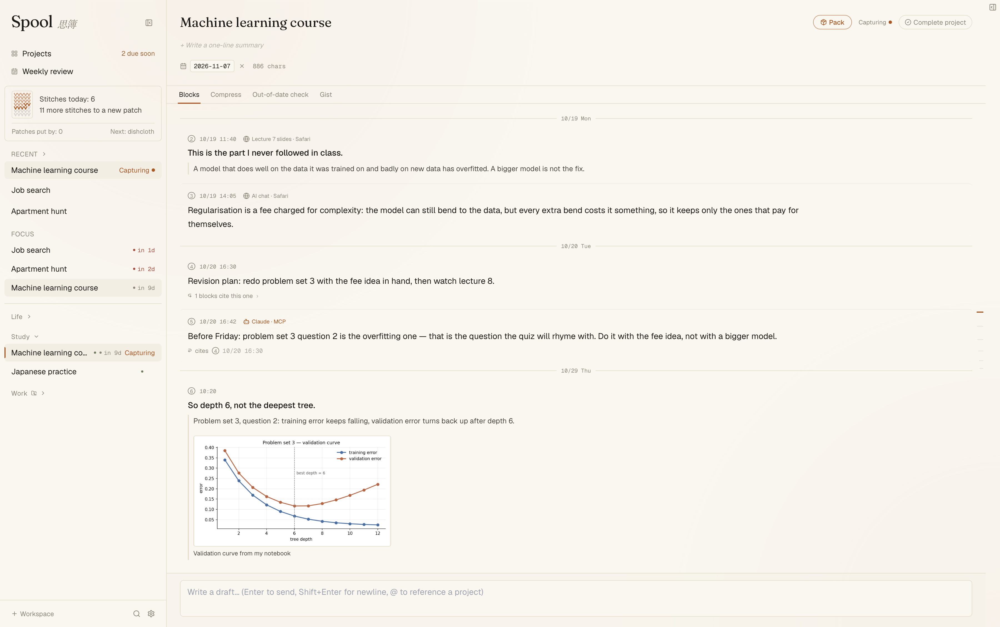
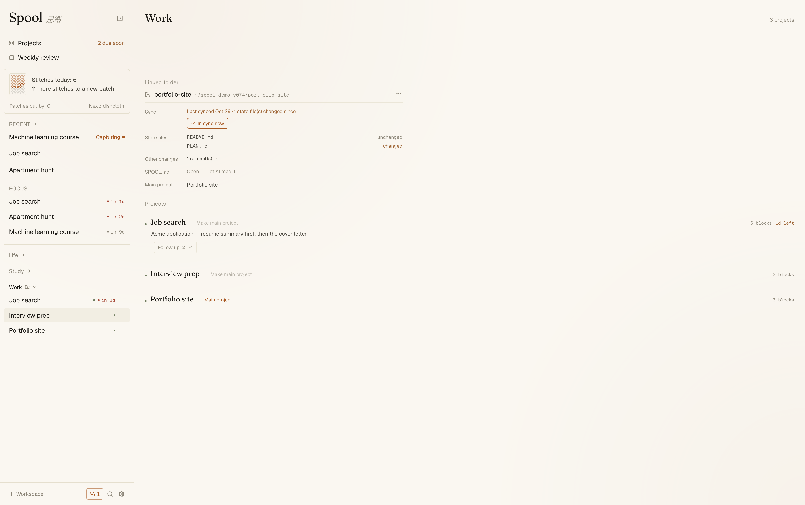
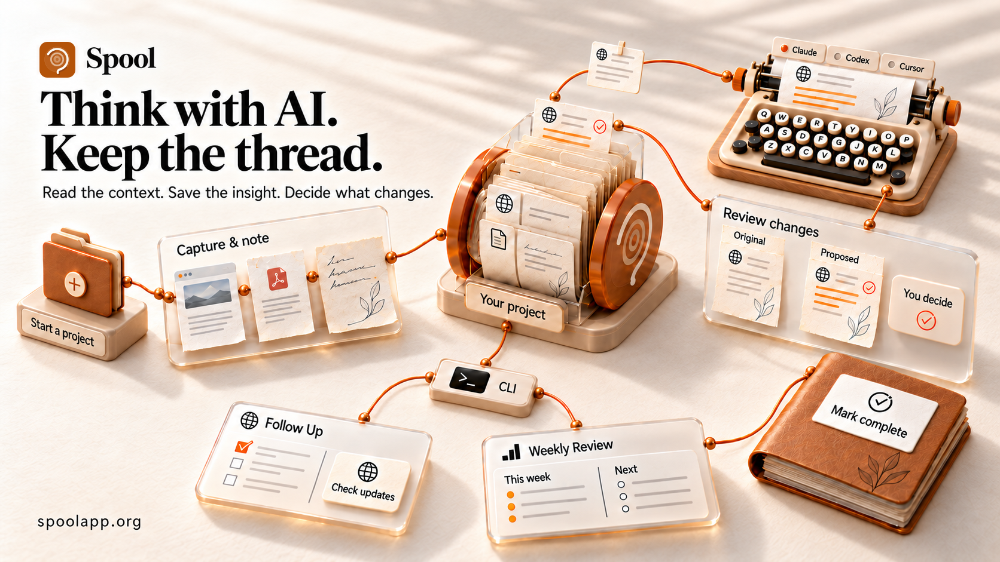

# 演示项目、录屏素材与制作交接

> 状态：**COMPLETE · 拍摄准备方案与素材映射已交付；本轮未改演示库、未调用付费引擎、未新录视频。**
> **方案署名：ChatGPT｜版本：2026-10-29 v1.0**
> 本文是两支视频共用的演示数据与提示词来源。脚本中的结果是拍摄目标，只有真实运行得到的画面才能当产品实录使用。

## 1. 已经存在、可以先用于分镜的素材

最新一组真实图在 `docs/screenshots/portfolio/v0.7.4-*`。来源已记在 [PORTFOLIO_FACTS §9.5](../../PORTFOLIO_FACTS.md)：v0.7.4 tag 源码的隔离构建、演示库；MCP 测试另使用公证发布件读取演示数据。现有截图不等于已录好了下列全部流程。

| 已有素材 | 可用场景 | 使用前要知道 |
|---|---|---|
| [时间线与截图块](../../screenshots/portfolio/v0.7.4-01-desktop-timeline.png) | 产品外观、块里放图片、原始资料与批注 | Machine learning course 案例；用于片尾横向用途或前期分镜，不冒充 Portfolio site |
| [真实 MCP 写入](../../screenshots/portfolio/v0.7.4-02-mcp-write-in-timeline.png) | 来源标签、引用关系 | 客户端是 Terminal probe，不把其标签改成 Claude / Codex |
| [待审卡](../../screenshots/portfolio/v0.7.4-03b-ai-proposal-card.png) | 新旧引文、用户选择 | 来自 Job search，不是本次作品集故事 |
| [两条引擎路线](../../screenshots/portfolio/v0.7.4-04b-ai-engine-two-routes-dialog.png) | 本机 CLI / API 配置解释 | 静态设置，不能说明已经跑过所有动作 |
| [压缩运行前](../../screenshots/portfolio/v0.7.4-05-compress-before-run.png) | 本地预检、夜间队列、路线 | 没有压缩运行结果，需要另录 |
| [工作区连文件夹](../../screenshots/portfolio/v0.7.4-06-workspace-linked-folder.png) | Portfolio site、PLAN.md changed、SPOOL.md | 已有改变状态；创建与连接向导仍需另录 |
| [项目右栏](../../screenshots/portfolio/v0.7.4-08-project-right-rail.png) | 文件夹、跟进、附件同处一栏 | 案例是 Job search，主体故事用新录替换 |
| [跟进编辑器](../../screenshots/portfolio/v0.7.4-09b-follow-up-editor-dialog.png) | 单次 / 永久、每周自动、路线 | 自动开关是关；不是一次真实跟进运行的证明 |
| [MCP 两道开关](../../screenshots/portfolio/v0.7.4-10-settings-mcp-switches.png) | 读写权限解释 | 只裁了上半；不要用未连接的客户端列表制造成功状态 |
| [概念工作流程图](../2026-10-17/spool-concept-ai-workflow.png) | P13 / P18 渲染风格、纸卡串联 | 概念美术，不是可点击的界面 |
| [每日积累图](../2026-10-17/spool-concept-daily-progress.png) | 时间积累的情绪参考 | 保持它与功能实录的区别 |
| [Logo（10-30 液态玻璃版，sRGB）](../../logo/exports/spool-artwork-srgb-1024.png)、[Logo 动画](../../logo/spool-logo-assembly.mp4) | 正式品牌与片尾 | 优先复用官方 Logo，别让生成图重画拼错；动画是 10-31 采纳的纯净组装版（同一路径，旧的平面版已替换） |

### 视觉参考页







## 2. 使用现有 v0.7.4 演示环境

已记录的位置：

- 演示 App：`~/Desktop/Spool/Spool-Demo-v0.7.4/Spool Demo.app`。
- 演示数据标识：`com.oceanjin.spool.demo074`。
- 演示数据库目录：`~/Library/Application Support/com.oceanjin.spool.demo074/`。
- 已连接的演示仓库：`~/spool-demo-v074/portfolio-site`。
- 来源：PORTFOLIO_FACTS §9.5。这些是已有记录，本轮没有启动或改变它们；正式录制前复核是否仍在、构建是否相同。

准备拍摄时从这一套演示数据制作拍摄副本，保持原始演示素材。使用 v0.7.4 tag 或实际决定的后续构建，不直接打开日常 `/Applications/Spool.app` 就假定它是发布版。

拍摄副本需要独立的 bundle identifier、MCP 数据标识和 Keychain service；客户端测试配置也只指向拍摄副本。只有 MCP 进程设置 `SPOOL_DATA_DIR` 还不够证明 GUI、引擎子进程和钥匙串都隔离，先核对具体进程与实际打开的库。隔离构建细节沿用 PORTFOLIO_FACTS §9.5，不在生产仓库改常量。

现有 `scripts/seed-demo-library.sh` 默认会删除并重建 `com.oceanjin.spool.verify` 目录，**不要原样运行去“补数据”**。本次需要的是演示副本中的有意场景，不是重置已有环境。录制也不需要连接 Knote、Flux 或任何个人真实资料。

拍摄时不要在隔离 App 里随手点击 Launch at login 或生产客户端的 Update config；它们可能影响日常配置。要展示 MCP 正常连接流程，使用单独测试配置 / 测试用户来录。关闭自动跟进、夜间队列和月检，直到录对应章节时再展示开关；录后恢复。

## 3. 同一个项目的故事数据

### 3.1 固定目标和结果

| 项目 | 设定 |
|---|---|
| 工作区 | Work |
| 项目 | Portfolio site |
| 一句话目标 | Three case studies, ready to submit. |
| 截止日期 | 拍摄时选择真实的未来周五；所有日期相对于该次拍摄，不硬写“明天” |
| 成果 | 一个可本地浏览的作品集：三个案例、音乐入口、清楚的结果说明 |
| 起始待办 | 案例结构未定；音乐案例缺结果段；首页项目数量有旧计划 |
| 结尾 | 三篇案例完成、用户确认可提交、结果写回、Complete project |

片中人物为演示用户。案例中的作品集文件和项目经历均为虚构示例，不拿个人申请材料替代。演示文案、AI 真实返回和外部资料三者的来源要分开。

### 3.2 拍摄过程依次加入的块

块号由产品实际生成；下面 D01 等是制片编号，不写进产品正文。旧种子已有相同意思的资料时直接用，不重复堆一份。

| 制片编号 | 内容 / 来源 | 录入时点与用途 |
|---|---|---|
| D01 | `Three projects maximum. Cut everything else.` / 用户原话 | 项目创建；核心限制 |
| D02 | `Keep the music project. It shows how I think. No blog for this first version.` / 用户原话 | 截图批注或用户块；跨 AI 必须保留 |
| D03 | `Structure each case study around the problem, the work, and the result.` / 演示阅读资料 | 文字捕捉；来源显示 Demo reference page，避免假称研究结论 |
| D04 | 演示作品集页面截图 / 来源标真实 Demo portfolio preview | 图片捕捉；写 D02 的一句批注 |
| D05 | `The music case study still needs a short paragraph explaining the result.` / 用户检查 | AI 提出今天下一步的依据 |
| D06 | `Earlier plan: show six projects on the home page.` / 用户旧计划 | 只在“积累后”状态出现；与 D01 构成过期检测材料，日期在 D01 前 |
| D07 | `Decision: finish the music case study first, then refine the other two. Keep the first release to three projects and postpone the blog.` / AI 真实写回 | 必须经过真实 MCP 写入并带实际客户端标签 |
| D08 | `We chose responsive local images for the first release; confirm the current Astro guidance before implementation.` / AI 讨论后确立的真实结论 | 连接联网跟进；若实际讨论选择不同，用真实决定替换 |
| D09 | `Is there official Astro guidance that changes how we should implement responsive portfolio images?` / AI 提议、用户接受 | 单次 Follow up 示例，真实官方来源搜索 |
| D10 | `Watch Astro's official release notes for image-related breaking changes relevant to this portfolio.` / 用户接受 | 永久 Follow up 示例；无新消息也是有效结果 |
| D11 | `All three case studies now have a clear result paragraph. The music project stays on the first page. The preview is ready for my final check.` / 用户确认 | 周回顾和完成依据；真实演示文件也必须已改完 |
| D12 | 用户最终一句完成结论 / 用户本人 | 进入完成状态；不要由模型单方面宣布已交付 |

D09 / D10 选择 Astro 是为了用有公开官方资料的真实主题，**不是因为 Spool 依赖 Astro**。拍摄前核对本次样例仓库确实采用或计划采用它。若使用其他框架，换成该框架的官方图像文档；主体跨 AI 接力不依赖这个选择。

既有种子里 `Claude · MCP` 标签可能是 SQL 预置的故事数据；不能把预置块称为本次实际 AI 运行。主片的 D07 和 AI B 接力需要新录。

### 3.3 演示文件夹内容

这些是准备阶段应在拍摄副本中新建或整理的文件，不要求改变 Knote 源码。

```text
portfolio-site/
  README.md
  PLAN.md
  CLAUDE.md       （如要演示该客户端入口）
  AGENTS.md       （如要演示该客户端入口）
  SPOOL.md        （由连接流程生成，不预先假造）
  content/
    case-study-draft.md
    music-project.md
  public/
    demo-cover.png
```

`PLAN.md` 的拍摄起始文本：

```markdown
# Portfolio plan

Goal: three case studies, ready to submit.
Keep the music project. No blog in the first version.
Next: write the missing result paragraph for the music case study.
Open question: confirm the image implementation against current official guidance.
```

T14 的真实变更：把 Next 改为 `Next: music case study first, then tighten the other two introductions.`。让 Spool 报告 changed，读取、写回这一变化后再确认同步。

`case-study-draft.md` 用明确的虚构演示内容：

```markdown
# Music project — draft case study

Problem: I wanted listeners to explore several layers of a short composition.
Work: I arranged the audio, built a small interactive prototype, and tested the controls.
Result: [write the result paragraph after the demo preview is checked]
```

片尾真正把 Result 的占位符补成有实际演示预览支持的一句话。不要编造用户量、效率提升或实验成果数字。

## 4. 可复制的 AI 提示词

提示词属于演示用户的正常说话方式，不向观众展示工具 schema。明确命名 Spool 项目，首次确认客户端实际读到的是演示库。根据对话语言可直接使用中文；英文回答可在提示末尾加“请用英文回答”。

### D-P1 · Pack 路线：第一份有用结果

把 Pack 正文放在前面，再输入：

> 请根据上面的 Portfolio site 项目，列出我今天最应该先做的三件事。解释每件事依据了哪条资料或我的判断。保留我对项目数量、音乐案例和博客的取舍；不确定的地方直接指出，不要替我编经历。

目标：回答把用户限制用于排序，而不是只总结项目内容。

### D-P2 · MCP 路线：实际读取

> 从 Spool 读取 Work 里的 Portfolio site。先告诉我目标、我已经做出的取舍，以及现在最值得推进的一件事。需要看附图或附件才能判断的地方，请实际读取；如果拿不到就说明缺什么。

目标：确有 MCP 读取，说明读到的项目；AI 不能只靠上文猜。

### D-P3 · 写回和提议

> 我决定先把音乐案例写完整，再精修另外两篇；首版仍然只放三个项目，不做博客。请把这次新确定的决定写回 Portfolio site，保留它依据的原话。再提议一条跟进：是否有会影响这份作品集响应式图片实现的最新官方指引。把未知和已确定的事分开。

目标：新结论真实追加；跟进行是提议；用户审批后才进入可跟进状态。不要让 AI 把所有已有块又抄成一篇摘要。

### D-P4 · 第二个 AI 接续

在另一客户端全新对话输入，不附 D07 正文：

> 从 Spool 接着做 Portfolio site。上一次确定了什么？我现在先做哪一步最合适？请根据项目里的来源和我的取舍回答。

目标：读到新写回的“音乐案例优先”决定，而不是只复述旧种子。录下实际读取与回答。

### D-P5 · 受控的修改提议

> 项目里早期“首页放六个项目”的计划已经被我后来“最多三个”的决定替代。请给出取代提议，附上新旧原文和理由，等我在 Spool 里选择。

这是 MCP 提议操作的示例，与自动过期扫描是两种来源。若用于 T13 备用素材，镜头字幕明确写 AI proposal，不冒充扫描命中。

### D-P6 · 仓库与项目对齐

> 先读这个演示仓库的指令文件和 SPOOL.md，再读 README、PLAN 的当前状态，核对相应的 Spool 项目。把真正改变的决定写回，把未解问题提出为跟进建议；不要重复已有内容。全部对齐后再记录已同步，并告诉我改了什么。

目标：先确认文件夹当前状态，再做补充与同步；不在不知道变化的情况下点“已同步”。

### D-P7 · 完成检查

> 根据 Portfolio site 里的目标、文件和最新结果，检查还缺什么。不要替我宣布完成。给我一份很短的最终核对清单，我会自己看预览，再决定是否完成并归档。

目标：把最终决定交还用户；成果预览与文字记录互相对得上。

## 5. 状态与拍摄顺序

| 状态 | 包含内容 | 拍什么 | 留存方式 |
|---|---|---|---|
| S0 · 空白 | Work，尚无本次拍摄项目 | 创建项目、欢迎浮窗 | 拍摄副本的起点 |
| S1 · 首次成功 | 目标 + 限制 + 文件 + 两次捕捉 | T02–T07、P05–P10 | 退出拍摄 App 后复制整个拍摄数据目录作检查点 |
| S2 · AI 接力 | 真实 D07、新跟进、AI B 读取 | T08–T11、P11–P14 | 保存原始聊天录屏与工具调用证据 |
| S3 · 积累 | 有合理历史的长资料、D06 / D01 的变化 | 压缩、过期、文件夹 changed、周回顾 | 相应片头用 Later / Several days later 说明时间 |
| S4 · 完成 | 真正补完演示文件、D11 / D12 | 成果、Complete project、归档 | 保留完成状态，用于补拍结尾 |

不运行删除、回滚生产库的脚本。要重拍创建项目，回到拍摄副本 S0，而不是删掉正在录的真实项目。复制 SQLite 检查点时先停该副本的 GUI 和相关 MCP / 引擎写入，或使用产品已有的备份方式，避免只拷贝主 DB 漏掉 WAL。

拍摄顺序按依赖走：先录真实捕捉、AI 接力，再跑维护动作，最后完成。概念动画根据真实成功画面制作。失败素材单独留存，不拼接成“全部立即成功”。

## 6. Welcome / Byebye 具体录法

1. 在拍摄用浏览器页面或纯文本窗口准备 `Welcome to Spool!` 和 `Byebye 👋`，来源名可以叫 Demo desk。
2. 将捕捉目标设为拍摄专用的 Production slate 项目，避免这两条台词进入 Portfolio site 的 AI 上下文。
3. 真实复制 Welcome，双击 ⌥ / Ctrl，录下浮窗出现及保存；使用产品原有的动画、位置和边框。
4. 正式工作段切回 Portfolio site 作为捕捉目标。
5. 结束时回 Production slate，同样捕捉 Byebye。不要依赖之前剪贴板里残留的文字。
6. 片头 / 片尾可后期延长停留、增加细线或网址；不能给真实浮窗画上不存在的产品按钮。

拍的是“这段文字被捕捉进来”，不是“软件启动时自动弹欢迎语”。观众仍会得到轻巧的拟人感，也能从首尾记住双击交互。

## 7. 录屏与真人的技术准备

| 项目 | 选定方案 |
|---|---|
| 桌面 | 干净浏览器配置，无个人书签、邮件、通知；固定分辨率和窗口尺寸 |
| 录屏 | 尽量 2560×1440 或更高，60fps 原始录屏；最终主片 / 教程 30fps；光标清楚 |
| 应用窗口 | 16:9 构图内有足够宽度显示右栏；关键字段单独录近景，避免全靠后期数码放大 |
| 界面语言 | 英文；口播中文；必要按钮在字幕中补英文名 |
| 真人 | 镜头与眼睛平齐，柔光，干净背景；开头结尾全屏，操作时小窗或隐藏 |
| 声音 | 麦克风尽量单独录，48kHz；先录 10 秒房间底噪；每条开头口述镜号用于同步 |
| 维护调用 | 提前明确采用哪个现有账户 / 路线并做少量试录；不用多个服务反复烧额度求“好看结果” |
| 字幕 | 英文、中文分别输出 SRT / VTT；字幕不盖来源标签、批注、接受按钮 |
| 原素材 | 每镜动作前后各多留 3–5 秒；无字幕无音乐原档，方便日后改版 |

### 原始文件命名

推荐：`P06-capture-text-mac-take01.mov`、`T09-ai-handoff-win-take01.mov`。每条素材登记：拍摄日期、OS、App 版本、commit、演示数据状态、客户端版本、是否实际调用模型、等待是否剪短。

`05-asset-shot-list.csv` 提供所需镜头与当前素材状态。录制后在同目录的实际素材记录中补 take 与真实路径；不要把“计划录”改写为“已拍完”。

## 8. 录完一条，就检查一个结果

| 镜头 | 必须能看见 | 不通过时怎么办 |
|---|---|---|
| 不切屏捕捉 | 复制、双击、浮窗、原页面保持位置 | 核对权限和目标后重录，不能用截图拼接证明 |
| 截图捕捉 | 剪贴板确有图片，Spool 内显示同一图片 | 用剪贴板截图快捷键重录；不混用磁盘浮动缩略图流程 |
| AI A 写回 | 服务端实际来源标签、新决定、正确项目 | 停止使用预置示例标签作证据 |
| AI B 接力 | 新对话确实读取 Spool 并提到刚写回决定 | 查测试连接和读到的数据目录，不把答案人工覆盖 |
| Follow up | 真来源、真日期、用户审批或真实无更新 | 无更新也可用，避免依赖虚构 Acme 的招聘信息 |
| 压缩 | 前后对照、重要条件、实际保存状态 | 小项目不适合就换已有长项目状态，不虚构节省比例 |
| 过期 | 新旧引文和用户选择 | 无命中如实说明；备用 MCP 提议清楚标来源 |
| 仓库 | changed → 阅读变化 → 写回 → 同步 | 缺一步就补拍对应状态，不能提前清除提示 |
| 周回顾 | 真实运行输出和采纳后的状态 | v0.7.4 用手动采纳；P10 按钮用确实包含它的构建 |
| 完成归档 | 成品可读、Complete project、完成列表可找回 | 先补齐演示文件，再录完成 |

本轮只设计并引用既有素材。最终文件可放在本目录的 `source/`、`audio/`、`exports/` 或项目约定的媒体位置；避免把庞大原始录屏直接加入普通 Git 历史。文档、素材清单和可复现的来源记录保留在代码库即可。
